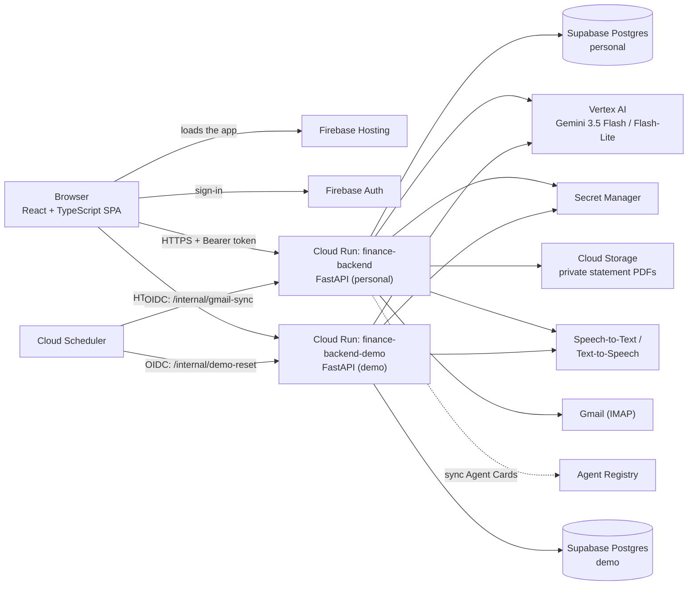

# Personal Finance AI

**An AI-assisted personal finance ledger for Indian bank accounts.** It reads bank statements, receipts, spreadsheets and Gmail bank alerts with Google Gemini, reconciles them into one deduplicated ledger, and adds analytics, budgets, forecasts, an AI "CFO" chat and voice clarification on top. An orchestrator with four specialist agents (A2A Agent Cards, in-process delegation) and a Ledger MCP server sit behind the same API.


**Live app:** [personal-finance-agent-507010.web.app](https://personal-finance-agent-507010.web.app) (sign-in required). A demo account with synthetic data is available on request.

**Recorded demo:** [rohit792a.github.io/personal-finance-agent](https://rohit792a.github.io/personal-finance-agent/) (available once GitHub Pages is enabled in repository settings). No sign-in and no backend: it replays responses recorded from the real backend and Gemini. See [Try the recorded demo](#try-the-recorded-demo).

> [!NOTE]
> This is a personal project that runs in production for its author. The code is published so you can read and evaluate it; it is **not open source** (see [License](#license)). Real financial data never enters this repository: statements, uploads and owner-specific values are git-ignored (see [Privacy](#security-and-privacy)).

---

## Contents

- [Features](#features)
- [Architecture](#architecture)
- [Tech stack](#tech-stack)
- [Repository layout](#repository-layout)
- [Getting started](#getting-started)
- [Try the recorded demo](#try-the-recorded-demo)
- [Configuration](#configuration)
- [Testing](#testing)
- [Deployment](#deployment)
- [Security and privacy](#security-and-privacy)
- [Documentation](#documentation)
- [Project status](#project-status)
- [License](#license)

---

## Features

**Getting data in**
- **Bank statement PDFs** (HDFC, Kotak, SBI and others). Long statements are read a few pages per Gemini call in parallel, with checks for cut-off replies and missing rows, so a partial read never imports silently.
- **Password-protected PDFs** are unlocked before the model sees them, with the password typed on the Upload screen (used in memory only, never logged or stored) or the statement passwords saved in Secret Manager. Uploads are deleted after processing; Bank Sync keeps the unlocked copy of a statement in its private bucket.
- **Receipts and bills** (images) and **spreadsheets** (`.xlsx`/`.xls`) through dedicated AI importers.
- **Gmail Bank Sync**: bank alert emails and monthly statement attachments arrive over IMAP, on demand or through an hourly Cloud Scheduler check that syncs once the interval set on Bank Sync has passed.

**Keeping the ledger correct**
- **Deduplication at import time.** An incoming row that is already in the ledger (a Gmail alert, an overlapping statement, a re-import, the other side of a transfer between your own accounts) updates that row instead of adding a copy. The evidence is a shared 12-digit UPI/IMPS reference number or matching amount and wording. Each statement file is imported only once (SHA-256).
- **Changes need proof.** A re-import never relabels a row on its own say-so, and rows you edited are locked against automatic changes.
- **A date guard** keeps AI-extracted dates in the statement's period. This fixes the "uploaded in 2026, saved as 2023" class of bugs.
- **A review queue** for low-confidence rows, with text or voice answers (Cloud Speech-to-Text and Text-to-Speech).
- **Closed-loop learning.** Every confirmed category becomes a learned payee rule. The rule is applied to matching unverified rows, used as few-shot memory in extraction prompts and enforced on later imports.

**Understanding your money**
- Transactions, Analytics (month start and end balances, category breakdown), Budgets, Recurring & Forecast, and an **AI CFO** chat grounded in the ledger: the backend calls four MCP tools and puts their results in the prompt (Gemini isn't given tools to call). Model tiering sends simple look-ups to Flash-Lite and everything else, planning questions included, to Flash.
- **A copilot dock** on every screen that answers voice or text commands about the current page.

**Agents and governance**
- **A four-agent workflow**: ingestion, reconciliation, clarification and advisor agents, behind an orchestrator. Each has an A2A Agent Card, served at `/.well-known/agent.json` and registered in Google Cloud Agent Registry. The orchestrator delegates to them in-process through that card registry; the agents don't call each other over the A2A protocol.
- **A Ledger MCP server** with 12 tools (ledger queries and updates, statements, sync status, calculators), served as JSON-RPC 2.0 at `POST /mcp/jsonrpc` with the official `mcp` SDK's message types. The agents call it in-process.
- **Guardrails**: per-agent identities with least-privilege MCP tool allowlists (HMAC-signed workload tokens with SPIFFE-style IDs, issued and checked in one process: a local stand-in for SPIFFE / Workload Identity), an approval flag that write tools require (sent when the user applies a change or asks the copilot for one), an audit log, prompt-injection screening (local regex; plus the Google Cloud Model Armor API on prompts, extracted document text and replies when configured), PII masking of chat messages before Gemini sees them and of extracted narrations before they're saved (local regex tokens; plus Sensitive Data Protection when enabled), OpenTelemetry traces (exported to Cloud Trace when enabled) and a rule-based autorater over a small golden dataset. Each Google Cloud layer is behind an opt-in flag that defaults off locally and is enabled on both deployed Cloud Run backends (`DEC-065`; see [Configuration](#configuration)).

**Two environments from one codebase**
- **Personal**: Google sign-in, owner only.
- **Demo**: email and password sign-in, an 18-month synthetic ledger that resets nightly, Gmail off and daily AI limits.
- Plus a **recorded demo**: a static copy of the app for GitHub Pages that replays responses recorded from the demo environment ([details](#try-the-recorded-demo)).

---

## Architecture



Inside the backend, [`app/api.py`](app/api.py) is the FastAPI server entry point (`uvicorn api:app`), while [`app/main.py`](app/main.py) (`process_file`) is the document import pipeline (hash check, unlock, extraction, date guard, narration screening, reconciliation, batch save). The agents in `mcp/` make their ledger writes through the MCP server's tools, where the allowlist and approval checks apply; some reads (the master resolver's ledger scan, learned rules, reconciled balances) query the database directly. [docs/APPLICATION_ARCHITECTURE.md](docs/APPLICATION_ARCHITECTURE.md) has the detailed diagrams, and [docs/API.md](docs/API.md) documents every HTTP endpoint.

---

## Tech stack

| Layer | Technology |
| --- | --- |
| Backend | Python 3.12, FastAPI, Uvicorn, SQLAlchemy 2 + `pg8000`, Pydantic 2 |
| AI | Gemini 3.5 Flash and Flash-Lite on Vertex AI (`vertexai` SDK from `google-cloud-aiplatform`, global endpoint), Cloud Speech-to-Text, Text-to-Speech |
| Documents | `pypdf` (page splitting, decryption), pandas + openpyxl/xlrd (spreadsheets), Pillow (images) |
| Agents | Ledger MCP server (JSON-RPC 2.0 with the official `mcp` SDK's types), A2A Agent Cards, Google Cloud Agent Registry |
| Frontend | React 19, TypeScript 5.9, Vite 5, Tailwind CSS 3, React Router 7, Firebase Auth, DOMPurify + marked |
| Data | Supabase Postgres (row-level security on every table), Cloud Storage for statement PDFs |
| Platform | Cloud Run (two services, one image), Cloud Build, Artifact Registry, Secret Manager, Cloud Scheduler, Firebase Hosting |
| Governance (opt-in flags; on in prod) | Model Armor API (`us-central1` templates), Sensitive Data Protection (Cloud DLP API), Cloud Trace via OpenTelemetry; each defaults off locally and is enabled on both deployed backends (`DEC-065`; see [Configuration](#configuration)) |
| Quality | pytest, ESLint (`typescript-eslint` strict, type-checked), Playwright + axe-core, GitHub Actions |

---

## Repository layout

```text
.
├── app/                        # Backend import root (modules import each other by plain name)
│   ├── api.py                  # FastAPI app: REST, MCP JSON-RPC, A2A endpoints, AI quotas
│   ├── main.py                 # Import pipeline: unlock → hash check → extract → reconcile → save
│   ├── database.py             # Postgres access, schema, lockdown, cross-source reconciliation
│   ├── statement_agent.py      # Page-chunked Gemini statement reader with coverage checks
│   ├── extractor.py            # Receipt / bill reader
│   ├── ai_importer.py          # Spreadsheet importer
│   ├── gmail_sync.py           # Gmail alerts and statement attachments (IMAP)
│   ├── advisor.py              # AI CFO chat and insight reports (model tiering)
│   ├── voice_agent.py          # Voice clarification and payee-rule learning
│   ├── dedupe.py, date_guard.py
│   ├── owner_profile.py        # Loads owner-only data from the git-ignored app/private/
│   ├── auth.py                 # Firebase ID token + Cloud Scheduler OIDC verification
│   ├── security/               # Agent identities, Model Armor screening, DLP masking
│   ├── mcp/                    # Ledger MCP server, A2A bus, orchestrator, Agent Registry
│   ├── telemetry/, eval/       # Traces; autorater and golden dataset
│   └── frontend/               # React + TypeScript SPA (Vite), Firebase Hosting config, Playwright tests
│       ├── src/recorded/       # Recorded demo mode: replays recorded responses, no sign-in or backend
│       └── recorded-demo/      # The recorded responses (written by scripts/record_demo.py)
├── tests/                      # pytest suite (unit, Postgres-backed, opt-in live suite)
├── scripts/                    # Infra, deploy, secrets, demo reset and recording, and dedupe tools
├── docs/                       # Architecture, API reference, developer guide, and examples
├── Dockerfile                  # Backend image (non-root, one image for both environments)
├── requirements.txt            # Pinned runtime dependencies (what the image installs)
├── requirements-dev.txt        # + test tools (pytest)
└── start_services.sh           # Local launcher (personal / demo backend, optional Vite)
```

---

## Getting started

> [!IMPORTANT]
> The code is wired to the author's Google Cloud and Firebase projects. To run your own copy you need your own GCP project (Vertex AI, Secret Manager, Cloud Storage), a Postgres database and a Firebase project. Then point `PROJECT_ID`, the database settings, `AUTH_ALLOWED_USERS` and [`app/frontend/src/config/firebase.ts`](app/frontend/src/config/firebase.ts) at them.

### Prerequisites

- Python 3.12 and Node.js 20 or newer (CI uses Node 24)
- [Google Cloud CLI](https://cloud.google.com/sdk/docs/install) with Application Default Credentials: `gcloud auth application-default login`
- Docker (optional; only for the Postgres-backed tests)

### Backend

```bash
python3.12 -m venv venv
venv/bin/pip install -r requirements-dev.txt   # runtime deps + pytest
cp .env.example .env            # optional: local overrides, see Configuration

./start_services.sh             # personal backend on http://127.0.0.1:8080
./start_services.sh demo        # demo backend (demo database) on http://127.0.0.1:8081
./start_services.sh stop
```

`start_services.sh` runs `uvicorn api:app` from `app/` ([`app/api.py`](app/api.py) is the HTTP server entry point; [`app/main.py`](app/main.py) is the document import pipeline called on uploads and statement syncs). Secrets are read from Secret Manager with your gcloud login. To skip Secret Manager, set `DB_PASS` (and `DATABASE_URL` for a local Postgres) in `.env`. Every route except `/health` needs a Firebase sign-in, so use the web app or send a real ID token. See [docs/DEVELOPMENT.md](docs/DEVELOPMENT.md) for local Postgres setup and development workflows.

### Frontend

```bash
cd app/frontend
npm ci
cp .env.example .env.development.local   # then set VITE_API_BASE_URL, e.g. http://127.0.0.1:8081
npm run dev                              # http://localhost:5173
```

Or start the demo backend and the dev server together with `./start_services.sh demo --frontend`.

---

## Try the recorded demo

**[Open the recorded demo](https://rohit792a.github.io/personal-finance-agent/)** (live once GitHub Pages is enabled in repository settings). No sign-in needed.

The recorded demo is this React app built so that it needs no backend, no Firebase and no Google Cloud, so it keeps working after the Cloud Run services are switched off. It is a static site on GitHub Pages.

- Every screen shows responses recorded from the real backend on the demo environment's synthetic data: the 18-month ledger and its review queue, analytics, budgets, recurring payments and the forecast, the Agent Registry with its skills and MCP tools, and the upload of a synthetic statement.
- The AI CFO chat offers the recorded questions as suggestion chips and replays Gemini's recorded answers; other questions get a note listing the recorded ones. The Jarvis copilot works the same way.
- Changes (edits, budgets, category answers, rules, uploads) are acknowledged but not saved.
- A banner shows the recording date, with links to this repository and the demo video.

How it works: [`scripts/record_demo.py`](scripts/record_demo.py) runs the real FastAPI app in-process (FastAPI `TestClient`) against a throwaway local PostgreSQL seeded with the demo data, calls the endpoints the screens use, and saves the responses in [`app/frontend/recorded-demo/recorded/`](app/frontend/recorded-demo/recorded/) with a manifest (recording date, commit, Gemini token usage). `npm run build:recorded` builds the frontend from `src/recorded/main.tsx`; its API client answers every request from those files ([`src/recorded/transport.ts`](app/frontend/src/recorded/transport.ts)). The normal build is unchanged and contains none of this code.

**Preview it locally:**

```bash
cd app/frontend
npm run build:recorded      # served from /personal-finance-agent/ (set PAGES_BASE_PATH to change it)
npm run preview:recorded    # http://localhost:4173/personal-finance-agent/
npm run test:e2e:recorded   # optional: Playwright checks every screen and that no request leaves the site
```

**Re-record it** (for example after a feature change):

```bash
venv/bin/python scripts/record_demo.py           # temporary local PostgreSQL + Gemini on Vertex AI (ADC)
venv/bin/python scripts/record_demo.py --no-ai   # everything except the Gemini calls; costs nothing
venv/bin/python -m pytest tests/test_recorded_fixtures.py -q
```

The recorder needs the PostgreSQL server binaries (`initdb`, `pg_ctl`) or `--database-url` for an empty local database, and Application Default Credentials with Vertex AI access for the AI answers. It never touches Supabase, Secret Manager or the owner profile, and it refuses to run next to a `.env` file. It prints the Gemini token usage and stops at `--max-spend-inr` (default ₹300); a full recording is 13 Gemini calls, about 52,000 tokens. `tests/test_recorded_fixtures.py` (part of the normal test run) checks the files: complete, real AI answers, and nothing that looks like a credential or personal data.

**Publish it on GitHub Pages:** [`.github/workflows/pages.yml`](.github/workflows/pages.yml) builds the recorded demo, checks that its code calls no backend, Firebase or Google service, and deploys it on every push to `main` (or from **Actions → Recorded demo (GitHub Pages) → Run workflow**).

1. Push the repository to GitHub.
2. In the repository, open **Settings → Pages** and under **Build and deployment** set **Source** to **GitHub Actions**.
3. Run the workflow (or re-run its first, failed run). The site appears at `https://<owner>.github.io/personal-finance-agent/`; replace the placeholder links above with it.
4. Optional, under **Settings → Secrets and variables → Actions → Variables**: `DEMO_VIDEO_URL` (shown in the banner), `DEMO_REPO_URL` (defaults to this repository), `PAGES_BASE_PATH` (defaults to the path GitHub Pages reports).

To point the live app at the recorded demo when its backend is unreachable, build it with `VITE_RECORDED_DEMO_URL=https://<owner>.github.io/personal-finance-agent/ npm run build`.

---

## Configuration

The backend reads environment variables, plus an optional git-ignored `.env` in the repository root. [`.env.example`](.env.example) lists every setting with its default. The most important ones:

| Variable | Default | Purpose |
| --- | --- | --- |
| `APP_ENV` | `personal` | `personal` or `demo`: picks the database, sign-in allowlist and AI limits |
| `PROJECT_ID` / `LOCATION` | author's project / `global` | Vertex AI and Secret Manager project. Gemini 3 is served from `global` |
| `MODEL_NAME` / `MODEL_LITE` / `MODEL_PRO` | `gemini-3.5-flash` / `gemini-3.5-flash-lite` / `gemini-3.5-flash` | Model per tier |
| `DB_PASS` / `DATABASE_URL` | Secret Manager / Supabase pooler | Database password and optional full connection URL |
| `AUTH_ALLOWED_USERS` | owner / demo account | Comma-separated `email` or `email:provider` allowlist |
| `STATEMENT_BUCKET` | (local disk) | Private Cloud Storage bucket for statement PDFs |
| `STATEMENT_PAGES_PER_CALL` / `STATEMENT_PARALLEL_CALLS` | `2` / `6` | Statement reading chunk size and parallelism |
| `OWNER_PROFILE_PATH` | `app/private/owner_profile.json` | Owner-only data (see below) |
| `MODEL_ARMOR_TEMPLATE` | (off) | Full Model Armor template name, `projects/{p}/locations/{l}/templates/{id}`. Turns on the Model Armor API for chat prompts, document text and the advisor's replies, after the regex screen (the fallback if the API fails). `MODEL_ARMOR_TIMEOUT_SECONDS` (default 5) bounds each call |
| `SDP_ENABLED` | `0` | `1` adds Sensitive Data Protection (Cloud DLP API) findings to the regex PII redaction; 12-digit reference numbers in statement rows are kept. Tuning: `SDP_INFO_TYPES`, `SDP_MIN_LIKELIHOOD` (`LIKELY`), `SDP_LOCATION` (`global`), `SDP_TIMEOUT_SECONDS` (10) |
| `ENABLE_CLOUD_TRACE` | `0` | `1` also exports the OpenTelemetry spans (one trace per chat, insights request or upload) to Cloud Trace |
| `ENABLE_VERTEX_CONTEXT_CACHE` | `0` | `1` puts the advisor's static persona in an explicit Vertex AI cache per model. gemini-3.5-flash only caches 4,096+ tokens, so with today's ~170-token persona creation fails once and requests go out as usual. Token usage (including implicit-cache hits) is recorded regardless |

The Google APIs above stay off locally until their flags are set, and the app behaves the same without them. On the deployed Cloud Run services (`scripts/deploy_backend.sh`), `MODEL_ARMOR_TEMPLATE`, `SDP_ENABLED=1` and `ENABLE_CLOUD_TRACE=1` are enabled, while `ENABLE_VERTEX_CONTEXT_CACHE` stays unset because today's persona is under the 4,096-token minimum. Each service account has the matching roles: `roles/modelarmor.user`, `roles/dlp.user`, `roles/cloudtrace.agent`.

**Secrets** live in Google Secret Manager and are never committed: `pfa-db-password-personal`, `pfa-db-password-demo`, `pfa-gmail-app-password`, `pfa-statement-passwords`. Store one with `scripts/set_secret.sh <name>`. The script uses a hidden prompt, so the value never appears in shell history.

**Owner profile.** The personal deployment knows a few things about its owner: their own account numbers (internal sweeps), how their name appears in UPI narrations (self-transfers), family and friends whose credits are reimbursements, and statement-reconciled monthly balances. These live in `app/private/owner_profile.json`. Git ignores that file, but Cloud Build still ships it in the backend image. Without the file, the rules fall back to generic keywords and no balances are seeded. The format is in [docs/examples/owner_profile.example.json](docs/examples/owner_profile.example.json).

---

## Testing

```bash
# Backend unit tests: no Google credentials, network or database needed
venv/bin/python -m pytest tests -q

# Postgres-backed reconciliation tests against a throwaway local database
docker run -d --name pfa-reconcile-test -e POSTGRES_HOST_AUTH_METHOD=trust -p 127.0.0.1:55433:5432 postgres:17
TEST_DATABASE_URL=postgresql://postgres@127.0.0.1:55433/postgres venv/bin/python -m pytest tests/test_reconcile_db.py -q

# Live integration suite: calls the real personal database and Gemini, so it is opt-in
PFA_LIVE_TESTS=1 venv/bin/python -m pytest tests/test_fde_integration.py -q

# Frontend
cd app/frontend
npm run typecheck && npm run lint && npm run build
npm run test:e2e                # Playwright + axe; real demo sign-in, mocked backend (see below)
```

The Playwright suite signs in to Firebase with the demo account. It reads the credentials at runtime from `~/.config/personal-finance-agent/demo-login.txt` and never prints them. `E2E_BACKEND=http://127.0.0.1:8081 npm run test:e2e -- integration` runs the integration spec against a local backend instead of mocks.

GitHub Actions runs the backend unit tests and the frontend type-check, lint and build on every push to `main` and every pull request ([`.github/workflows/ci.yml`](.github/workflows/ci.yml)). The suites that need credentials (Postgres, live and Playwright) run locally. The recorded demo has its own Playwright spec, which needs no credentials: `npm run build:recorded && npm run test:e2e:recorded`.

---

## Deployment

| What | How |
| --- | --- |
| One-time infrastructure | `scripts/phase1_infra.sh` creates Artifact Registry, least-privilege service accounts, secret access and the private statement bucket (idempotent) |
| Backend (both Cloud Run services, one image, plus Scheduler jobs) | `scripts/deploy_backend.sh build`, or demo first: `scripts/deploy_backend.sh build demo`, then `scripts/deploy_backend.sh <image-tag> personal` |
| Frontend | `cd app/frontend && npm run build && firebase deploy --only hosting` |
| Recorded demo (GitHub Pages) | Automatic on push to `main` ([`.github/workflows/pages.yml`](.github/workflows/pages.yml)); see [Try the recorded demo](#try-the-recorded-demo) |
| Agent Registry sync | `venv/bin/python scripts/register_gcp_agents.py` |
| Demo data reset (normally nightly via Scheduler) | `APP_ENV=demo venv/bin/python scripts/demo_reset.py` |

See [docs/DEVELOPMENT.md](docs/DEVELOPMENT.md#deployment-and-rollback) for deployment verification and rollback commands.

---

## Security and privacy

- **Sign-in on every route.** The backend verifies a Firebase ID token and an allowlist on every request. `/internal/*` accepts only Cloud Scheduler OIDC tokens. CORS is limited to the hosting site and localhost.
- **No credentials in code.** Database, Gmail and statement passwords come from Secret Manager. Cloud Run mounts the database password as a secret.
- **The database is locked down.** Every table has row-level security, Supabase's anon and authenticated roles get no access, and views run as the caller (`security_invoker`).
- **Uploads are constrained**: a type allowlist, a 25 MB cap, a random folder per upload and sanitised file names. PDF passwords stay in memory only.
- **AI guardrails**: prompt-injection screening (local regex, plus the Model Armor API when `MODEL_ARMOR_TEMPLATE` is set), PII masking of chat messages before they reach Gemini and of extracted narrations before they're saved (local regex, plus Sensitive Data Protection when `SDP_ENABLED=1`), least-privilege agent tools and an approval flag on writes. Uploaded documents themselves go to Gemini unredacted; the screening applies to the text read from them.
- **Personal data stays out of git.** Statements (`data/`), uploads, screenshots of real transactions, internal workspace logs, and the owner profile (`app/private/`) are all git-ignored. The public history starts from a scrubbed snapshot.

Found a vulnerability? Please follow [SECURITY.md](SECURITY.md) and don't open a public issue.

---

## Documentation

| Document | What's in it |
| --- | --- |
| [docs/API.md](docs/API.md) | Complete HTTP, MCP JSON-RPC, and A2A endpoint & request-body reference |
| [docs/DEVELOPMENT.md](docs/DEVELOPMENT.md) | Entry points (`app/api.py` vs `app/main.py`), module maps, local Postgres setup, test tiers, extension recipes, and troubleshooting |
| [docs/APPLICATION_ARCHITECTURE.md](docs/APPLICATION_ARCHITECTURE.md) | System diagrams, agent workflows, data model, idempotency design |
| [docs/FDE_ENTERPRISE_ARCHITECTURE.md](docs/FDE_ENTERPRISE_ARCHITECTURE.md) | The Build / Govern / Scale / Optimize design: MCP, A2A, identity, evaluation, model tiering |
| [app/frontend/FRONTEND_GUIDE.md](app/frontend/FRONTEND_GUIDE.md) | Frontend structure, styling, recorded demo mode, and sanitisation |
| [CHANGELOG.md](CHANGELOG.md) | Notable changes by milestone |
| [CONTRIBUTING.md](CONTRIBUTING.md) | Development workflow and conventions |
| [SECURITY.md](SECURITY.md) | Security architecture and vulnerability reporting |

---

## Project status

The project is in active development. Core security hardening, Firebase authentication, dual Cloud Run environments (personal + demo), static recorded demo mode, the MCP/A2A agent platform, and multi-page statement reconciliation are complete (see [CHANGELOG.md](CHANGELOG.md)).

---

## License

Copyright © 2026 Rohit Kushwaha. **All rights reserved.** The source is published for reading and evaluation only. No license is granted to copy, modify, distribute or deploy it without written permission. See [LICENSE](LICENSE).

Nothing in this repository is financial advice.
