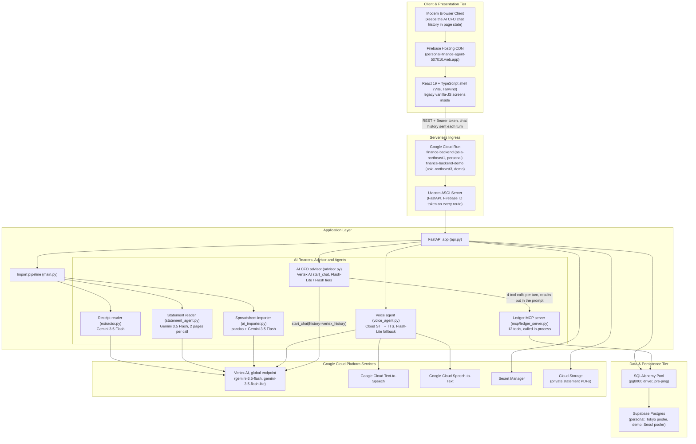
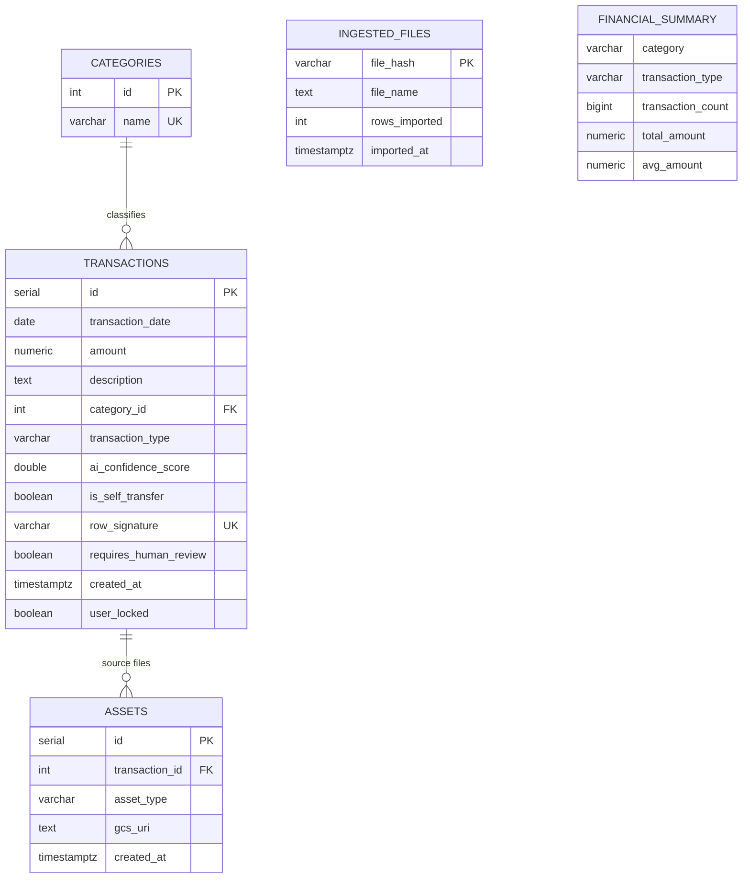
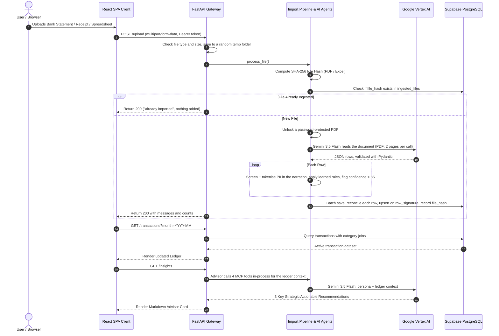

# Application Architecture (AA) Specification
## Personal Finance AI — Autonomous Financial Intelligence Platform

**Document Version:** 3.1.0 (accuracy pass)  
**Status:** Describes the code on `main` as of 2 Nov 2026. The app runs in production for its author; it is a personal project.  
**Target Audience:** Enterprise Architects, Staff Engineers, Tech Leads, DevOps & Security Engineers  
**Enterprise Specification:** [FDE Enterprise Agent Architecture](FDE_ENTERPRISE_ARCHITECTURE.md)  
**Live Production Web Application (Firebase Hosting):** [https://personal-finance-agent-507010.web.app](https://personal-finance-agent-507010.web.app) (sign-in required)  
**Production Backends (Google Cloud Run):** `finance-backend` (personal, `asia-northeast1`): `https://finance-backend-328452160072.asia-northeast1.run.app`; `finance-backend-demo` (demo, `asia-northeast3`): `https://finance-backend-demo-328452160072.asia-northeast3.run.app`. Every route except `/health` needs a Firebase sign-in.  
**Interactive API Documentation (Swagger):** off in production. Set `ENABLE_API_DOCS=1` to serve `/docs`, `/redoc` and `/openapi.json` on a local backend.  
**System Health Check:** `GET /health` on either backend (the only public route)

> **Accuracy pass, 2 Nov 2026:** this spec was brought in line with the code. It still described Gemini 2.5 (replaced by Gemini 3.5 on 20 Oct 2026, DEC-042), a `us-central1` backend that was deleted on 18 Oct 2026 (DEC-025), a vanilla-JS dark UI, wildcard CORS, a three-table schema and a function-calling advisor. Earlier revisions also had local-regex-only guardrails; the Google Cloud Model Armor API, Sensitive Data Protection and Cloud Trace export were wired up behind opt-in flags in DEC-063 and enabled on both deployed Cloud Run backends in DEC-065. The capability list, diagrams, schema and API table below now match `main`.

---

## 1. Executive Summary & Solution Context

**Personal Finance AI** is a personal finance system for Indian bank accounts. It ingests heterogeneous financial documents (receipts, multi-page PDF bank statements, Excel spreadsheets and Gmail bank alerts), extracts structured transactions with Gemini on Vertex AI, categorizes them, detects transfers between the owner's own accounts, reconciles everything into one ledger and offers CFO-style insights and chat on top.

### Core Capabilities & FDE Pillars:
1. **Multimodal Ingestion (Build)**: Reads receipt images (PNG/JPG), multi-page bank statements (PDF, two pages per Gemini call, up to six calls in parallel) and Excel workbooks (XLS/XLSX, one sheet per file) with Gemini 3.5 Flash on Vertex AI. Gmail bank alerts and statement attachments arrive over IMAP.
2. **Model Context Protocol (MCP) & Agent2Agent (Build)**: A Ledger MCP server with 12 tools, served as JSON-RPC 2.0 at `POST /mcp/jsonrpc`. The agents and the AI CFO advisor call it in-process; Gemini is not given the tools (there is no function calling). An orchestrator and four specialist agents publish A2A Agent Cards at `/.well-known/agent.json`, registered in Google Cloud Agent Registry (DEC-050); delegation between them runs in-process.
3. **Guardrails (Govern)**: A local regex prompt-injection screen and local regex PII tokenisation run on chat messages before they reach Gemini, and on the narrations extracted from statements and receipts before they are saved. The documents themselves go to Gemini as uploaded. Behind flags that default off locally and are enabled on both deployed Cloud Run backends (`DEC-065`), the Google Cloud Model Armor API (`MODEL_ARMOR_TEMPLATE`, `us-central1` templates) and Sensitive Data Protection (`SDP_ENABLED=1`) add managed screening (including advisor replies) and Indian PII detection with automatic regex fallback.
4. **Deduplication & Idempotency (Govern)**: A SHA-256 file hash skips a statement or spreadsheet file that was already imported. Rows are upserted on a SHA-256 row signature (`date|amount|description|type`) and reconciled against existing rows by a shared 12-digit UPI/IMPS reference or matching amount and wording, so an overlapping statement or Gmail alert updates the existing row instead of adding a copy (DEC-034).
5. **Evaluation & Tracing (Scale)**: A rule-based autorater (`GET /eval/benchmark`) scores the fixed examples stored in a small golden dataset; it calls no model and is not an LLM judge. OpenTelemetry spans (one trace per chat, insights request or upload) are kept in a bounded in-memory store behind `GET /telemetry/traces` and exported to Cloud Trace when `ENABLE_CLOUD_TRACE=1` (defaults off locally; enabled on both deployed backends in DEC-065).
6. **Model Tiering & Context Size (Optimize)**: A keyword router sends simple look-ups to Gemini 3.5 Flash-Lite and everything else to Gemini 3.5 Flash; the "Pro" tier also defaults to `gemini-3.5-flash` (DEC-042). Chat history beyond the last four messages is condensed into a short summary. Explicit Vertex AI context caching is implemented (`ENABLE_VERTEX_CONTEXT_CACHE=1`, off) but can't activate with today's prompt: the static persona is about 167 tokens, and gemini-3.5-flash caches only 4,096 tokens or more (DEC-063).
7. **Interactive Voice & Natural Language Clarification**: Low-confidence rows get a spoken question from Google Cloud Text-to-Speech (`en-US-Neural2-F`). Replies are transcribed by Google Cloud Speech-to-Text (`en-US`), with Gemini 3.5 Flash-Lite as the transcription fallback, and mapped to a category by keyword rules first and Flash-Lite second.
8. **Single Page Application (SPA)**: A React 19 + TypeScript shell (Vite, Tailwind CSS, React Router, Firebase Auth), light theme first with a dark option. Seven of the eight screens are still the original vanilla-JS components running inside the shell; the Agent Registry screen is React.

---

## 2. High-Level System Architecture

The browser loads the SPA from Firebase Hosting and calls a FastAPI backend on Cloud Run. One container image runs as two services, personal and demo, each with its own Supabase Postgres database, service account and secrets.



---

## 3. Component Breakdown & Interaction Models

### 3.1. Frontend Single Page Application (SPA)
- **Path**: `app/frontend/` (details in [FRONTEND_GUIDE.md](../app/frontend/FRONTEND_GUIDE.md))
- **Build Toolchain**: Vite 5, TypeScript 5.9 (strict), React 19, React Router 7, Tailwind CSS 3, PostCSS; ESLint with strict type-checked rules; Playwright + axe-core.
- **Production Hosting Strategy**:
  - **Firebase Hosting (Global CDN)**: Production UI is deployed to Firebase Hosting at `https://personal-finance-agent-507010.web.app` (backed by `app/frontend/firebase.json`, which rewrites every path to `/index.html`).
  - **Backend selection**: The signed-in account picks the backend (`src/config/backends.ts`): Google sign-in goes to the personal backend, the demo's email and password sign-in to the demo backend. `VITE_API_BASE_URL` overrides this in local development only.
  - **Local single-origin option**: When `app/frontend/dist/` exists, FastAPI also serves it (`/assets`, and `index.html` at `/`). The Cloud Run image doesn't include the frontend (`.dockerignore`), so in production `/` returns the health payload.
- **Component Hierarchy**:
  - React shell (`src/App.tsx`, `src/shell/`): sign-in gate, sidebar, top bar (period picker, search, theme toggle, user menu), URL state, the Agent Registry screen (`AgentRegistryScreen.tsx`) and the copilot dock (`MasterCopilotDock.tsx`). `src/legacy/bridge.ts` mounts the legacy screens and keeps them in sync with the URL.
  - Legacy vanilla-JS screens (`src/components/`), each mounted inside the shell:
    - `ledger.js`: Transaction table with month filtering (from the URL's `?month=`), search, the statement overview stages (overview → years → months), metrics cards and an edit modal.
    - `analytics.js`: Summary cards, category breakdown, start and end-of-month balances and savings rate.
    - `budgets.js`: Category spending limits with progress bars (warning at 80%, critical at 100%) and budget editing.
    - `recurring.js`: Recurring charges and the cost forecast (from `GET /recurring` and `GET /forecast`).
    - `upload.js`: Drag-and-drop upload with an optional PDF password, result messages and a ledger refresh.
    - `insights.js`: AI CFO recommendation cards and the **Multi-Turn Chat**; markdown is rendered with `marked` and sanitised with DOMPurify.
    - `bankSync.js`: Gmail Bank Sync settings, sync and the statement vault (personal environment only).
    - `modal.js`: Voice clarification modal (Web Speech API for live feedback, browser SpeechSynthesis fallback, Cloud STT/TTS through the backend) and the edit dialogs.
    - `toast.js`: Text-only notification queue supporting stacked alerts.

### 3.2. FastAPI Application & REST Gateway
- **Path**: `app/api.py`
- **Deployment**: Google Cloud Run, one image as two services: `finance-backend` (`asia-northeast1`, up to 3 instances) and `finance-backend-demo` (`asia-northeast3`, up to 2 instances), both scaling to zero (`scripts/deploy_backend.sh`).
- **Framework**: FastAPI (Asynchronous Server Gateway Interface / ASGI via Uvicorn).
- **Security & Middleware**:
  - `FirebaseAuthMiddleware` (`app/auth.py`): every route except `/health` needs a Firebase ID token (RS256, verified against Google's certificates) from an allowlisted `email[:provider]`; `/internal/*` accepts only Cloud Scheduler OIDC tokens.
  - `CORSMiddleware` allows only the Firebase Hosting origins and the local development ports (override with `CORS_ALLOWED_ORIGINS`).
  - Automatic JSON request validation and response serialization via Pydantic models (`TransactionCreate`, `TransactionUpdate`, `BudgetUpdate`, `ChatRequest`, ...).
  - Uploads: a type allowlist (`.pdf`, `.jpg`, `.jpeg`, `.png`, `.xlsx`, `.xls`), a 25 MB cap, a random folder per upload under `temp_uploads/` and a sanitised file name; the folder is deleted after processing.
  - Demo environment: daily AI limits per feature, counted atomically in Postgres (HTTP 429 once reached); Gmail routes return 403.

### 3.3. Document Ingestion & AI Routing Pipeline
- **Path**: `app/main.py`, `app/extractor.py`, `app/statement_agent.py`, `app/ai_importer.py`
- **Routing Decision Tree**:
  - **`.pdf` Files**: A file that was already imported (same SHA-256) is skipped before any AI call. A password-protected PDF is unlocked first, with the password sent with the upload (used in memory only) or a saved statement password (Secret Manager); the unlocked copy replaces the temporary upload. `StatementExtractor` sends the PDF to `gemini-3.5-flash` two pages per call (`STATEMENT_PAGES_PER_CALL`), up to six calls in parallel (`STATEMENT_PARALLEL_CALLS`). A cut-off or short reply is read again in smaller pieces, and a page that still fails stops the import, so a statement is never saved half-read (DEC-060). Gemini answers in JSON (`response_mime_type`), validated into `StatementData`, with `is_self_transfer` and a 0–100 confidence per row.
  - **`.png`, `.jpg`, `.jpeg` Files**: Routed to `ReceiptExtractor`, which extracts date, total amount, merchant description, category, confidence and `is_self_transfer` into `ReceiptData`.
  - **`.xlsx`, `.xls` Files**: Routed to `AISpreadsheetImporter`. A file that was already imported (same SHA-256) is skipped; otherwise pandas reads the "Transactions" sheet (or the first sheet) and Gemini parses its expense and income tables verbatim. CSV files are not accepted.
- **After extraction** (PDF and receipt routes): each narration is screened for prompt injection (local regex; plus the Model Armor API when configured) and its PII is tokenised (local regex; plus Sensitive Data Protection when enabled), keeping 12-digit reference numbers for reconciliation. Learned payee rules are applied, and rows with confidence below 85 or a category the database doesn't know are flagged for review. Every route then saves through `DatabaseManager.save_transactions_batch()`, which reconciles each row against the ledger. A year guard (`date_guard.py`) keeps extracted dates in the document's period (DEC-035).

### 3.4. Voice Clarification & Human-In-The-Loop Agent
- **Path**: `app/voice_agent.py`
- **Mechanism**:
  1. Low-confidence transactions (< 85% score) or rows with an unrecognized category are marked with `requires_human_review = true`.
  2. The endpoint `/transactions/{id}/clarification` constructs a clarification question.
  3. `/transactions/{id}/clarification-audio` calls Google Cloud Text-to-Speech with the neural voice `en-US-Neural2-F` (MP3, cached in memory per question), with automatic fallback to browser `SpeechSynthesis`.
  4. The user records or types a clarification (e.g., "This was for office lunch with clients"). Real-time feedback is provided via the browser's Web Speech API.
  5. The audio is transcribed via Google Cloud Speech-to-Text (`en-US`; fallback to Gemini 3.5 Flash-Lite audio understanding), mapped to a category by the deterministic `CATEGORY_RULES` or Flash-Lite, and saved via `/transactions/{id}/resolve`. The confirmed category also becomes a learned payee rule (DEC-051).

### 3.5. Multi-Turn Strategic AI CFO Advisor (Stateless Cloud Run Pattern)
- **Path**: `app/advisor.py`, `POST /insights/chat`, `GET /insights`
- **Engine**: Gemini on Vertex AI (`vertexai.generative_models.GenerativeModel`, from `google-cloud-aiplatform`). Each message goes to a tier: Flash-Lite for look-up phrasings near the start of a conversation ("what is my balance", "total spend on", ...), Flash for everything else. The Pro tier, chosen for planning words such as "retirement" or "portfolio", also uses `gemini-3.5-flash` by default. No temperature or thinking budget is set (DEC-042).
- **Stateless Serverless Architecture**:
  - Because FastAPI runs serverless on Google Cloud Run with zero-scale autoscaling and independent stateless containers, storing conversation state in server RAM or local disk is an anti-pattern.
  - **Client-Side History Retention**: The SPA frontend (`insights.js`) tracks the chronological array of conversation turns:
    ```javascript
    chatHistory = [
      { role: "user", content: "Can I afford a ₹15,000 trip to Goa?" },
      { role: "model", content: "Based on your ₹12,400 monthly surplus..." }
    ];
    ```
  - **Stateless Request Model**: On each new turn, the client submits:
    ```json
    {
      "message": "What if I cut dining by 20%?",
      "history": [
        {"role": "user", "content": "Can I afford a ₹15,000 trip to Goa?"},
        {"role": "model", "content": "Based on your ₹12,400 monthly surplus..."}
      ]
    }
    ```
  - **Vertex AI Session Recreation via `start_chat`**:
    1. The message is screened (local regex prompt-injection screen; plus the Model Armor API when `MODEL_ARMOR_TEMPLATE` is set) and its PII is replaced with reversible tokens (local regex; plus Sensitive Data Protection when `SDP_ENABLED=1`). A prompt the screen blocks is rejected; the endpoint answers HTTP 500 with the reason.
    2. FastAPI translates the incoming history into Vertex AI `Content` objects. The last four messages are kept verbatim, and older ones are condensed into a short summary (`_compact_context_history`):
       ```python
       role = "model" if msg.get("role") in ("assistant", "model") else "user"
       vertex_history.append(Content(role=role, parts=[Part.from_text(msg["content"].strip())]))
       ```
    3. Ledger context: the advisor calls four MCP tools in-process (`get_financial_summary`, `get_recent_transactions`, `project_savings_capacity`, `calculate_emi_and_shortfall`) and puts their output, after the static persona, into the model's `system_instruction`. Gemini is not given the tools.
    4. Initiates a chat session:
       ```python
       chat = advisor_model.start_chat(history=vertex_history)
       response = chat.send_message(redacted_msg, generation_config={"top_p": 0.95})
       ```
       With `MODEL_ARMOR_TEMPLATE` set, the reply is screened before the PII tokens are restored and `{"reply": ...}` is returned.
    5. Resilient Fallback: If Vertex AI is unavailable or the call fails, a fixed reply with a topic hint (spending, investing and SIPs, budgets and saving) is returned instead of an error.

---

## 4. Data Architecture & Database Schema

The persistence layer is managed PostgreSQL on Supabase, connected through a SQLAlchemy engine pool with the `postgresql+pg8000` driver. `_ensure_schema()` creates the whole schema on an empty database (the demo database was set up this way). Every table has row-level security, Supabase's `anon` and `authenticated` roles have no privileges, and the view runs with `security_invoker`.



### 4.1. Table Specifications

#### `categories`
| Column | Type | Constraints | Description |
|---|---|---|---|
| `id` | SERIAL | PRIMARY KEY | Unique category identifier |
| `name` | VARCHAR(100) | UNIQUE, NOT NULL | Standard category (Food, Rent, Utilities, SIP, etc.) |

#### `transactions`
| Column | Type | Constraints | Description |
|---|---|---|---|
| `id` | SERIAL | PRIMARY KEY | Primary key |
| `transaction_date`| DATE | NOT NULL | Execution date |
| `amount` | NUMERIC(12,2)| NOT NULL | Monetary amount (INR) |
| `description` | TEXT | NOT NULL | Transaction merchant/narration |
| `category_id` | INTEGER | FOREIGN KEY -> categories(id), ON DELETE SET NULL | Associated category |
| `transaction_type`| VARCHAR(20) | DEFAULT 'EXPENSE' | 'EXPENSE', 'INCOME', or 'TRANSFER' |
| `ai_confidence_score`| DOUBLE PRECISION | DEFAULT 100.0 | Model confidence (0 to 100) |
| `is_self_transfer` | BOOLEAN | DEFAULT FALSE | Transfer between the owner's own accounts |
| `row_signature` | VARCHAR(64) | NOT NULL, UNIQUE | SHA-256 of `date|amount|description|type` |
| `requires_human_review`| BOOLEAN | DEFAULT FALSE | Flag for low confidence or ambiguous records |
| `created_at` | TIMESTAMPTZ | DEFAULT CURRENT_TIMESTAMP | Ingestion timestamp |
| `user_locked` | BOOLEAN | NOT NULL, DEFAULT FALSE | Edited or confirmed by the user; imports and reconciliation never overwrite it |

#### `ingested_files`
| Column | Type | Constraints | Description |
|---|---|---|---|
| `file_hash` | VARCHAR(64) | PRIMARY KEY | SHA-256 hash of raw file contents |
| `file_name` | TEXT | NOT NULL | Original filename |
| `rows_imported` | INTEGER | NOT NULL | Count of rows read from the file |
| `imported_at` | TIMESTAMPTZ | DEFAULT CURRENT_TIMESTAMP | Processing timestamp |

For statement PDFs the file hash is claimed inside the same database transaction as the rows, so two imports of the same file running at once add nothing the second time (DEC-034); the spreadsheet importer checks the hash before calling Gemini and records it after saving. There is no foreign key between files and transactions; `assets` records which source file each row came from.

#### Other tables
| Table | Holds |
|---|---|
| `assets` | The source document (Cloud Storage or local path) behind each transaction |
| `budgets` | Monthly budget per category (seeded once, then edited on the Budgets screen) |
| `ai_usage` | The demo's daily AI counters per feature (India time) |
| `app_meta` | Small facts about the database, e.g. the marker the demo reset requires |
| `gmail_sync_settings`, `gmail_processed_emails`, `exported_statement_pdfs` | Bank Sync settings (the App Password lives in Secret Manager, not here), processed messages and exported statement PDFs |
| `learned_rules` | Payee pattern → category rules learned from the user's corrections (DEC-051) |
| `agent_audit_log` | MCP tool calls, A2A delegations and approved rule updates |
| `agent_registry` | The Agent Cards, with their Google Cloud Agent Registry URNs |
| `monthly_bank_balances` | Statement-reconciled month start and end balances (DEC-054) |

#### `financial_summary` (Database View)
```sql
CREATE OR REPLACE VIEW financial_summary WITH (security_invoker = true) AS
SELECT 
    COALESCE(c.name, 'Uncategorized') AS category,
    t.transaction_type,
    COUNT(t.id) AS transaction_count,
    ROUND(SUM(t.amount)::numeric, 2) AS total_amount,
    ROUND(AVG(t.amount)::numeric, 2) AS avg_amount
FROM transactions t
LEFT JOIN categories c ON t.category_id = c.id
GROUP BY COALESCE(c.name, 'Uncategorized'), t.transaction_type
ORDER BY t.transaction_type, total_amount DESC;
```
Only the legacy Streamlit dashboard (`app/frontend.py`) reads this view. The `get_financial_summary` MCP tool queries `transactions` directly, excluding self-transfers and balance-marker rows.

---

## 5. End-to-End Data Flow



---

## 6. Complete REST API Specifications

Every route needs a Firebase ID token from an allowlisted account except `/health`; `/internal/*` accepts only Cloud Scheduler OIDC tokens. Routes marked † count against the demo's daily AI limits.

| Method | Endpoint | Description | Request Body / Parameters | Response Status |
|---|---|---|---|---|
| `GET` | `/` | `index.html` when `app/frontend/dist/` exists (local builds); otherwise the health payload | None | 200 OK |
| `GET` | `/health` | Health check (public) | None | 200 OK (JSON) |
| `GET` | `/me` | Signed-in account, environment, enabled features, demo AI usage | None | 200 OK |
| `POST`| `/upload` † | Upload and import a statement PDF, receipt image or Excel file | Multipart (`file`, optional `password`) | 200 OK; 400, 413, 429 |
| `GET` | `/transactions` | List filtered transactions | `month`, `order_by`, `order_dir`, `type`, `category`, `search`, `requires_review`, `limit` (default 1000) | 200 OK |
| `POST`| `/transactions` | Manually insert a transaction record | JSON (`date`, `description`, `amount`, `category`, `type`) | 200 OK |
| `GET` | `/transactions/months` | Months in the ledger with totals, review counts and reconciled balances | None | 200 OK |
| `GET` | `/transactions/{id}/clarification` | Retrieve text clarification prompt | Path `id` | 200 OK |
| `GET` | `/transactions/{id}/clarification-audio` † | Spoken clarification question (Cloud TTS, MP3) | Path `id`; optional `description`, `amount`, `category` | 200 OK (`audio/mpeg`) |
| `POST`| `/transactions/{id}/resolve` † | Resolve a flagged row by text or voice; learns a payee rule | Form Data (`text_reply` or `audio_file`) | 200 OK |
| `PUT` | `/transactions/{id}` | Update a row; locks it against automatic changes and learns a payee rule | JSON (`description`, `category`, `amount`) | 200 OK |
| `DELETE`| `/transactions/{id}` | Delete a transaction and its asset rows | Path `id` | 200 OK |
| `GET` | `/analytics/summary` | Totals, category breakdown, start and end-of-month balances | `month` (optional, default all time) | 200 OK |
| `GET` | `/recurring` | List identified recurring expenses | None | 200 OK |
| `GET` | `/forecast` | Rule-based cost forecast from the last 7 days, last month and the same months last year | None | 200 OK |
| `GET` | `/budgets` | Category spending limits vs. current utilization | `month` (optional) | 200 OK |
| `POST`| `/budgets` | Set or update the budget for a category | JSON (`category`, `monthly_budget`) | 200 OK |
| `GET` | `/insights` † | Three AI CFO recommendations | None | 200 OK |
| `POST`| `/insights/chat` † | Multi-turn stateless conversation with the AI CFO advisor | JSON (`message: str`, `history: List[Dict]`) | 200 OK (`{"reply": str}`) |
| `GET` | `/eval/benchmark` † | Rule-based autorater over the golden dataset | None | 200 OK |
| `GET`, `POST` | `/mcp/tools`, `/mcp/execute`, `/mcp/jsonrpc` | MCP tool catalogue, a direct tool call, and JSON-RPC 2.0 (`initialize`, `ping`, `tools/list`, `tools/call`) | JSON | 200 OK |
| `GET`, `POST` | `/.well-known/agent.json`, `/a2a/agents/{id}/.well-known/agent.json`, `/a2a/agents`, `/a2a/registry`, `/a2a/registry/register`, `/a2a/registry/sync-gcp`, `/a2a/agents/{id}/tasks/send`, `/a2a/delegate` | Agent Cards, the registry, Agent Registry sync and in-process task delegation | JSON | 200 OK |
| `POST`| `/agents/workflow` | Four-agent workflow over a batch of rows passed in the request; returns the processed rows without saving them | JSON | 200 OK |
| `POST`| `/agents/master-resolve`, `/agents/master-resolve/apply` | Rule-based category resolver (dry run unless `auto_apply`) and applying its approved decisions | JSON | 200 OK; 403 |
| `POST`| `/agents/orchestrator/command` | Copilot command (voice or text) about the current screen | JSON (`message`, screen, month, ...) | 200 OK |
| `GET`, `POST`, `DELETE` | `/agents/learned-rules` | Learned payee rules | JSON / `pattern` | 200 OK |
| `GET` | `/agents/audit-trail` | Recent agent audit log entries | `limit` | 200 OK |
| `GET` | `/telemetry/traces` | Recent trace summaries and the weakest step | `limit` | 200 OK |
| `GET`, `POST` | `/api/gmail/settings`, `/api/gmail/sync`, `/api/gmail/statements`, `/api/gmail/statements/{id}/download`, `/api/gmail/statements/{id}/unlock` | Gmail Bank Sync (personal only; 403 in the demo) | JSON | 200 OK |
| `POST`| `/internal/gmail-sync`, `/internal/demo-reset` | Cloud Scheduler jobs (hourly Gmail tick on personal, nightly reset on demo) | None | 200 OK |

---

## 7. Security, Resilience & Scalability Architecture

1. **Stateless Multi-Turn Scaling**:
   - Built specifically for serverless autoscaling on Google Cloud Run. By offloading conversation history retention to the client SPA and re-instantiating Vertex AI `start_chat(history=...)` per turn, any Cloud Run instance can process any user request with zero session affinity requirements.
2. **Deterministic Idempotency**:
   - File-level hashes (`ingested_files.file_hash`) skip a statement or spreadsheet that was already imported, and row-level signatures (`transactions.row_signature`) plus cross-source reconciliation update a row that is already in the ledger instead of adding a copy.
3. **Connection Resilience**:
   - Database sessions use connection pooling with pre-ping validation (stale connections are replaced) and explicit session teardown (`finally: db.close()`).
4. **Graceful Degradation**:
   - The Voice Agent supports a dual-tier architecture: Google Cloud Speech-to-Text acts as the primary recognizer, while Gemini audio understanding and the browser's Web Speech API act as fallbacks if acoustic parsing degrades. The advisor falls back to a fixed reply when Vertex AI is unavailable.
5. **Decoupled Modern Infrastructure**:
   - The frontend is served via Firebase Hosting's global CDN edge, while the API runs containerized on Google Cloud Run (two services, one image) with autoscaling to handle burst ingestion loads.
6. **Container Isolation**:
   - Packaged with an unprivileged, multi-layer `Dockerfile` on Python 3.12-slim ready for zero-scale autoscaling on Google Cloud Run.
7. **Sign-in and Environment Isolation**:
   - Every route except `/health` checks a Firebase ID token against a per-environment allowlist, and each Cloud Run service runs as its own least-privilege service account that can read only its own secrets. A demo backend refuses to start against the personal database.
