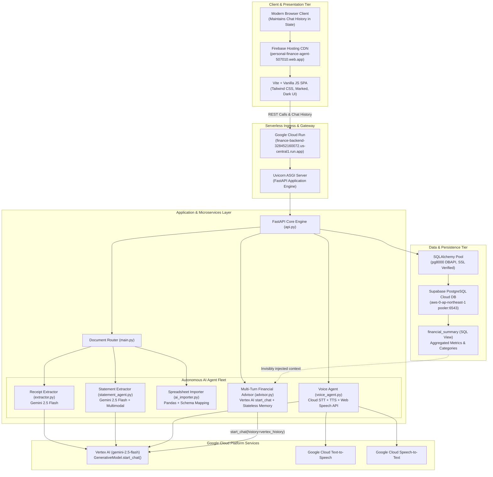
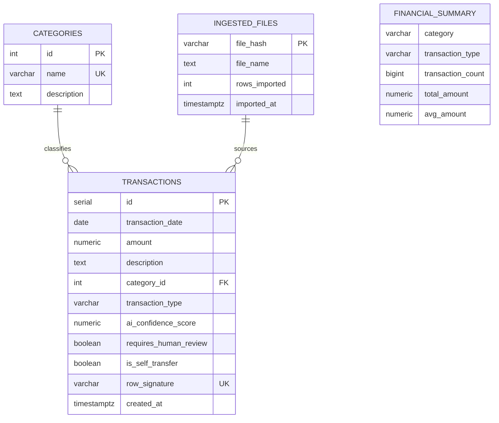
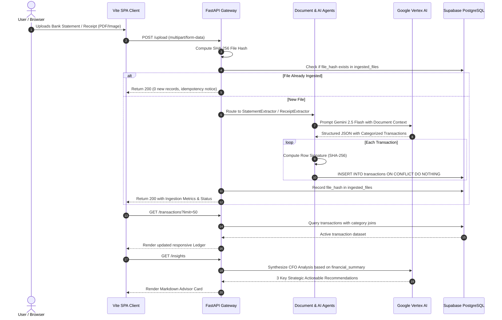

# Application Architecture (AA) Specification
## Personal Finance AI — Autonomous Financial Intelligence Platform

**Document Version:** 3.0.0-ENTERPRISE  
**Status:** Approved / Production Ready  
**Target Audience:** Enterprise Architects, Staff Engineers, Tech Leads, DevOps & Security Engineers  
**Enterprise Specification:** [FDE Enterprise Agent Architecture](file:///home/rkushwaha8610/personal-finance-agent/docs/FDE_ENTERPRISE_ARCHITECTURE.md)  
**Live Production Web Application (Firebase Hosting):** [https://personal-finance-agent-507010.web.app](https://personal-finance-agent-507010.web.app)  
**Production Backend API (Google Cloud Run):** [https://finance-backend-328452160072.us-central1.run.app](https://finance-backend-328452160072.us-central1.run.app)  
**Interactive API Documentation (Swagger):** [https://finance-backend-328452160072.us-central1.run.app/docs](https://finance-backend-328452160072.us-central1.run.app/docs)  
**System Health Check:** [https://finance-backend-328452160072.us-central1.run.app/health](https://finance-backend-328452160072.us-central1.run.app/health)  

---

## 1. Executive Summary & Solution Context

The **Personal Finance AI** platform is an enterprise-grade, autonomous financial management system designed to ingest heterogeneous financial documents (receipts, multi-page PDF bank statements, Excel spreadsheets), extract structured transactions with high precision, automatically categorize expenditures, detect internal bank self-transfers, and provide executive-level Chief Financial Officer (CFO) insights.

### Core Capabilities & FDE Pillars:
1. **Multimodal Autonomous Ingestion (Build)**: Ingests raster receipts (PNG/JPG), multi-page complex bank statements (PDF), and multi-tab spreadsheets (XLS/XLSX) using Google Gemini 2.5 Flash and Vertex AI.
2. **Model Context Protocol (MCP) & Agent2Agent (Build)**: Decoupled tool plane enabling LLMs to query financial databases and services over open standards without vendor lock-in.
3. **Layer-7 Zero-Trust Perimeter (Govern)**: Model Armor inline prompt-injection screening and automated Cloud DLP PII/PCI redaction before models ingest untrusted documents.
4. **Deterministic Deduplication & Idempotency (Govern)**: Employs SHA-256 cryptographic fingerprinting across transaction fields to guarantee zero duplicate insertions upon repeated uploads.
5. **Continuous Quality Autorater Flywheel (Scale)**: Scientific benchmarking on Golden Datasets with OpenTelemetry distributed trajectory tracing, moving past subjective vibe checks.
6. **Dynamic Model Tiering & Prefix Caching (Optimize)**: Eliminates token fan-out and quadratic context growth via sliding-window compaction and Vertex AI Context Caching.
7. **Interactive Voice & Natural Language Clarification**: Features conversational clarification via Google Cloud Speech-to-Text, Gemini multimodal audio reasoning, and Google Cloud Text-to-Speech (Journey neural voices) to resolve ambiguous transactions.
8. **Modern Single Page Application (SPA)**: Lightweight, accessible, dark-themed responsive UI built on Vite, Tailwind CSS, PostCSS, and vanilla ES modules.

---

## 2. High-Level System Architecture

The solution follows a modern decoupled architecture where the client UI interacts with an asynchronous, high-throughput REST API layer backed by cloud-hosted relational storage and Google Cloud generative AI infrastructure.



---

## 3. Component Breakdown & Interaction Models

### 3.1. Frontend Single Page Application (SPA)
- **Path**: `app/frontend/`
- **Build Toolchain**: Vite 5.4, PostCSS, Autoprefixer, Tailwind CSS 3.4.
- **Production Hosting Strategy**:
  - **Firebase Hosting (Global CDN)**: Production UI is deployed to Firebase Hosting at `https://personal-finance-agent-507010.web.app` (backed by `app/frontend/firebase.json` with SPA routing rewrites to `/index.html`).
  - **Environment Configuration**: Configured with `VITE_API_BASE_URL=https://finance-backend-328452160072.us-central1.run.app` for high-throughput cross-origin calls to the Cloud Run backend.
  - **Hybrid Single-Origin Fallback**: Production build outputs to `app/frontend/dist/`. The FastAPI backend also mounts static bundles at `/assets` and serves `index.html` at `/` for unified single-port containerized runs.
- **Component Hierarchy**:
  - `main.js`: Application lifecycle, navigation tabs (Transactions, Analytics, Budgets, Subscriptions, Upload, AI CFO), and global health monitoring.
  - `ledger.js`: Real-time transaction grid with multi-month dropdown filtering (defaults to latest available month on load), search queries, pagination, metrics cards, and inline edit modal.
  - `analytics.js`: Visual summary cards, category expenditure distribution, and net savings rate calculations.
  - `budgets.js`: Category spending limit configuration, progress bar alerts (warning at 80%, critical at 100%), and interactive budget updates.
  - `recurring.js`: Algorithmic detection of repeating charges (e.g., Netflix, AWS, Rent, SIPs).
  - `upload.js`: Drag-and-drop document upload with real-time feedback and dynamic ledger synchronization.
  - `insights.js`: AI CFO advisor terminal featuring executive recommendation cards and interactive **Multi-Turn Chat** backed by `marked` markdown renderer.
  - `modal.js`: Dual-engine voice clarification modal (Web Speech API STT + SpeechSynthesis TTS fallback + Cloud STT/TTS).
  - `toast.js`: Animated notification queue supporting stacked alerts.

### 3.2. FastAPI Application & REST Gateway
- **Path**: `app/api.py`
- **Deployment**: Google Cloud Run (`finance-backend-328452160072.us-central1.run.app`), autoscaling 0-to-N instances.
- **Framework**: FastAPI (Asynchronous Server Gateway Interface / ASGI via Uvicorn).
- **Security & Middleware**:
  - `CORSMiddleware` configured to allow `https://personal-finance-agent-507010.web.app`, Cloud Shell, localhost origins, and wildcard origins for mobile and remote access.
  - Automatic JSON request validation and response serialization via Pydantic models (`TransactionCreate`, `TransactionUpdate`, `BudgetUpdate`, `ChatRequest`).
  - Temporary payload staging in `temp_uploads/` with automated lifecycle cleanup.

### 3.3. Document Ingestion & AI Routing Pipeline
- **Path**: `app/main.py`, `app/extractor.py`, `app/statement_agent.py`, `app/ai_importer.py`
- **Routing Decision Tree**:
  - **`.pdf` Files**: Routed to `StatementExtractor`. Converts pages to visual context, sends high-resolution prompts to `gemini-2.5-flash`, extracts tabular bank statements, detects self-transfers (`is_self_transfer: true`), and calculates AI confidence score.
  - **`.png`, `.jpg`, `.jpeg` Files**: Routed to `ReceiptExtractor`. Extracts merchant name, total receipt amount, date, tax values, and maps them to canonical categories (`Food`, `Rent`, `Utilities`, `Personal`, etc.).
  - **`.xlsx`, `.xls`, `.csv` Files**: Routed to `AISpreadsheetImporter`. Analyzes sheet structures via `pandas`, uses Gemini to infer dynamic column mappings (date column, debit/credit split, narration), and normalizes records into standardized schemas.

### 3.4. Voice Clarification & Human-In-The-Loop Agent
- **Path**: `app/voice_agent.py`
- **Mechanism**:
  1. Low-confidence transactions (< 85% score) or ambiguous descriptions are marked with `requires_human_review = true`.
  2. The endpoint `/transactions/{id}/clarification` constructs a clarification question.
  3. `/transactions/{id}/clarification-audio` calls Google Cloud Text-to-Speech using the high-fidelity neural voice `en-US-Journey-F` to synthesize natural audio prompts, with automatic fallback to browser `SpeechSynthesis`.
  4. The user records or types a clarification (e.g., "This was for office lunch with clients"). Real-time feedback is provided via the browser's Web Speech API.
  5. The audio is transcribed via Google Cloud Speech-to-Text (fallback to Gemini multimodal audio), analyzed against deterministic `CATEGORY_RULES` or Gemini classification, and updated in the database via `/transactions/{id}/resolve`.

### 3.5. Multi-Turn Strategic AI CFO Advisor (Stateless Cloud Run Pattern)
- **Path**: `app/advisor.py`, `POST /insights/chat`, `GET /insights`
- **Engine**: Gemini 2.5 Flash on Vertex AI (`vertexai.generative_models.GenerativeModel`).
- **Stateless Serverless Architecture**:
  - Because FastAPI runs serverless on Google Cloud Run with zero-scale autoscaling and independent stateless containers, storing conversation state in server RAM or local disk is an anti-pattern.
  - **Client-Side History Retention**: The SPA frontend (`insights.js`) tracks the chronological array of conversation turns:
    ```javascript
    chatHistory = [
      { role: "user", content: "Can I afford a ₹15,000 trip to Goa?" },
      { role: "model", content: "Based on your ₹12,400 monthly surplus..." }
    ];
    ```
  - **Stateless Request Model**: On each new turn, the client submits:
    ```json
    {
      "message": "What if I cut dining by 20%?",
      "history": [
        {"role": "user", "content": "Can I afford a ₹15,000 trip to Goa?"},
        {"role": "model", "content": "Based on your ₹12,400 monthly surplus..."}
      ]
    }
    ```
  - **Vertex AI Session Recreation via `start_chat`**:
    1. FastAPI translates incoming history into Vertex AI `Content` objects:
       ```python
       vertex_history = [
           Content(role=msg["role"], parts=[Part.from_text(msg["content"])])
           for msg in request.history
       ]
       ```
    2. Invisible Database Context Injection: Injects real-time aggregated metrics from the PostgreSQL `financial_summary` view directly into the `GenerativeModel`'s `system_instruction`.
    3. Initiates a chat session:
       ```python
       chat = advisor_model.start_chat(history=vertex_history)
       response = chat.send_message(request.message)
       return {"reply": response.text}
       ```
    4. Resilient Fallback: If Vertex AI credentials or network calls drop, a deterministic fiduciary heuristic analyzes the prompt topic (Savings, SIP, Dining, Budget) and returns actionable advice without failing the HTTP request.

---

## 4. Data Architecture & Database Schema

The persistence layer uses managed PostgreSQL hosted on Supabase, connected via SQLAlchemy engine pooling using the `postgresql+pg8000` driver.



### 4.1. Table Specifications

#### `categories`
| Column | Type | Constraints | Description |
|---|---|---|---|
| `id` | SERIAL | PRIMARY KEY | Unique category identifier |
| `name` | VARCHAR(50) | UNIQUE, NOT NULL | Standard category (Food, Rent, Utilities, SIP, etc.) |
| `description` | TEXT | NULLABLE | Human-readable explanation of category scope |

#### `transactions`
| Column | Type | Constraints | Description |
|---|---|---|---|
| `id` | SERIAL | PRIMARY KEY | Primary key |
| `transaction_date`| DATE | NOT NULL | Execution date |
| `amount` | NUMERIC(12,2)| NOT NULL | Monetary amount (INR) |
| `description` | TEXT | NOT NULL | Transaction merchant/narration |
| `category_id` | INTEGER | FOREIGN KEY -> categories(id) | Associated category |
| `transaction_type`| VARCHAR(20) | DEFAULT 'EXPENSE' | 'EXPENSE', 'INCOME', or 'TRANSFER' |
| `ai_confidence_score`| NUMERIC(5,2)| NULLABLE | Model confidence (0.0 to 100.0%) |
| `requires_human_review`| BOOLEAN | DEFAULT FALSE | Flag for low confidence or ambiguous records |
| `is_self_transfer` | BOOLEAN | DEFAULT FALSE | Internal bank transfer flag |
| `row_signature` | VARCHAR(64) | UNIQUE | Deterministic SHA-256 fingerprint |
| `created_at` | TIMESTAMPTZ | DEFAULT CURRENT_TIMESTAMP | Ingestion timestamp |

#### `ingested_files`
| Column | Type | Constraints | Description |
|---|---|---|---|
| `file_hash` | VARCHAR(64) | PRIMARY KEY | SHA-256 hash of raw file contents |
| `file_name` | TEXT | NOT NULL | Original filename |
| `rows_imported` | INTEGER | NOT NULL | Count of new transactions ingested |
| `imported_at` | TIMESTAMPTZ | DEFAULT CURRENT_TIMESTAMP | Processing timestamp |

#### `financial_summary` (Database View)
```sql
CREATE OR REPLACE VIEW financial_summary AS
SELECT 
    COALESCE(c.name, 'Uncategorized') AS category,
    t.transaction_type,
    COUNT(t.id) AS transaction_count,
    ROUND(SUM(t.amount)::numeric, 2) AS total_amount,
    ROUND(AVG(t.amount)::numeric, 2) AS avg_amount
FROM transactions t
LEFT JOIN categories c ON t.category_id = c.id
GROUP BY c.name, t.transaction_type;
```

---

## 5. End-to-End Data Flow



---

## 6. Complete REST API Specifications

| Method | Endpoint | Description | Request Body / Parameters | Response Status |
|---|---|---|---|---|
| `GET` | `/` | Serves Production SPA Web Dashboard | None | 200 OK (HTML) |
| `GET` | `/health` | Health check & uptime status | None | 200 OK (JSON) |
| `POST`| `/upload` | Upload and process receipts, statements, Excel | Multipart File (`file`) | 200 OK |
| `GET` | `/transactions` | List filtered transactions | `month`, `category`, `type`, `limit`, `offset` | 200 OK |
| `POST`| `/transactions` | Manually insert a transaction record | JSON (`date`, `description`, `amount`, `category`, `type`) | 201 Created |
| `GET` | `/transactions/months` | List distinct calendar months available in ledger | None | 200 OK |
| `GET` | `/transactions/{id}/clarification` | Retrieve text clarification prompt | Path `id` | 200 OK |
| `GET` | `/transactions/{id}/clarification-audio` | Stream synthesized neural voice MP3 | Path `id` | 200 OK (`audio/mpeg`) |
| `POST`| `/transactions/{id}/resolve` | Resolve transaction categorization via text/audio | Form Data (`user_answer_text`, `audio_file`) | 200 OK |
| `PUT` | `/transactions/{id}` | Update existing transaction record | JSON (`description`, `category`, `amount`) | 200 OK |
| `DELETE`| `/transactions/{id}` | Delete transaction record | Path `id` | 200 OK |
| `GET` | `/analytics/summary` | Multi-month financial breakdown & totals | `month` (optional, default ALL) | 200 OK |
| `GET` | `/recurring` | List identified recurring expenses | None | 200 OK |
| `GET` | `/budgets` | Get category spending limits vs. current utilization | `month` (optional) | 200 OK |
| `POST`| `/budgets` | Set or update spending budget for category | JSON (`category`, `monthly_budget`) | 200 OK |
| `GET` | `/insights` | Generate executive AI CFO recommendations | None | 200 OK |
| `POST`| `/insights/chat` | Multi-turn stateless conversation with AI CFO Advisor | JSON (`message: str`, `history: List[Dict]`) | 200 OK (`{"reply": str}`) |

---

## 7. Security, Resilience & Scalability Architecture

1. **Stateless Multi-Turn Scaling**:
   - Built specifically for serverless autoscaling on Google Cloud Run. By offloading conversation history retention to the client SPA and re-instantiating Vertex AI `start_chat(history=...)` per turn, any Cloud Run instance can process any user request with zero session affinity requirements.
2. **Deterministic Idempotency**:
   - Both file-level hashes (`ingested_files.file_hash`) and row-level signatures (`transactions.row_signature`) prevent redundant database write amplification, making repeated uploads completely safe.
3. **Connection Resilience**:
   - Database sessions use connection pooling with pre-ping validation, automatic reconnect on connection drops, and explicit session teardown (`finally: db.close()`).
4. **Graceful Degradation**:
   - The Voice Agent supports a dual-tier architecture: Google Cloud Speech-to-Text acts as the primary recognizer, while Gemini multimodal audio and Web Speech API act as autonomous fallbacks if acoustic parsing degrades.
5. **Decoupled Modern Infrastructure**:
   - The frontend is served via Firebase Hosting's global CDN edge, while the API runs containerized on Google Cloud Run with autoscaling to handle burst ingestion loads.
6. **Container Isolation**:
   - Packaged with an unprivileged, multi-layer `Dockerfile` on Python 3.12-slim ready for zero-scale autoscaling on Google Cloud Run.
