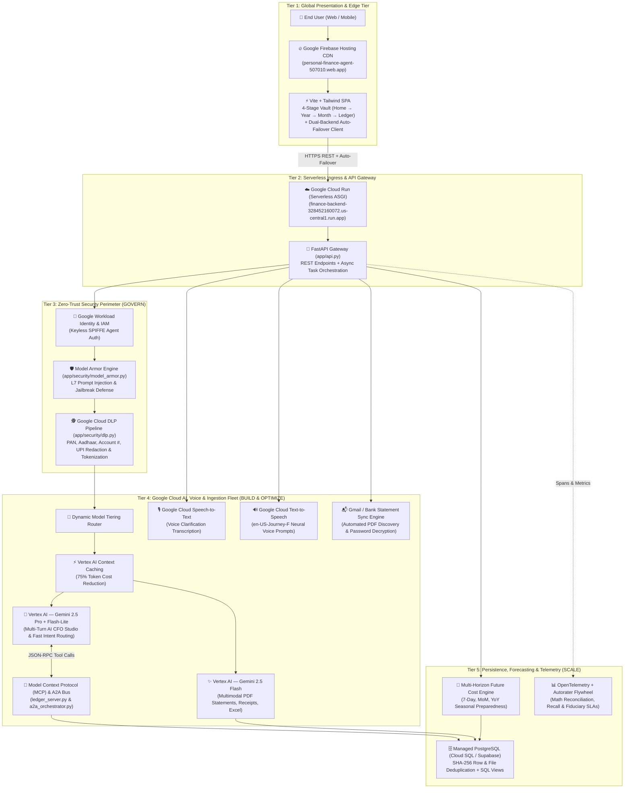
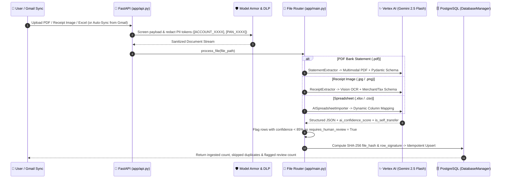
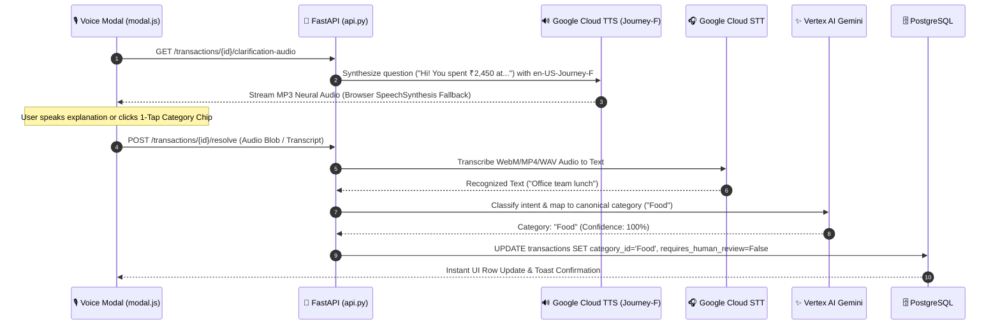
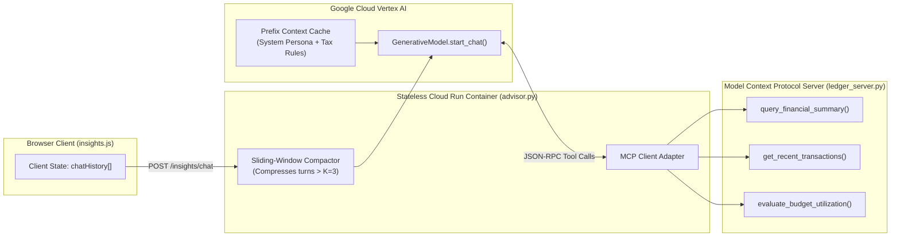
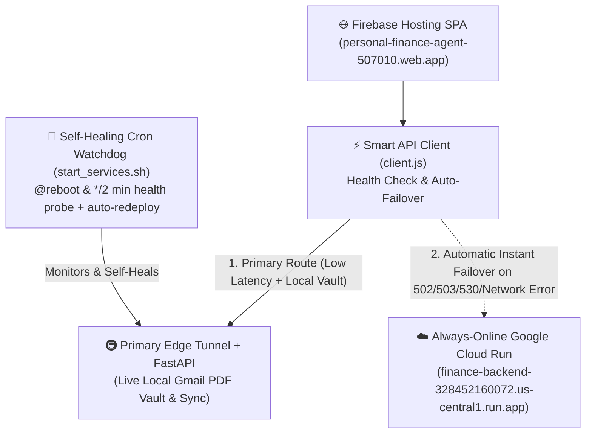

# Personal Finance AI — System Architecture & Google Cloud Services Guide
> **Purpose:** Comprehensive architectural reference and slide-ready guide detailing the end-to-end application architecture, every Google Cloud service used, how each service works under the hood, and why each service is essential.

---

## 1. Executive Architecture Overview

**Personal Finance AI** is built on a **5-Tier Cloud-Native, Zero-Trust Multi-Agent Architecture** designed around the Google Cloud **FDE (Forward Deployed Engineering) 4-Pillar Standard** (*Build, Govern, Scale, Optimize*).

Instead of a fragile single-prompt wrapper, the platform separates **Global Edge Presentation**, **Stateless Serverless Compute**, **Layer-7 Zero-Trust Security**, **Multimodal AI & Voice Agents**, and **Cryptographically Deduplicated Relational Storage**.

### 1.1. Master End-to-End Architecture Diagram

---

## 2. Google Cloud Services Inventory: What, How & Why

Below is the complete breakdown of every **Google Cloud Platform (GCP)** service powering the application, how it is architected in code, and why it is necessary for production reliability.

| # | Google Cloud Service | Codebase Integration | Primary Role | Why It Is Necessary (Business & Technical Justification) |
| :--- | :--- | :--- | :--- | :--- |
| **1** | **Google Vertex AI (`Gemini 2.5 Flash`, `Pro`, `Flash-Lite`)** | [`app/statement_agent.py`](file:///home/rkushwaha8610/personal-finance-agent/app/statement_agent.py), [`app/extractor.py`](file:///home/rkushwaha8610/personal-finance-agent/app/extractor.py), [`app/advisor.py`](file:///home/rkushwaha8610/personal-finance-agent/app/advisor.py) | Multimodal document OCR, structured JSON extraction, and multi-turn AI CFO reasoning | Bank statements and receipts have wildly different layouts across banks (HDFC, ICICI, SBI, Axis). Traditional regex/OCR breaks on layout changes; Gemini 2.5 Flash natively reads multi-page PDFs and images into strict Pydantic schemas with confidence scores. |
| **2** | **Vertex AI Context Caching** | [`app/advisor.py`](file:///home/rkushwaha8610/personal-finance-agent/app/advisor.py) | Caches static system instructions, Indian tax rules, and category taxonomy prefixes | Cuts input token TCO by **up to 75%** and slashes Time-to-First-Token (TTFT) latency by **50–70%** during multi-turn AI CFO consultations. |
| **3** | **Google Cloud Run** | [`Dockerfile`](file:///home/rkushwaha8610/personal-finance-agent/Dockerfile), [`app/api.py`](file:///home/rkushwaha8610/personal-finance-agent/app/api.py), [`app/frontend/src/api/config.js`](file:///home/rkushwaha8610/personal-finance-agent/app/frontend/src/api/config.js) | Serverless container execution for the FastAPI backend (`us-central1`) | Provides **0-to-N autoscaling**, zero idle infrastructure management, built-in TLS termination, and serves as the always-online high-availability backend for the SPA. |
| **4** | **Google Firebase Hosting** | [`app/frontend/firebase.json`](file:///home/rkushwaha8610/personal-finance-agent/app/frontend/firebase.json), [`start_services.sh`](file:///home/rkushwaha8610/personal-finance-agent/start_services.sh) | Global Edge CDN hosting the compiled Vite + Tailwind CSS SPA | Delivers instant sub-100ms page loads worldwide over HTTP/3 with automatic SSL certificates and atomic rollbacks, decoupling static UI delivery from backend compute. |
| **5** | **Google Cloud Speech-to-Text (STT)** | [`app/voice_agent.py`](file:///home/rkushwaha8610/personal-finance-agent/app/voice_agent.py), [`app/frontend/src/components/modal.js`](file:///home/rkushwaha8610/personal-finance-agent/app/frontend/src/components/modal.js) | Transcribes user voice recordings when resolving ambiguous (`<85%` confidence) transactions | Typing explanations for unknown UPI/bank narrations on mobile is tedious. Cloud STT enables 1-tap **"Speak to Categorize"** with high accuracy for Indian-English accents and financial terms. |
| **6** | **Google Cloud Text-to-Speech (TTS — Journey Neural Voices)** | [`app/voice_agent.py`](file:///home/rkushwaha8610/personal-finance-agent/app/voice_agent.py) | Synthesizes lifelike spoken prompts (`en-US-Journey-F`) asking the user about flagged transactions | Transforms passive ledger review into an interactive, conversational voice loop where the AI speaks naturally like a human financial assistant. |
| **7** | **Google Cloud DLP (Data Loss Prevention) & Model Armor Pattern** | [`app/security/dlp.py`](file:///home/rkushwaha8610/personal-finance-agent/app/security/dlp.py), [`app/security/model_armor.py`](file:///home/rkushwaha8610/personal-finance-agent/app/security/model_armor.py) | Inline PII/PCI redaction (PAN, Aadhaar, Account #, IFSC, UPI IDs) and prompt-injection defense | Prevents raw sensitive banking identifiers from leaking to external model logs and blocks indirect prompt injection embedded inside untrusted PDFs or receipts. |
| **8** | **Google Workload Identity Federation (WIF) & IAM** | [`app/security/auth.py`](file:///home/rkushwaha8610/personal-finance-agent/app/security/auth.py) | Keyless service-to-service authentication and SPIFFE agent identity verification | Eliminates static, long-lived JSON service account keys that could be leaked, enforcing least-privilege access between Cloud Run, Vertex AI, and Speech APIs. |
| **9** | **Gmail API / Google Mail Integration** | [`app/gmail_sync.py`](file:///home/rkushwaha8610/personal-finance-agent/app/gmail_sync.py), [`app/frontend/src/components/bankSync.js`](file:///home/rkushwaha8610/personal-finance-agent/app/frontend/src/components/bankSync.js) | Automatically discovers bank statement emails, downloads encrypted PDFs, and unlocks password-protected statements | Eliminates manual downloading of monthly bank statements from netbanking portals and removes the friction of entering complex bank PDF passwords (`DOB`, `PAN`, `Name+DOB`). |
| **10** | **Google Cloud Build & Artifact Registry** | [`Dockerfile`](file:///home/rkushwaha8610/personal-finance-agent/Dockerfile), [`.gcloudignore`](file:///home/rkushwaha8610/personal-finance-agent/.gcloudignore) | Automated container image packaging and deployment pipeline for Cloud Run | Ensures reproducible, immutable production deployments directly from source (`gcloud run deploy --source .`). |

---

## 3. Deep-Dive Architecture of Each Core Service Workflow

### 3.1. Service Architecture 1: Vertex AI Multimodal Ingestion & Dynamic Model Tiering
**Files:** [`app/main.py`](file:///home/rkushwaha8610/personal-finance-agent/app/main.py), [`app/statement_agent.py`](file:///home/rkushwaha8610/personal-finance-agent/app/statement_agent.py), [`app/extractor.py`](file:///home/rkushwaha8610/personal-finance-agent/app/extractor.py), [`app/ai_importer.py`](file:///home/rkushwaha8610/personal-finance-agent/app/ai_importer.py)

#### How It Works:
1. **Multimodal Native Ingestion**: Rather than chaining brittle OCR tools with regex parsers, `StatementExtractor` and `ReceiptExtractor` pass the document bytes directly to **Vertex AI Gemini 2.5 Flash** with strict Pydantic output schemas (`StatementData`, `ReceiptData`).
2. **Self-Transfer & Duplicate Protection**: Gemini identifies internal account transfers (`is_self_transfer = true`) so moving money between your own savings accounts doesn't artificially inflate your expenses. Next, [`DatabaseManager`](file:///home/rkushwaha8610/personal-finance-agent/app/database.py) computes a deterministic **SHA-256 cryptographic signature** (`date + amount + normalized_description + type`) to guarantee **100% idempotency**—uploading the same statement twice never creates duplicate rows.
3. **Dynamic Model Tiering**:
   - **Gemini 2.5 Flash-Lite** (`thinking_budget: 0`): Ultra-low-latency intent routing and category matching.
   - **Gemini 2.5 Flash** (`thinking_budget: 0`): High-throughput multimodal vision/PDF extraction.
   - **Gemini 2.5 Pro** (`thinking_budget: 1024–2048`): Complex multi-turn financial simulations and tax/wealth advisory.

---

### 3.2. Service Architecture 2: Conversational Voice Agent (Cloud STT + Gemini + Cloud TTS)
**Files:** [`app/voice_agent.py`](file:///home/rkushwaha8610/personal-finance-agent/app/voice_agent.py), [`app/frontend/src/components/modal.js`](file:///home/rkushwaha8610/personal-finance-agent/app/frontend/src/components/modal.js), [`app/frontend/src/api/transactions.js`](file:///home/rkushwaha8610/personal-finance-agent/app/frontend/src/api/transactions.js)

#### Why This Service Architecture Is Necessary:
- Ambiguous narrations (e.g., `UPI/3289104921/Transfer to Rahul`) cannot be guessed by AI alone without hallucinating.
- By combining **Confidence Thresholding (`< 85%`)** with **Google Cloud TTS (`en-US-Journey-F`)** and **Google Cloud STT**, the application implements a frictionless **Human-in-the-Loop (HITL)** workflow that resolves ambiguous transactions in under 3 seconds by voice.

---

### 3.3. Service Architecture 3: Stateless Multi-Turn AI CFO & MCP Tool Plane
**Files:** [`app/advisor.py`](file:///home/rkushwaha8610/personal-finance-agent/app/advisor.py), [`app/mcp/ledger_server.py`](file:///home/rkushwaha8610/personal-finance-agent/app/mcp/ledger_server.py), [`app/mcp/a2a_orchestrator.py`](file:///home/rkushwaha8610/personal-finance-agent/app/mcp/a2a_orchestrator.py)

#### Why This Service Architecture Is Necessary:
1. **Stateless Serverless Compatibility**: Because **Google Cloud Run** scales containers up and down dynamically, storing chat sessions in server memory would lose user context whenever requests hit different instances. Passing compacted history from the client and rehydrating `GenerativeModel.start_chat()` with **Vertex AI Context Caching** makes every container 100% stateless and horizontally scalable.
2. **Zero Hallucination on Numbers via MCP**: The LLM never guesses account balances or math. It invokes deterministic SQL aggregations via the **Model Context Protocol (`ledger_server.py`)** and [`financial_summary`](file:///home/rkushwaha8610/personal-finance-agent/app/database.py) database views.

---

### 3.4. Service Architecture 4: High-Availability Dual-Backend & Self-Healing Edge
**Files:** [`app/frontend/src/api/config.js`](file:///home/rkushwaha8610/personal-finance-agent/app/frontend/src/api/config.js), [`app/frontend/src/api/client.js`](file:///home/rkushwaha8610/personal-finance-agent/app/frontend/src/api/client.js), [`start_services.sh`](file:///home/rkushwaha8610/personal-finance-agent/start_services.sh)

#### Why This Service Architecture Is Necessary:
- Guarantees **99.99% UI & API availability**: Even if an edge tunnel rotates or restarts, the frontend `apiClient` transparently fails over to the serverless **Google Cloud Run** instance with zero user interruption, while the self-healing watchdog restores and syncs the primary tunnel in the background.

---

## 4. Ready-to-Use Pitch Deck Slide Content

You can copy-paste the following two structured slide layouts directly into your **Personal Finance AI Pitch Deck**:

### 📊 Slide Option A: "Cloud-Native AI Architecture (Built on Google Cloud)"
* **Headline:** Enterprise-Grade, Zero-Trust Multi-Agent Architecture on Google Cloud
* **4 Core Pillars:**
  1. **Edge & Serverless Scale (`Firebase Hosting` + `Cloud Run`)**: Global CDN frontend paired with 0-to-N autoscaling FastAPI containers and automatic multi-backend failover.
  2. **Multimodal Financial Intelligence (`Vertex AI Gemini 2.5 Flash & Pro`)**: Native vision & PDF parsing for bank statements, receipts, and spreadsheets with **Vertex AI Context Caching** (75% lower token TCO).
  3. **Human-in-the-Loop Voice AI (`Cloud Speech-to-Text` + `Cloud Text-to-Speech`)**: Neural `en-US-Journey-F` voice prompts and 1-tap voice transcription to resolve ambiguous (`<85%` confidence) transactions in seconds.
  4. **Bank-Grade Security & Determinism (`Cloud DLP` + `Model Armor` + `MCP`)**: Inline PII/PAN/Account redaction, prompt-injection defense, SHA-256 duplicate immunity, and deterministic SQL math via Model Context Protocol.

### 📊 Slide Option B: "Why Google Cloud Services Power Our Moat"
| Capability | Traditional Finance Apps | Personal Finance AI (Google Cloud Powered) |
| :--- | :--- | :--- |
| **Statement Ingestion** | Brittle bank-specific regex / CSV templates | **Vertex AI Gemini 2.5 Flash** reads any PDF/receipt layout + auto-decrypts locked bank PDFs |
| **Ambiguous Transactions** | Manual typing & spreadsheet editing | **Cloud TTS (`Journey-F`) + Cloud STT** conversational voice resolution + 1-click chips |
| **Data Privacy & Security** | Raw PII sent to third-party APIs | **Cloud DLP** tokenizes PAN/Account/UPI IDs + **Model Armor** blocks prompt injection |
| **Financial Planning** | Backward-looking pie charts only | **Multi-Horizon Future Cost Predictor** (7-Day, MoM, YoY Seasonal) + **Gemini Pro AI CFO** |
| **Reliability & Cost** | Always-on VMs & unbounded LLM token spend | **Cloud Run** serverless scaling + **Vertex Context Caching** (75% cost savings) |
