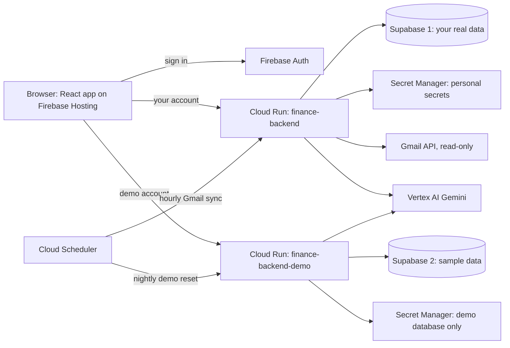

# Personal Finance AI: Overhaul Plan

> **Status:** Agreed 2026-10-18. Phase 0 complete on 2026-10-18 (DEC-023, DEC-024 in decision.md). Phase 1 complete on 2026-10-19: backend, infrastructure and demo data (DEC-025, DEC-026), the React shell on Firebase Hosting (DEC-029, DEC-030), your Google sign-in confirmed (DEC-031). Next: Phase 2, Connect Gmail. Tick items off as they ship.
> **Based on:** the [UX and enterprise UI audit](UX_ENTERPRISE_AUDIT.md). Every change gets logged in [decision.md](file:///home/rkushwaha8610/decision.md).

---

## 1. Decisions

| Area | Decision | Why |
|---|---|---|
| Frontend | React + TypeScript, switched over one screen at a time | Data grid, accessible components and data loading come from ready-made libraries. TypeScript catches the kind of bug that broke Bank Sync |
| Sign-in | Firebase Auth: Google sign-in for you, email + password for the demo | Fits Firebase Hosting, and it's the base for multi-user later |
| Theme | Light first, dark as an option | The norm for business finance tools; matches the pitch deck |
| Users | Two separate environments: **Personal** (your real data and Gmail) and **Demo** (sample data, shareable login). Multi-user comes later, not now | You can show the app to managers without exposing your finances |
| Bank data | Gmail, through a read-only "Connect Gmail" button | Individuals can't use Account Aggregator: only entities regulated by RBI, SEBI, IRDAI or PFRDA can receive the data |
| Secrets | Google Secret Manager. Never in Supabase, never in code, nothing sensitive on the Cloud Shell disk | The demo has to run on Cloud Run, which can't read Cloud Shell files. Cloud Shell also deletes its disk after 120 days unused |
| Hosting | Cloud Run is the only backend. Cloud Shell is for development only; the Cloudflare tunnel and cron watchdog are retired | Always on, and no more redeploys when the tunnel URL changes |

---

## 2. Target architecture

**Why two backends:** both run the same code with different settings. The demo backend holds no credentials for your real database or your Gmail. So even if a demo visitor found a bug, they couldn't reach your data.

---

## 3. The two environments

| | Personal | Demo |
|---|---|---|
| Who | You | Anyone you share the login with |
| Sign-in | Sign in with Google (`rkushwaha8610@gmail.com`) | An email and password that I create, saved to a private file in Cloud Shell |
| Backend | Cloud Run `finance-backend` | Cloud Run `finance-backend-demo` |
| Database | Current Supabase project (real data) | New free Supabase project (sample data) |
| Secrets it can read | Real database, Gmail connection, statement passwords | Demo database only |
| Gmail | Connect Gmail (read-only), synced every hour | Turned off |
| AI features | Full | Daily limits, to cap costs |
| Data reset | Never | Every night, back to the sample data. This also clears anything a visitor uploaded |

- **Demo login email:** a plus-address of your Gmail, such as `rkushwaha8610+pfademo@gmail.com`. Password-reset emails then land in your inbox, so nobody else can take over the account.
- **Sample data:** about 18 months of realistic Indian transactions, generated by a script so it can be reset.
  - It covers salary, rent, UPI food and grocery orders, bills, SIPs, insurance, card bill payments, transfers between your own accounts, refunds and a festive-season spike.
  - A few items need review and one is a possible duplicate, so every screen has something to show.

---

## 4. Where secrets live

| Secret | Today | After |
|---|---|---|
| Supabase password (personal) | Hardcoded in [config.py](file:///home/rkushwaha8610/personal-finance-agent/app/config.py#L39-L42) and copied into the Docker image | Changed and stored as `pfa-db-password-personal` |
| Supabase password (demo) | Doesn't exist yet | `pfa-db-password-demo` |
| Gmail App Password | Plain text in Supabase (publicly readable) and in the project's `.env` file | Phase 0: replaced with a new one, stored as `pfa-gmail-app-password`. Phase 2: replaced by Connect Gmail, then revoked |
| Gmail connection token | Doesn't exist yet | `pfa-gmail-token`, written by the backend when you click Connect Gmail |
| Google sign-in credentials for the Gmail connection (OAuth client) | Don't exist yet | `pfa-gmail-oauth-client` |
| Bank-statement PDF passwords | Plain text in Supabase | `pfa-statement-passwords` |

- Each Cloud Run backend runs as its own service account, and each service account can read only its own secrets.
- In Cloud Shell, the app reads the same secrets using your gcloud login, so no secret files sit on disk.
- Secrets never pass through chat. A helper script asks for the value at a hidden prompt and stores it directly.

---

## 5. Phases

### Phase 0 · Safety net and critical fixes (this week)
- [x] Back up first: archive the project folder and take a full dump of the real database.
- [x] Take credentials out of the code.
  - [config.py](file:///home/rkushwaha8610/personal-finance-agent/app/config.py) reads them from Secret Manager or environment variables, and refuses to start if they're missing.
  - Turn on Secret Manager and add the helper script.
- [x] Put the project under git, ignoring `.env`, `venv/`, uploads and build output. This happens after the credentials leave the code, so they never enter the history.
- [x] **You:** change the Supabase password and create a new Gmail App Password. Store both with the helper script. (Done 2026-10-18; old database password and old App Password verified dead.)
- [x] Delete the plain-text copies: the Gmail columns in Supabase and the project's `.env` file.
- [x] Lock down Supabase.
  - Turn on row-level security on all 8 tables.
  - Remove the public `anon` and `authenticated` access.
  - Before that, I'll confirm it doesn't affect the database role the backend uses.
- [x] Accept API calls only from your Firebase site and local development.
- [x] Fix the crashes and data bugs from the audit:
  - Bank Sync's `toast()` crash
  - the confidence-scale bug, plus a one-time correction of old rows that clears up to about 476 review items
  - user corrections being overwritten (fixed with a `user_locked` flag)
  - one shared definition of "needs review"
  - unsafe HTML in AI answers and email text (XSS)
  - unsafe upload file names
  - the small-bug list
  - publicly published source maps
- [x] Quick win: if the existing ☀️ light theme holds up, make it the default now. Checked: it doesn't hold up (8–46 low-contrast text elements per page), so light-first moves to the Phase 1 design tokens.

**Outcome:** your data is no longer publicly readable, the review backlog shrinks, and Bank Sync works again.

### Phase 1 · Sign-in, two environments, always on (1–2 weeks)
Backend:
- [x] **You:** in the Firebase console, turn on Authentication with the Google and Email/Password providers (about 2 minutes).
- [x] Every API route checks the Firebase login. Only your account and the demo account get in. Each backend has its own allowlist pinned to the sign-in method (DEC-025).
- [x] **You:** create a second free Supabase project, `pfa-demo`, in the same region as the current one. Store its connection string with the helper script. (Created in Seoul, `ap-northeast-2`; password stored as `pfa-db-password-demo`.)
  - Supabase's free plan allows 2 active projects.
  - If you're already at the limit, the fallback is a separate, locked-down schema (an isolated section) in the current database.
- [x] Copy the table structure (no data) to the demo database, then load the sample data. The app now creates its full schema on an empty database; 1,449 sample rows over 18 months (DEC-026).
- [x] Deploy two Cloud Run services from one container image, each with its own service account. `finance-backend` in Tokyo and `finance-backend-demo` in Seoul, each next to its own database.
  - Fix the Docker import bug so the current code starts.
  - Put Cloud Run in the region closest to Supabase, because the app makes many small database calls. The database is in Tokyo (`ap-northeast-1`), so `asia-northeast1`.
  - Pin the Python dependencies. The Vertex AI SDK module the app uses (`vertexai.generative_models`) is deprecated, so a fresh image build could pull a version without it. Pin it now and plan a move to the `google-genai` SDK.
  - Fix the `app.`-prefixed imports (for example in `advisor.py`) that fail inside the Docker image.
- [x] Add Cloud Scheduler jobs:
  - the nightly demo reset, which also keeps the free demo database from pausing after a week of inactivity
  - the hourly Gmail sync for Personal
- [x] Store budgets in the database. Today they live in server memory, so they'd be lost on Cloud Run.
- [x] Retire the Cloudflare tunnel and cron watchdog. [start_services.sh](file:///home/rkushwaha8610/personal-finance-agent/start_services.sh) becomes a local development script.
- [x] Create the demo login and save it to a private file in Cloud Shell (`~/.config/personal-finance-agent/demo-login.txt`, readable only by you).

Frontend:
- [x] Add React + TypeScript to the existing Vite setup, with ESLint and strict type checks. (DEC-029)
- [x] Build the new app shell: (live on Firebase Hosting since 2026-10-19, DEC-029 and DEC-030)
  - a sign-in screen
  - a left sidebar
  - a top bar with the period picker and search
  - page state kept in the URL
  - light-first styling with a dark option

  The existing screens run inside the shell unchanged.
- [x] After sign-in, the app talks to the backend that matches the account. The demo login was verified on the live site (DEC-030), and your Google sign-in loaded all 917 of your transactions on 2026-10-19 (DEC-031).

**Outcome:** safe sign-in, a personal app that's always on, and a demo you can share.

### Phase 2 · Connect Gmail, Personal only (about 3–5 days)
- [ ] **You:** in the Google Cloud console, I'll give you the exact clicks for:
  - setting the app's audience to External
  - publishing it "In production" (in Testing mode, access expires every 7 days)
  - adding the `gmail.readonly` permission and the redirect address
- [ ] Turn on the Gmail API.
- [ ] Add the Connect Gmail button.
  - It opens Google's consent screen, where you click past a one-time "Google hasn't verified this app" warning.
  - The resulting token is saved to Secret Manager.
- [ ] Sync through the Gmail API.
  - Fetch only messages that arrived since the last sync, with a date-based catch-up after long gaps.
  - Reuse the existing parsing in [gmail_sync.py](file:///home/rkushwaha8610/personal-finance-agent/app/gmail_sync.py).
- [ ] Retry locked statements whenever a statement password is saved.
- [ ] Show a "Reconnect Gmail" banner if Google cuts off access, for example after a password change or 6 months without use.
- [ ] Remove the IMAP code and the App Password columns.
- [ ] **You:** revoke the App Password.

**Outcome:** no Gmail password is stored anywhere, and access is read-only and revocable.

### Phase 3 · Rebuild the screens in React (2–4 weeks)
Replace one screen at a time, and delete the old file once its replacement ships:
1. [ ] **Transactions:**
   - a dense table with an account column
   - bulk actions and inline category editing
   - a details panel with an "Always categorize X as Y" toggle
   - fast scrolling for long lists
2. [ ] **Review Inbox:**
   - items grouped by merchant, with "Accept all"
   - keyboard shortcuts for working through items quickly
   - "Accept all suggestions ≥ 90%"
   - backend support: merchant rules, and a stored reason for each flag
3. [ ] **Analytics, Budgets and Forecast:** charts that click through to the matching transactions, and month-to-date pacing instead of alarming half-month deficits.
4. [ ] **Statements & Sync**
5. [ ] **AI CFO**

Then:
- [ ] An accessibility pass.
- [ ] Automated browser tests for the main flows, including the demo login.

**Outcome:** the enterprise-grade UI shown in the audit's mockups.

### Phase 4 · Stand-out features (4+ weeks)
- [ ] Background imports with progress and partial results
- [ ] An accounts model, showing which bank each transaction came from
- [ ] Indian financial-year view and tax tags (80C, 80D)
- [ ] Transfer pairing and refund netting
- [ ] AI CFO tools that work per month, with links to the transactions behind each answer
- [ ] A real accuracy metric based on your corrections
- [ ] Bring the docs and pitch deck in line with the code (audit §7)

---

## 6. Your to-do list
These are the only steps I can't do for you:

| Phase | Task | Time |
|---|---|---|
| 0 | Change the Supabase password and store the new one with the helper script | 5 min |
| 0 | Create a new Gmail App Password, revoke the old one, and store the new one | 5 min |
| 1 | Firebase console: turn on Google and Email/Password sign-in | 2 min |
| 1 | Create the `pfa-demo` Supabase project and store its connection string | 5 min |
| 2 | Google Cloud console: publish the app, add the Gmail permission and the redirect address | 10 min |
| 2 | Once Connect Gmail works, revoke the App Password | 1 min |

---

## 7. Later: multi-user (not part of this plan)

**What it will take:**
- a user ID on every table, with row-level security per user
- a Gmail connection per user
- Google verification, plus a yearly security assessment by an outside firm, for Gmail access. The personal-use exemption no longer applies at that point, and unverified apps have a user cap
- per-user AI limits, a sign-up flow and account deletion

**How this plan keeps the door open:**
- Firebase Auth from day one
- all "who is this user" logic in one backend function
- secrets named per account
- no new code that assumes a single row, like today's `WHERE id = 1`
