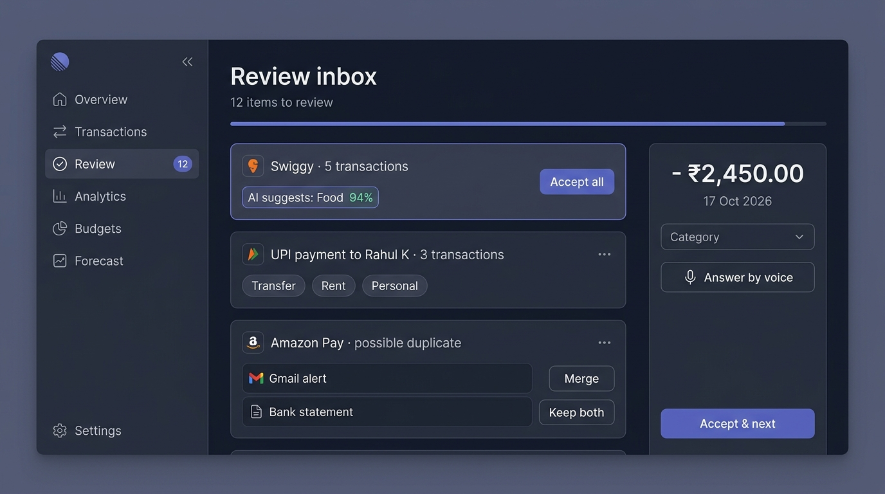
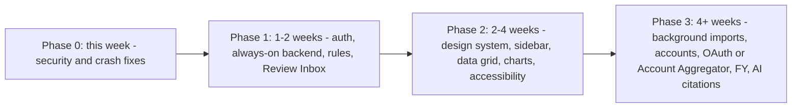

# Personal Finance AI: User Pain Points and Enterprise UI Audit

> **Document status:** Audit snapshot from 2026-10-18 (agy). Findings come from the code, the live database (read-only, counts only) and Cloud Run GET probes at that date. No fixes have been applied yet. See the roadmap in section 6.

**Scope:** `personal-finance-agent`, about 12K lines of code: a FastAPI + Gemini backend and a Vite/vanilla-JS single-page app (SPA).

**How I checked:**
- Two parallel full-code audits, one for the backend and one for the frontend.
- I re-checked every critical claim myself against the code.
- I reviewed the 8 live-app screenshots from 17 Oct; the UI hasn't changed since.
- I ran read-only database queries that return counts only.
- I probed the Cloud Run fallback with GET requests only.

**I didn't modify any project files.**

> [!CAUTION]
> **Act today: credentials are exposed.**
> - The Supabase database password is hardcoded in [config.py](file:///home/rkushwaha8610/personal-finance-agent/app/config.py#L39-L42), which also gets copied into the Docker image.
> - Row-Level Security (RLS) is **off on all 8 tables**.
> - Supabase's public `anon` role can `SELECT/UPDATE/DELETE/TRUNCATE` both `transactions` and `gmail_sync_settings`. That second table holds your Gmail App Password in plaintext.
> - None of the 27 API routes require authentication, and CORS (the browser's cross-site access rule) lets any website call the API with credentials.
>
> **Rotate the database password and the Gmail App Password now. Then turn on RLS and revoke the `anon`/`authenticated` grants.**

---

## 1. Executive summary

- **The #1 user pain point can be fixed in a day.** 80.6% of the ledger (738 of 916 rows) is stuck in "Needs Review".
  - 501 of those rows store confidence on a **0–1 scale**, but the flag rule expects 0–100 and flags anything under 85.
  - So they get flagged no matter how good the categorization is.
  - Converting the scale and backfilling the old rows clears up to about 476 items at once.
- **Corrections don't stick.**
  - Re-imports and the matching of Gmail alerts against monthly statements overwrite categories the user already fixed.
  - Nothing is learned from corrections: 58 merchants were flagged again in two or more months.
- **The live app is half-broken right now.**
  - No local backend and no crontab are running, so the Firebase SPA has switched to a **stale Cloud Run version**.
  - On that version, `/forecast` and `/api/gmail/*` return 404, so Future Plan and Bank Sync don't work. Review badges show 0 there.
  - Separately, every Bank Sync action throws `TypeError: toast is not a function`.
- **UI verdict:** it looks ambitious, but it reads as an "AI playground" rather than an enterprise product. It **can get there**:
  - one sidebar for navigation, with Transactions as the home screen
  - a token-based design system (shared color, spacing and type values)
  - a real data grid for the ledger
  - URL routing
  - a Review Inbox
  - basic accessibility

---

## 2. Fix-now list (critical defects, mostly small effort)

| # | Defect | Evidence | User impact | Fix | Effort |
|---|---|---|---|---|---|
| 1 | Secrets in source code, RLS off, full grants for `anon` | [config.py#L39-L42](file:///home/rkushwaha8610/personal-finance-agent/app/config.py#L39-L42); live check: RLS off on 8 of 8 tables | Anyone with the source code, or with the public anon key (if the Supabase REST API is on), could read or wipe the ledger and Gmail credentials | Rotate passwords; use Secret Manager; `ENABLE ROW LEVEL SECURITY` + `REVOKE ALL … FROM anon, authenticated` | S |
| 2 | No authentication on any route; CORS accepts any origin (`allow_origin_regex=".*"`) with credentials | [api.py#L64-L80](file:///home/rkushwaha8610/personal-finance-agent/app/api.py#L64-L80); no auth checks anywhere | Anyone with the tunnel or Cloud Run URL can read and change all financial data | Verify a Firebase Auth token on every route; limit CORS to the Firebase origin | M |
| 3 | Confidence-scale bug causes the 80% review backlog | The Excel prompt never says what scale to use ([ai_importer.py#L122](file:///home/rkushwaha8610/personal-finance-agent/app/ai_importer.py#L122)); nothing converts the value ([models.py#L21](file:///home/rkushwaha8610/personal-finance-agent/app/models.py#L21)); anything under 85 is flagged ([main.py#L67-L69](file:///home/rkushwaha8610/personal-finance-agent/app/main.py#L67-L69)) | Review queue is unusable | In the validator: `if c <= 1: c *= 100`; one-time backfill of old rows; restrict categories to a fixed list | S |
| 4 | Bank Sync calls `toast()` as a function, but `toast` is an object | [toast.js#L128](file:///home/rkushwaha8610/personal-finance-agent/app/frontend/src/components/toast.js#L128) vs [bankSync.js#L75](file:///home/rkushwaha8610/personal-finance-agent/app/frontend/src/components/bankSync.js#L75) (10 calls) | No feedback; the ledger never refreshes after a successful sync; unlocking statements breaks | Use `toast.show(...)`; add the ESLint `no-undef` rule and `checkJs` | S |
| 5 | Stale Cloud Run fallback, and the watchdog isn't running | `/forecast` returns 404 and `/api/gmail/settings` returns 404 (probed); `crontab -l` shows nothing | Future Plan and Bank Sync break whenever Cloud Shell sleeps | Make Cloud Run the main backend; fix the Docker import ([advisor.py#L20-L21](file:///home/rkushwaha8610/personal-finance-agent/app/advisor.py#L20-L21) vs [Dockerfile#L23-L29](file:///home/rkushwaha8610/personal-finance-agent/Dockerfile#L23-L29)); deploy through CI | M |
| 6 | Unsafe HTML rendering of AI and email content (XSS risk) | `marked.parse` output goes into innerHTML with no sanitizer ([insights.js#L15-L18](file:///home/rkushwaha8610/personal-finance-agent/app/frontend/src/components/insights.js#L15-L18), [#L262](file:///home/rkushwaha8610/personal-finance-agent/app/frontend/src/components/insights.js#L262), [#L327](file:///home/rkushwaha8610/personal-finance-agent/app/frontend/src/components/insights.js#L327)); toasts render raw HTML; email subjects and filenames go in unescaped ([bankSync.js#L374-L376](file:///home/rkushwaha8610/personal-finance-agent/app/frontend/src/components/bankSync.js#L374-L376)) | Malicious text in a merchant name could trick the AI into returning HTML that runs script in the app | DOMPurify for markdown; `textContent` in toasts; escape values in bankSync | S |
| 7 | Upload path traversal | `os.path.join(UPLOAD_DIR, file.filename)` ([api.py#L180](file:///home/rkushwaha8610/personal-finance-agent/app/api.py#L180)); Starlette doesn't strip directories from the filename | A crafted upload can overwrite or delete files on the server | Random UUID temp names; size and type checks | S |
| 8 | User corrections get overwritten | Reconciliation UPDATE ([database.py#L328-L352](file:///home/rkushwaha8610/personal-finance-agent/app/database.py#L328-L352)) and upsert ([database.py#L355-L366](file:///home/rkushwaha8610/personal-finance-agent/app/database.py#L355-L366)) | "I already fixed this!" | Add a `user_locked` column that both statements respect | S |
| 9 | Review badge count doesn't match the review list | Badge counts "flagged OR confidence < 85" ([api.py#L256](file:///home/rkushwaha8610/personal-finance-agent/app/api.py#L256)); list shows flagged only ([api.py#L410-L414](file:///home/rkushwaha8610/personal-finance-agent/app/api.py#L410-L414)); edits don't reset confidence ([api.py#L692-L705](file:///home/rkushwaha8610/personal-finance-agent/app/api.py#L692-L705)) | The count never reaches 0; 3 such phantom rows exist in the live data | One shared `review_status` definition | S |
| 10 | Small but visible bugs | See the list below this table | Erodes trust | One cleanup PR | S |

The small visible bugs in row 10:
- The button reads "+ + Add Entry" ([ledger.js#L240](file:///home/rkushwaha8610/personal-finance-agent/app/frontend/src/components/ledger.js#L240)).
- The Budget form label says "($)", and `step="100"` makes the browser reject amounts like ₹2,550 ([modal.js#L500-L501](file:///home/rkushwaha8610/personal-finance-agent/app/frontend/src/components/modal.js#L500-L501)).
- "₹X budgeted of ₹Y" actually shows the amount spent ([budgets.js#L173-L174](file:///home/rkushwaha8610/personal-finance-agent/app/frontend/src/components/budgets.js#L173-L174)).
- CSV export is cut off at the first `#` character ([ledger.js#L1961-L1962](file:///home/rkushwaha8610/personal-finance-agent/app/frontend/src/components/ledger.js#L1961-L1962)).
- The upload fallback never runs, because `getTransactions` is called but never imported ([upload.js#L6](file:///home/rkushwaha8610/personal-finance-agent/app/frontend/src/components/upload.js#L6) vs [#L264](file:///home/rkushwaha8610/personal-finance-agent/app/frontend/src/components/upload.js#L264)).
- The upload screen offers CSV, but the backend rejects it ([main.py#L123-L125](file:///home/rkushwaha8610/personal-finance-agent/app/main.py#L123-L125)).
- Source maps are published publicly ([vite.config.js#L60](file:///home/rkushwaha8610/personal-finance-agent/app/frontend/vite.config.js#L60)).

---

## 3. Top user pain points: causes and ideas

### P1 · "741 transactions need my review": the queue is unusable
**What users see:** the Home banner says "741 Transaction(s) Need Your Review". In the Year view, all 388 transactions from 2025 are flagged.

**Root causes (checked against the live database):**
- 501 flagged rows store confidence between 0 and 1. The Excel importer returns that scale, nothing converts it, and the under-85 rule flags it.
- The AI writes categories as free text, which often doesn't match the database list. Those rows end up as "Other" (254 rows, 27.7%) and get flagged.
- Gmail alerts are flagged whenever the regex classifier returns "Other" ([gmail_sync.py#L688](file:///home/rkushwaha8610/personal-finance-agent/app/gmail_sync.py#L688)).
- The only way to review is a voice modal, one transaction at a time. There is no bulk action.

**Ideas:**
1. Convert the scale and backfill old rows (S). Up to about 476 rows with a valid category clear immediately.
2. Make Gemini pick from the database's category list (an enum in `response_schema`). Return the top 3 categories with probabilities.
3. Store a `review_reason` (low confidence, new merchant, possible duplicate, possible transfer) so users can see *why* a row was flagged.
4. Add a **Review Inbox** (see the mockup in §5):
   - group rows by merchant
   - "Accept all" per group
   - keyboard triage: 1–9 to pick a category, Enter to accept, J/K to move
   - "Accept all AI suggestions ≥ 90%"

### P2 · "I already fixed this": corrections are overwritten and never learned
- Two code paths overwrite user fixes ([database.py#L328-L366](file:///home/rkushwaha8610/personal-finance-agent/app/database.py#L328-L366)).
- 58 merchants were flagged again in two or more months, covering 389 rows (from the backend audit's database query).

**Ideas:**
1. Add a `categorized_by` column (`ai` / `rule` / `user`) plus a `user_locked` flag. Imports never overwrite fields the user set.
2. Add a `merchant_rules` table that maps a normalized merchant to a category and type.
   - Users create rules from a correction with an **"Always categorize X as Y"** toggle.
   - Apply rules *before* calling the AI, which is faster, cheaper and more predictable.
3. Normalize merchant names by stripping UPI/IMPS reference numbers, so `UPI/DR/…/SWIGGY/…` becomes `Swiggy`. This also makes rules and recurring-bill detection work.
4. Include the user's most common rules as examples in the extraction prompts.

### P3 · Uploads are slow, opaque and all-or-nothing, and some files just fail
- Each upload is one blocking request, with no job id and no progress ([api.py#L174-L237](file:///home/rkushwaha8610/personal-finance-agent/app/api.py#L174-L237)).
- Gemini calls have no retries and no timeouts.
- One bad row rejects the whole file.
- The UI offers CSV, but the backend rejects it.
- Password-protected PDFs fail with a generic 500 error.
- The progress bar is fake, and the fallback path never runs.
- When failing over to Cloud Run, the frontend re-sends `POST /upload`, so the same file can be processed twice.

**Ideas:**
1. Background import jobs:
   - the server returns `202` with a job id
   - the UI shows progress (pages parsed, rows found, duplicates skipped)
   - several files can be queued at once
2. Partial imports with a per-row error report, e.g. "212 imported · 3 need attention".
3. A password flow: the server returns `422 PDF_PASSWORD_REQUIRED`, the UI asks for the password inline and remembers it per bank (encrypted).
4. Fixed parsers for standard bank CSV/XLSX exports, with presets for HDFC, SBI, Kotak, ICICI and Axis. Use the AI only for unknown layouts.
5. Idempotency keys so a repeated request is processed once. Never retry a POST automatically during failover.

### P4 · Silent data loss and false merges
- The duplicate fingerprint is just date, amount, description and type ([database.py#L93-L98](file:///home/rkushwaha8610/personal-finance-agent/app/database.py#L93-L98)). Two identical purchases on the same day (say, two ₹10 teas) collapse into one.
- Matching a Gmail alert to a statement row can merge them on the same date and amount, even when the merchants differ (backend audit, database.py#L161).
- Alerts are dated by the email header, not the transaction date inside the email (backend audit).

**Ideas:**
- Add an occurrence number and the source/UTR reference to the fingerprint.
- Use a "Possible duplicate" review reason with a side-by-side **Merge / Keep both** choice, instead of merging silently.
- Show where each transaction came from (e.g. "Gmail alert + SBI statement") in the row details.

### P5 · Bank Sync: no feedback, stuck statements, risky credentials
- The `toast()` crash (fix-now #4).
- 6 of 8 exported statements are stuck at `PASSWORD_REQUIRED`. They are never retried, even after the correct password is saved (backend audit).
- Sync uses IMAP with a 16-character App Password, which grants full mailbox access. The password is stored in plaintext.
- The unauthenticated `GET /api/gmail/settings` returns your Gmail address and the last 4 characters of the password.
- The hourly sync only runs while the local server (uvicorn) is up, and it looks back just 3 days. Any longer outage leaves gaps.

**Ideas:**
- Retry locked statements whenever a password is saved.
- A statement-password vault with format hints for each bank.
- Switch to **Gmail OAuth (`gmail.readonly`)** or India's **Account Aggregator** framework for consented bank data.
- Use Cloud Scheduler, and sync incrementally from the last processed message.
- A sync timeline, e.g. "Fetched 12 emails · 3 alerts · 1 statement · 0 duplicates".

### P6 · Navigation friction: three clicks to reach transactions, and nothing survives a refresh
- There is no router (no `pushState` or `hashchange` anywhere). Back leaves the app, refresh resets to Home, and nothing can be linked or shared.
- Users must go Home → Year → Month → Ledger.
- The ledger has four controls for picking a month: breadcrumb, stepper, "Switch Month" and a Month dropdown.
- The same destinations appear three times on Home: the nav bar, Quick Actions and the module tiles.

**Ideas:**
- Make Transactions the landing view, with a global period bar: This month · Last month · FY · Custom, plus ‹ › arrows.
- Keep state in the URL, e.g. `/transactions?month=2026-10&status=review`.
- Turn the Year/Month cards into a "Statements" overview instead of a required path.

### P7 · Gaps for Indian users
- Calendar years are labelled "Financial Year" ([ledger.js#L632](file:///home/rkushwaha8610/personal-finance-agent/app/frontend/src/components/ledger.js#L632), [#L855](file:///home/rkushwaha8610/personal-finance-agent/app/frontend/src/components/ledger.js#L855)). The Indian financial year runs April–March, and income-tax returns (ITR) are filed per financial year.
- Voice uses US English for both speech recognition and speech output ([voice_agent.py#L235-L236](file:///home/rkushwaha8610/personal-finance-agent/app/voice_agent.py#L235-L236), [#L268-L273](file:///home/rkushwaha8610/personal-finance-agent/app/voice_agent.py#L268-L273)).
- Dates use US formatting ([formatters.js#L48](file:///home/rkushwaha8610/personal-finance-agent/app/frontend/src/utils/formatters.js#L48)), and the Budget form shows "$".

**Ideas:**
- A Calendar / Indian FY toggle.
- en-IN formatting everywhere: "17 Oct 2026", and compact ₹L/₹Cr on headline numbers.
- Indian English (en-IN) speech recognition, with Hindi (hi-IN) as an alternative so users can answer in Hinglish.
- Tax tags (80C, 80D, …) and a financial-year summary export to help prepare the ITR.

### P8 · Misleading numbers that erode trust in the AI
- On 17 Oct, the half-finished month shows "Deficit · savings rate −165% · vitality 20/100" with no month-to-date context.
- "Transfer ₹20,000 (0%)" is listed first under Spending by Category.
- The AI CFO's savings tool returns **lifetime** totals labelled `monthly_income` / `monthly_surplus` ([ledger_server.py#L221-L238](file:///home/rkushwaha8610/personal-finance-agent/app/mcp/ledger_server.py#L221-L238), [client.py#L47](file:///home/rkushwaha8610/personal-finance-agent/app/mcp/client.py#L47)). Its SIP advice is therefore based on lifetime surplus.
- Budgets live only in memory ([api.py#L85-L97](file:///home/rkushwaha8610/personal-finance-agent/app/api.py#L85-L97)). They reset on every restart and aren't shared with Cloud Run.
- From the backend audit:
  - forecast confidence values are fixed formulas or constants
  - the forecast is anchored to the latest transaction, not today
  - refunds are counted as income
  - credit-card bill payments are counted as spending, which double-counts card purchases

**Ideas:**
- Month-to-date pacing: "₹10,000 so far vs ₹X at this point last month".
- Show "Transfers (excluded)" as its own section.
- Give the AI advisor tools that work on a single month.
- Store budgets in the database, per month.
- Add a "Why this forecast?" breakdown.
- Net refunds against the original purchase, pair up transfers between your own accounts, and treat card bill payments as transfers to pay off a liability.

### P9 · Reliability: the app degrades every time Cloud Shell restarts
- The free Cloudflare tunnel gets a new URL on every restart, which forces a rebuild and redeploy.
- The crontab doesn't survive Cloud Shell restarts; there is none now.
- The fallback Cloud Run version is stale and relies on the hardcoded database defaults.
- The status dot stays green even while the app is on the fallback.
- The current code can't start inside the Docker image.
- The project isn't under git, so there's nothing to roll back to.

**Ideas:**
- Make Cloud Run the only backend:
  - secrets in Secret Manager
  - automatic deploys with Cloud Build on every push
  - `min-instances=1` if cold starts hurt
- Store statements in Cloud Storage (GCS).
- Add a `/version` endpoint so the SPA can check which features the backend supports.
- `git init` and set up CI.

---

## 4. Ideas that remove user effort (beyond bug fixes)

| Idea | Pain it removes | Impact | Effort |
|---|---|---|---|
| Merchant rules + "Always categorize X as Y" | Reviewing the same merchants every month | High | M |
| Review Inbox with grouping, bulk accept and keyboard triage | 741 reviews, one modal at a time | High | M |
| **Statement coverage tracker**, e.g. "Feb & May 2026 missing; Mar 2026 has 1 transaction", with one-click fetch or upload | Silent gaps in analytics (visible in the Year view) | High | S–M |
| Background multi-file import with progress and partial results | Waiting on a spinner; all-or-nothing failures | High | M |
| Bank CSV/XLSX presets | AI cost, delay and mistakes on standard bank exports | Medium | M |
| Statement-password vault + automatic retry | Statements stuck at `PASSWORD_REQUIRED` | Medium | S |
| Month-to-date pacing and "safe to spend" | Alarming deficits for half-finished months | Medium | S |
| Forecast explanation ("Why ₹90,000?") | AI numbers nobody can check | Medium | S–M |
| Transfer pairing + refund netting | Inflated income and spending | High | M |
| Undo everywhere (soft delete, history per transaction) | Mistakes that can't be reversed; the browser's native `confirm()` dialog | Medium | S–M |
| Accounts model: account column, balances, check against the statement balance | "Which bank was this?" (there's no account column today) | High | M–L |
| Real accuracy tracking based on user corrections | Replaces the current eval, which compares a list with itself ([autorater.py#L229-L230](file:///home/rkushwaha8610/personal-finance-agent/app/eval/autorater.py#L229-L230)), with an honest metric | Medium | S |
| AI CFO answers with citations that link to the transactions used | Advice that can't be verified | Medium | M |
| Weekly digest: items to review, upcoming bills, budget pace | Having to open the app to notice problems | Medium | M |

---

## 5. Is the UI enterprise-grade?

**Verdict: not yet.** It's attractive and full of features, but it reads as an "AI playground" (neon orbs, glassmorphism, five theme "vibes", emoji icons, layout modes). Enterprise fintech tools put density, restraint, consistency, keyboard speed and accessibility first. The data and features already exist; what's missing is mostly navigation structure, a design system, and proper table and accessibility support.

**Scorecard (my assessment, 1–5):**

| Dimension | Score | Why |
|---|---|---|
| Visual polish | 3 | The dark look is cohesive, but the glow, orbs and emoji read as consumer or demo |
| Information architecture | 2 | The same destinations appear 5 times; 3 clicks to reach data; layout and theme toggles sit in the header |
| Data table features | 1.5 | No bulk actions, pagination, virtual scrolling, sticky header, column settings or account column |
| Design-system consistency | 1.5 | About 20 shades of slate, 4 primary colors, 7 corner radii, unused `brand` tokens, no `dark:` variants |
| Navigation and state | 1 | No router: Back leaves the app, refresh resets everything |
| Feedback and error states | 2 | The ledger has a loading skeleton and Retry; elsewhere, spinners that never stop, silent failures and developer error text |
| Accessibility | 1 | 15 ARIA attributes in the whole app; no live regions, `focus-visible` or reduced-motion support; clickable `
`s instead of buttons |
| Mobile | 2 | The desktop nav only appears at 1280px and wider; the table scrolls sideways; 16px tap targets |

### Current screens: problems at a glance
> The screenshots of these screens stay out of the public repository because they show real transactions; the notes below describe them.

**Home:** the same 4 destinations appear in the nav, Quick Actions and the module tiles. The header has about 15 controls, and labels wrap to two lines. Instruction-style copy ("Step 1… Step 2…") makes up for unclear navigation. The banner says 741 items need review.

**Ledger:**
- The button reads "+ + Add Entry".
- There are 4 controls for switching months, and both a "Sort By" dropdown and sortable column headers.
- "AI Confidence 95%" appears on every row, and an "EXPENSE" pill repeats what the minus sign already shows.
- There's no account column and no row checkboxes.
- "Net Balance" is really net cash flow.

**Analytics:** Transfer ₹20,000 is listed first but shown as 0%. The half-finished month reads as "savings rate −165%" and "vitality 20/100". Monthly Trends is a list, not a chart, and you can't click through to the transactions.

**Bank Sync:**
- An App Password form.
- Allowed senders are typed into one long comma-separated field.
- Status text looks like developer log output.
- "Last Sync" uses US date format.
- The page claims "real-time" sync, but it runs hourly or on demand.

**Worth keeping:**
- en-IN lakh/crore currency grouping and tabular numerals
- safe (escaped) rendering in the ledger
- the ledger's loading skeleton and Retry
- breadcrumbs
- the ⌘K command palette idea
- color-blind-friendly +/−/⇄ signs
- the voice clarification concept, once it gets a confirm step

### Target direction (AI-generated mockups; the row data is placeholder)
> The light-mode Transactions mockup stays out of the public repository: its placeholder rows reused real figures.

**Transactions workspace:**
- one sidebar
- a global period picker (This month / Last month / FY / Custom) with ‹ › arrows
- compact headline numbers labelled "month to date"
- filter chips, including Account
- a dense table with an account column, category pills and a status column
- a bulk action bar
- a details drawer with where the row came from and an "Always categorize Swiggy as Food" rule toggle

**Review Inbox:**
- items grouped by merchant, with "Accept all"
- confidence-ranked suggestion chips
- a "possible duplicate" card with Merge / Keep both
- "Answer by voice" kept as an option rather than the only path
- "Accept & next" for fast triage

### Enterprise UI blueprint
1. **Navigation structure**
   - Left sidebar: Overview · Transactions · Review (with badge) · Analytics · Budgets · Forecast · Statements & Sync · AI CFO · Settings.
   - Top bar: global period picker, search / ⌘K, account switcher, user menu.
   - Move theme and layout options into Settings.
   - Remove developer-facing text: "OpenAPI / Swagger", "Playground", "Stateless Vertex AI".
2. **Design system**
   - Semantic tokens: surface, text, muted, border, accent, success, warning, danger.
   - Light, dark and system themes, applied before the page paints.
   - One accent color.
   - One font family with tabular numerals, and no text under 12px.
   - 4/8px spacing and 3 corner radii.
   - **Lucide** icons instead of emoji.
   - Subtle motion that respects `prefers-reduced-motion`.
3. **Transactions grid**
   - Columns: Date · Merchant · Account · Category (edit inline) · Amount · Status.
   - Checkbox column and a bulk action bar.
   - Clicking a row opens a details drawer: source document, where the row came from, history, notes, splits.
   - Sticky header; pagination and search on the server; virtual scrolling for long lists; saved views.
   - Server-side CSV/XLSX export of whatever is filtered.
   - Show confidence only when it's low.
4. **Review Inbox:** its own route, as described in P1.
5. **Charts with drill-down**
   - Cash-flow trend.
   - Category breakdown where a click opens the matching transactions.
   - Headline numbers with change vs last month and last year.
6. **Accessibility**
   - Native `<dialog>` for modals, which gives focus trapping and Esc to close.
   - Toasts announced to screen readers (`aria-live`).
   - Real buttons and links instead of clickable divs.
   - `aria-sort` on sortable columns and `aria-current` on the active page.
   - Contrast-checked tokens.
   - Automated accessibility checks (axe) in CI.
7. **Engineering foundation**
   - A router with state in the URL.
   - A request layer that removes duplicate calls, cancels stale ones and retries.
   - ESLint plus `checkJs` or TypeScript, which would have caught both the `toast()` bug and the missing import.
   - Playwright smoke tests.
   - Error tracking with Sentry.
   - CSP and other security headers.
   - DOMPurify for any rendered HTML.

---

## 6. Phased roadmap

| Phase | Scope | Outcome |
|---|---|---|
| **0 · This week (S)** | Rotate secrets; turn on RLS; lock down CORS; fix the confidence scale and backfill; `toast.show`; `user_locked`; one review definition; XSS and path-traversal fixes; small-bug sweep; stop publishing source maps | Up to about 476 review items clear automatically; data is no longer publicly writable |
| **1 · 1–2 weeks (M)** | Firebase Auth with token checks on the backend; Cloud Run as the only backend, with CI, Secret Manager and git; merchant rules; Review Inbox v1; router with state in the URL | Safe and always on; corrections stick |
| **2 · 2–4 weeks (M–L)** | Design tokens and sidebar navigation; transactions grid; charts with drill-down; accessibility pass; mobile layout | Enterprise-grade UI |
| **3 · 4+ weeks (L)** | Background import jobs; accounts model; Gmail OAuth or Account Aggregator; FY support and tax tags; real accuracy metrics; AI CFO with per-month tools and citations | A product that stands out |

---

## 7. Docs and pitch claims that don't match the code

The pitch deck and the interview guide are built on these docs, so it's worth bringing them in line with the code before you present:

| Claim in docs/deck | What the code actually does | Evidence |
|---|---|---|
| Cloud DLP pipeline | Regex-based redaction, applied only to chat input | [dlp.py](file:///home/rkushwaha8610/personal-finance-agent/app/security/dlp.py); no `google.cloud.dlp` import |
| Model Armor | A local regex class named `ModelArmor`, not the GCP API. In strict mode it raises an error nothing catches, so users get HTTP 500 | [advisor.py#L40](file:///home/rkushwaha8610/personal-finance-agent/app/advisor.py#L40) |
| Vertex AI Context Caching | Not used; the only cache is an in-memory TTS audio cache | [voice_agent.py#L219](file:///home/rkushwaha8610/personal-finance-agent/app/voice_agent.py#L219) |
| Cloud TTS Journey voices / en-IN | `en-US-Neural2-F` for speech output, `en-US` for recognition | [voice_agent.py#L235-L236](file:///home/rkushwaha8610/personal-finance-agent/app/voice_agent.py#L235-L236) |
| Workload Identity Federation | No config or code found | none |
| OpenTelemetry tracing | Docstrings only; the tracer keeps data in memory, is used only in tests, and exports nothing | [tracer.py](file:///home/rkushwaha8610/personal-finance-agent/app/telemetry/tracer.py) |
| Categorization F1 benchmark | The predictions list is identical to the ground truth, so it always scores 100% | [autorater.py#L229-L230](file:///home/rkushwaha8610/personal-finance-agent/app/eval/autorater.py#L229-L230) |
| MCP server | An in-process class with no MCP transport; its tool declarations are never used | [client.py](file:///home/rkushwaha8610/personal-finance-agent/app/mcp/client.py) |
| `flow.md` lists `app/account_aggregator.py` | The file doesn't exist. The stale Cloud Run version still exposes `/api/bank/*`, including `mock-approve` | [flow.md](file:///home/rkushwaha8610/flow.md) |

---

## 8. Decisions needed from you

> [!IMPORTANT]
> 1. **Frontend stack for the enterprise UI:**
>    - (A) Keep vanilla JS and add a router, tokens and TanStack Table core. Least disruption.
>    - (B) Move to React + TypeScript + TanStack Table/Query + shadcn/ui one page at a time, starting with Transactions and the Review Inbox. shadcn/ui is built on Radix, which provides accessible components. **This is my recommendation for "enterprise grade".**
>    - (C) Svelte.
> 2. **Auth:** Firebase Auth (fits Firebase Hosting) or Cloud IAP.
> 3. **Bank data source:** Gmail moved to OAuth `gmail.readonly`, or Account Aggregator.
> 4. **Default theme:** light first with a dark option (typical for enterprise fintech), or dark first.

**Answered on 2026-10-18:**
- React + TypeScript
- Firebase Auth
- Gmail through a read-only "Connect Gmail" button (Account Aggregator dropped)
- light theme first
- two separate environments (Personal and Demo)
- secrets in Secret Manager

The full plan is in [OVERHAUL_PLAN.md](OVERHAUL_PLAN.md).

---

## Appendix: verification log

**Verified directly (code, live read-only query, or probe):**
- Live database:
  - 916 transactions; 738 flagged; 501 flagged rows on the 0–1 confidence scale; 3 phantom badge rows; 254 rows in "Other"
  - RLS off on all 8 tables; `anon`/`authenticated` hold full privileges on `transactions` and `gmail_sync_settings`
- No authentication on any route; CORS regex `.*` with credentials.
- Hardcoded credentials in `config.py`.
- Corrections overwritten by reconciliation and upsert; review badge and list use different definitions; edits don't reset confidence.
- Duplicate fingerprint formula; path join in upload; CSV rejected by the backend.
- Frontend: the `toast()` TypeError, the missing `getTransactions` import, unsanitized `marked` output, the CSV `#` truncation, the budget `$`/`step=100`, "+ + Add Entry", US date formatting, public source maps, no router.
- Docker `app.` imports vs `COPY app/ /app/`; budgets kept in memory; the self-matching eval; lifetime-as-monthly in the AI CFO tool; voice using en-US; model names hardcoded instead of read from `MODEL_NAME`.
- Cloud Run fallback: `/forecast` and `/api/gmail/settings` return 404; months payload has no `review_count`. No crontab.

**From the auditors' file:line evidence (not re-run by me):**
- Gmail sync: locked-statement skip logic, 150-message cap, email-header dates.
- Forecast: anchoring and constant confidence values.
- Refund and card-payment handling; the transfer regex.
- Failover re-sending POSTs.
- Per-row database round trips (about 79 ms each).
- Merchant re-flag statistics (58 merchants / 389 rows).
- Full lists of accessibility issues and XSS sinks.

**Unverified:**
- Whether Supabase's REST Data API is enabled with the anon key (this decides whether RLS-off is actually exploitable).
- Cloudflare's roughly 100-second tunnel timeout.
- The Gemini output-token limit at which long statements get cut off.
- Whether the 84 groups with the same date, amount and type are real duplicates.
