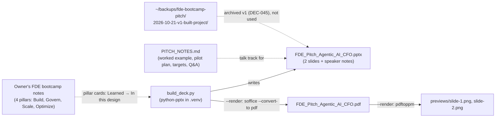
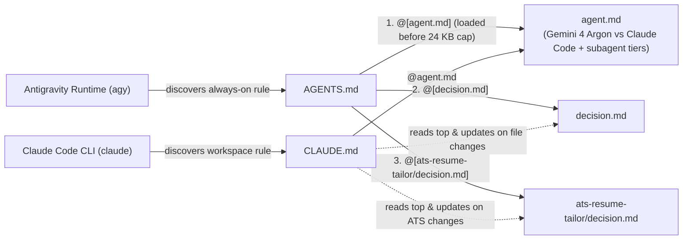

# Codebase Execution Flow & File Connections (`flow.md`)

> **Status:** Active (Maintained automatically by `agy` via [`AGENTS.md`](file:///home/rkushwaha8610/AGENTS.md))  
> **Purpose:** Records the end-to-end execution flow of the codebase—which file calls or runs into which other file, and how modules, APIs, agents, and frontend components are connected.

---

## Project 1: Personal Finance AI (`personal-finance-agent`)

### 1. High-Level File Execution Graph

```mermaid
flowchart TD
    subgraph Frontend ["Frontend SPA (app/frontend/src): React + TypeScript shell with the legacy screens inside (Phase 1)"]
        IndexHTML["index.html"] --> MainTSX["main.tsx → App.tsx"]
        MainTSX --> AuthGate["auth/AuthProvider.tsx · AuthGate<br/>(signed out → auth/SignInScreen.tsx)"]
        AuthGate -- "Google popup / demo email + password" --> FirebaseAuth[("Firebase Auth<br/>(config/firebase.ts)")]
        AuthGate --> Session["session/SessionProvider.tsx<br/>(config/backends.ts: sign-in method → backend, then GET /me)"]
        Session --> Shell["shell/AppShell.tsx<br/>(Sidebar · TopBar + Jarvis toggle · MasterCopilotDock · DemoBanner · FeatureUnavailable)"]
        Shell --> Jarvis["shell/MasterCopilotDock.tsx<br/>(Omnipresent Jarvis Voice + Text Copilot across all screens, DEC-058)"]
        Shell --> LegacyHost["legacy/LegacyScreens.tsx + legacy/bridge.ts<br/>(mount once, URL ↔ month / search sync)"]
        LegacyHost -- "dynamic import after /me" --> Components["legacy/index.js → components/*.js<br/>(ledger, analytics, budgets, recurring, upload, insights, bankSync, modal, toast)"]
        Session & Shell & Jarvis & Components --> APIClient["api/index.ts → api/client.ts<br/>(Bearer token · 401 retry then sign-out · 403 / 429 detail)"]
        Components -- "safe rendering" --> Utils["utils/markdown.js (marked + DOMPurify allowlist)<br/>utils/dom.js (escapeHtml)"]
        E2E["tests/e2e/*.spec.ts (Playwright)"] -- "real demo sign-in, mocked or local :8081 backend" --> MainTSX
    end

    subgraph BackendGateway ["Backend on Cloud Run (app/): one image, two services (DEC-025)"]
        APIClient -- "HTTPS + Firebase ID token<br/>(Google sign-in → finance-backend, Tokyo;<br/>demo login → finance-backend-demo, Seoul)" --> AuthMW["app/auth.py :: FirebaseAuthMiddleware<br/>(every route except /health; per-environment allowlist)"]
        Scheduler[("Cloud Scheduler<br/>hourly Gmail tick · nightly demo reset")] -- "OIDC token → /internal/*" --> AuthMW
        AuthMW --> UvicornAPI["app/api.py (FastAPI)<br/>/me · budgets in DB · demo AI limits + Gmail gate"]
        UvicornAPI -- "APP_ENV, allowlist, limits" --> ConfigPy["app/config.py"]
        DevScript["start_services.sh (local dev only)"] --> UvicornAPI
        DeployScript["scripts/deploy_backend.sh"] -- "Cloud Build image → Cloud Run (all, demo or personal; traffic to the new revision) + Scheduler jobs" --> UvicornAPI
    end

    subgraph CoreOrchestration ["Core Orchestration & Agents (app/)"]
        UvicornAPI -- "POST /upload" --> MainOrchestrator["app/main.py :: process_file()"]
        MainOrchestrator -- ".pdf" --> StmtAgent["app/statement_agent.py :: StatementExtractor<br/>(pypdf: 2 pages per Gemini call, 6 calls at once;<br/>cut-off reply → halves → single pages, DEC-060)"]
        MainOrchestrator -- ".jpg / .png" --> ReceiptAgent["app/extractor.py :: ReceiptExtractor"]
        MainOrchestrator -- ".xlsx / .xls" --> ExcelAgent["app/ai_importer.py :: AISpreadsheetImporter"]

        UvicornAPI -- "/insights & /insights/chat" --> Advisor["app/advisor.py :: FinancialAdvisor"]
        UvicornAPI -- "/transactions/{id}/clarification & /resolve" --> Voice["app/voice_agent.py :: VoiceAgent"]
        StmtAgent & ReceiptAgent & ExcelAgent & Advisor & Voice -- "model per tier: MODEL_NAME / MODEL_LITE / MODEL_PRO, LOCATION=global (DEC-042)" --> ConfigPy
        StmtAgent & ReceiptAgent & ExcelAgent & Advisor & Voice -- "reply_text(): answer parts joined, thought parts skipped" --> GeminiPy["app/gemini.py"]
        StmtAgent & ReceiptAgent & ExcelAgent & Advisor & Voice --> VertexAI[("Vertex AI, global endpoint<br/>standard + pro: gemini-3.5-flash · lite + voice: gemini-3.5-flash-lite")]
        ModelConfigTests["tests/test_model_config.py (fake Vertex AI, real SDK replies)"] --> GeminiPy & ConfigPy
        UvicornAPI -- "/api/gmail/* + /internal/gmail-sync (personal)" --> GmailSync["app/gmail_sync.py :: GmailBankSyncService"]
        MainOrchestrator -- "locked PDF upload: saved statement passwords (DEC-061)" --> GmailSync
        UvicornAPI -- "/internal/demo-reset (demo)" --> DemoSeed["app/demo_seed.py :: reset_demo_data()"]
    end

    subgraph EnterpriseOrgans ["FDE 4 Pillars: 4-Agent Orchestrator, Official MCP, Security, OTel & Eval (app/, DEC-049)"]
        UvicornAPI -- "POST /agents/workflow · /a2a/* · /agents/learned-rules" --> CFOOrch["app/mcp/a2a_orchestrator.py :: AgenticCFOOrchestrator & A2AOrchestrator<br/>(ingestion-agent · reconciliation-agent · clarification-agent · advisor-agent)"]
        UvicornAPI -- "POST /mcp/jsonrpc · /mcp/tools · /mcp/execute" --> MCPServer["app/mcp/ledger_server.py :: LedgerMCPServer<br/>(Official mcp SDK + mcp_types, 11 tools across 4 domains)"]
        CFOOrch --> MCPServer
        Advisor --> MCPClientMod["app/mcp/client.py :: MCPClient"] --> MCPServer
        Advisor --> PrefixCache["app/context_cache.py :: PrefixContextCacheManager<br/>(local prefix registry + explicit Vertex AI cache, DEC-063)"]
        PrefixCache -- "ENABLE_VERTEX_CONTEXT_CACHE=1: CachedContent.create per model<br/>advisor generates via from_cached_content (no system instruction)" --> VertexAI
        UvicornAPI & MainOrchestrator & CFOOrch --> Armor["app/security/model_armor.py :: ModelArmor<br/>(regex screen first · decision_layer per call)"]
        Armor & MainOrchestrator & CFOOrch --> DLP["app/security/dlp.py :: FinancialDLPPipeline<br/>(regex tokens first · reference numbers kept in rows)"]
        Armor -- "MODEL_ARMOR_TEMPLATE set: prompts, batched document rows, advisor replies" --> ArmorAPI["app/security/model_armor_api.py<br/>(google-cloud-modelarmor, regional endpoint, regex fallback)"]
        ArmorAPI -- "sanitizeUserPrompt / sanitizeModelResponse" --> ModelArmorSvc[("Google Cloud Model Armor<br/>modelarmor.{region}.rep.googleapis.com")]
        DLP -- "SDP_ENABLED=1: findings become [TYPE_n] tokens" --> SdpAPI["app/security/sdp_api.py<br/>(google-cloud-dlp inspect_content, regex fallback)"]
        SdpAPI -- "content.inspect (India infoTypes + UPI / account regex types)" --> SDPSvc[("Sensitive Data Protection<br/>(Cloud DLP API)")]
        MCPServer & CFOOrch --> AgentAuth["app/security/auth.py :: AgentIdentityManager<br/>(SPIFFE IDs · HMAC workload tokens, per-process key unless AGENT_WIF_SIGNING_KEY · least-privilege allowlists · HITL gates)"]
        UvicornAPI -- "GET /eval/benchmark" --> EvalSuite["app/eval/autorater.py :: run_full_evaluation_suite()"]
        EvalSuite --> GoldenJSON["app/eval/golden_dataset.json"]
        MainOrchestrator & CFOOrch & MCPServer & Advisor & EvalSuite --> Tracer["app/telemetry/tracer.py :: AgentTracer<br/>(OpenTelemetry SDK + find_weakest_step · one root span per request, DEC-063)"]
        ArmorAPI & SdpAPI -- "otel_span()" --> Tracer
        StmtAgent & ReceiptAgent & ExcelAgent & Voice -- "model_call_span() per Gemini call" --> Tracer
        Advisor & Tracer -- "usage_metadata of every reply (incl. cached_content_token_count)" --> Usage["app/telemetry/usage.py<br/>(token totals → PrefixContextCacheManager.get_stats)"]
        Tracer -- "ENABLE_CLOUD_TRACE=1: BatchSpanProcessor + CloudTraceSpanExporter" --> CloudTrace[("Google Cloud Trace")]
        GovernanceTests["tests/test_model_armor_api.py · test_sdp.py · test_tracing.py ·<br/>test_context_cache.py · test_guardrails_unchanged.py (clients mocked)"] --> Armor & DLP & Tracer & PrefixCache
    end

    subgraph Persistence ["Data & Schema Layer (app/)"]
        MainOrchestrator & UvicornAPI & ExcelAgent & Advisor & GmailSync & DemoSeed & MCPServer & CFOOrch --> DBManager["app/database.py :: DatabaseManager<br/>(full schema bootstrap + learned_rules + agent_audit_log + security hardening)"]
        StmtAgent & ReceiptAgent & ExcelAgent --> Models["app/models.py & app/config.py"]
        StmtAgent & ReceiptAgent & ExcelAgent -- "prompt_context() date rules · fix_years() after extraction (DEC-035)" --> DateGuard["app/date_guard.py<br/>(today + period in the file name; puts a wrong year back in the period)"]
        DateGuardTests["tests/test_date_guard.py (fake Gemini)"] --> DateGuard
        DBManager -- "personal" --> SupaP[("Supabase personal (Tokyo)")]
        DBManager -- "demo" --> SupaD[("Supabase demo (Seoul)")]
        GmailSync -- "statement PDFs" --> StatementStore["app/statement_store.py"]
        StatementStore --> GCS[("Cloud Storage: private statements bucket")]
        DedupeScript["scripts/dedupe_transactions.py (DEC-032)<br/>dry run → plan CSV + report · --apply · --undo"] -- "plan_duplicates(), plan CSV" --> DedupePy["app/dedupe.py<br/>(duplicate rules, no database access)"]
        DedupePy -- "extract_reference_numbers, description_similarity, is_generic_category, is_alert_description (shared with the importer, DEC-034)" --> DBManager
        DedupeScript -- "SECURITY_HARDENING_SQL only (own engine, no schema bootstrap)" --> DBManager
        DedupeScript -- "APP_ENV / DATABASE_URL, get_db_password()" --> Models
        DedupeScript -- "removed rows → transactions_removed (undo)" --> SupaP
        DedupeTests["tests/test_dedupe.py"] --> DedupePy
        ReconcileTests["tests/test_reconcile.py · tests/test_reconcile_db.py (Postgres via TEST_DATABASE_URL)"] -- "reconcile_rule, merged_labels, save_transactions_batch" --> DBManager
        MainOrchestrator -- ".pdf: compute_file_hash → find_ingested_file / FileAlreadyImported (DEC-034)" --> DBManager
        DBManager -- "reconciled monthly balances seed (DEC-054)" --> OwnerProfile["app/owner_profile.py<br/>(git-ignored app/private/owner_profile.json, DEC-062;<br/>no file → generic rules only, nothing seeded)"]
        CFOOrch -- "own accounts · own name · peer payees (resolver tiers 1, 2, 7)" --> OwnerProfile
        OwnerProfileTests["tests/test_owner_profile.py"] --> OwnerProfile
    end

    subgraph Secrets ["Secrets (Phase 0, DEC-023; per-service access DEC-025)"]
        DBManager -- "config.get_db_password() (Cloud Run injects DB_PASS)" --> SecretStore["app/secret_store.py"]
        GmailSync -- "App Password & statement passwords" --> SecretStore
        SecretStore -- "REST via google-auth" --> SecretManager[("Google Secret Manager")]
        SetSecretSh["scripts/set_secret.sh"] -- "gcloud, hidden prompt" --> SecretManager
        MigrationPy["scripts/phase0_db_migration.py"] -- "SECURITY_HARDENING_SQL" --> DBManager
        InfraSh["scripts/phase1_infra.sh"] -- "service accounts, per-secret IAM, bucket" --> SecretManager
    end

    subgraph RepoAutomation ["Repository automation on GitHub (DEC-062)"]
        CI[".github/workflows/ci.yml (GitHub Actions)"] -- "pip install -r requirements-dev.txt → pytest tests (no credentials)" --> UnitTests["tests/*.py<br/>(Postgres suite needs TEST_DATABASE_URL · live suite needs PFA_LIVE_TESTS=1)"]
        CI -- "npm ci → typecheck · lint · build" --> FrontendChecks["app/frontend (tsc -b · ESLint · Vite build)"]
        Dependabot[".github/dependabot.yml"] -- "monthly pip / npm / Actions PRs, checked by CI" --> CI
    end
```

### 2. Detailed File-to-File Connections (`personal-finance-agent`)

| Source File | Calls / Imports Into | Connection & Runtime Flow |
| :--- | :--- | :--- |
| [`start_services.sh`](file:///home/rkushwaha8610/personal-finance-agent/start_services.sh) | [`app/api.py`](file:///home/rkushwaha8610/personal-finance-agent/app/api.py) | [`app/auth.py`](file:///home/rkushwaha8610/personal-finance-agent/app/auth.py) (`FirebaseAuthMiddleware`, `AuthUser`), [`app/main.py`](file:///home/rkushwaha8610/personal-finance-agent/app/main.py) (`process_file`), [`app/database.py`](file:///home/rkushwaha8610/personal-finance-agent/app/database.py) (`DatabaseManager`), [`app/advisor.py`](file:///home/rkushwaha8610/personal-finance-agent/app/advisor.py) (`FinancialAdvisor`), [`app/voice_agent.py`](file:///home/rkushwaha8610/personal-finance-agent/app/voice_agent.py) (`VoiceAgent`), [`app/gmail_sync.py`](file:///home/rkushwaha8610/personal-finance-agent/app/gmail_sync.py) (`GmailBankSyncService`), [`app/statement_store.py`](file:///home/rkushwaha8610/personal-finance-agent/app/statement_store.py), [`app/demo_seed.py`](file:///home/rkushwaha8610/personal-finance-agent/app/demo_seed.py) (`reset_demo_data`, demo only), [`app/security/model_armor.py`](file:///home/rkushwaha8610/personal-finance-agent/app/security/model_armor.py), [`app/mcp/ledger_server.py`](file:///home/rkushwaha8610/personal-finance-agent/app/mcp/ledger_server.py), [`app/eval/autorater.py`](file:///home/rkushwaha8610/personal-finance-agent/app/eval/autorater.py), [`app/config.py`](file:///home/rkushwaha8610/personal-finance-agent/app/config.py) (`APP_ENV`, limits, startup `get_db_password()` check) | Main HTTP entry point, deployed as two Cloud Run services from one image (personal `finance-backend`, demo `finance-backend-demo`). Every route except `/health` passes `FirebaseAuthMiddleware` (registered inside CORS); `GET /me` returns account, environment, features and demo AI usage. Demo: `/api/gmail/*` return 403 and AI routes count against daily limits in `ai_usage` (429 when used up). Budgets are read/written in the `budgets` table. Cloud Scheduler calls `/internal/gmail-sync` (personal, respects the Bank Sync interval) and `/internal/demo-reset` (demo). Statement downloads/unlocks go through `statement_store` (private bucket). Refuses to start without the database password secret. Uploads are type- and size-checked and saved under a random folder with a sanitized name. Validates payloads, screens inputs via `ModelArmor`, serves Year/Month vault rollups (`GET /transactions/months`, review counts = `requires_human_review` only), queries/mutates PostgreSQL via `DatabaseManager` (user edits, resolutions and manual entries set `user_locked`), computes multi-horizon future cost forecasts (`GET /forecast`), and serves AI insights/voice clarification. |
| [`app/frontend/index.html`](file:///home/rkushwaha8610/personal-finance-agent/app/frontend/index.html) → [`src/main.tsx`](file:///home/rkushwaha8610/personal-finance-agent/app/frontend/src/main.tsx) | [`src/App.tsx`](file:///home/rkushwaha8610/personal-finance-agent/app/frontend/src/App.tsx) | `index.html` applies the saved theme before first paint and loads `main.tsx`, which renders `<App />` in StrictMode. `App.tsx`: `ErrorBoundary` → `ThemeProvider` → data router → `AuthProvider` → `AuthGate`; signed out → `SignInScreen` (the URL is kept for after sign-in), signed in → `SessionProvider` (keyed by uid) → `AppShell`. Replaced `main.js` (removed in Phase 1). |
| [`src/auth/AuthProvider.tsx`](file:///home/rkushwaha8610/personal-finance-agent/app/frontend/src/auth/AuthProvider.tsx) & [`src/auth/SignInScreen.tsx`](file:///home/rkushwaha8610/personal-finance-agent/app/frontend/src/auth/SignInScreen.tsx) | [`src/config/firebase.ts`](file:///home/rkushwaha8610/personal-finance-agent/app/frontend/src/config/firebase.ts) (`auth`), `firebase/auth`, [`src/auth/authErrors.ts`](file:///home/rkushwaha8610/personal-finance-agent/app/frontend/src/auth/authErrors.ts) | Firebase sign-in state; "Continue with Google" (`signInWithPopup`, `authDomain` stays on firebaseapp.com) and the demo email/password form; Firebase error codes become short messages; `signOut(message)` shows a notice on the sign-in screen. |
| [`src/session/SessionProvider.tsx`](file:///home/rkushwaha8610/personal-finance-agent/app/frontend/src/session/SessionProvider.tsx) | [`src/config/backends.ts`](file:///home/rkushwaha8610/personal-finance-agent/app/frontend/src/config/backends.ts) (`resolveBackend`), [`src/api/client.ts`](file:///home/rkushwaha8610/personal-finance-agent/app/frontend/src/api/client.ts) (`setApiSession`), [`src/api/me.ts`](file:///home/rkushwaha8610/personal-finance-agent/app/frontend/src/api/me.ts) (`getMe`) | Reads `firebase.sign_in_provider` from the ID token: `google.com` → `finance-backend` (Tokyo), `password` → `finance-backend-demo` (Seoul); `VITE_API_BASE_URL` overrides this on the dev server only. Binds the API client to that backend and the user's token, then calls `GET /me`: success → shell with `me` in context; 403 → "This account doesn't have access"; other errors → retry screen. |
| [`src/api/client.ts`](file:///home/rkushwaha8610/personal-finance-agent/app/frontend/src/api/client.ts) (used through [`src/api/index.ts`](file:///home/rkushwaha8610/personal-finance-agent/app/frontend/src/api/index.ts) and `api/{agents,me,transactions,bank,insights,upload}.ts`) | FastAPI routes in [`app/api.py`](file:///home/rkushwaha8610/personal-finance-agent/app/api.py) behind `FirebaseAuthMiddleware` | The app's only `fetch`: adds `Authorization: Bearer <ID token>`, uses the account's base URL, 401 → one forced token refresh then sign-out, 403 → access re-check (not for `/me` and `/api/gmail/*`), errors carry the backend `detail` (demo 429s show in toasts), `apiFetchBlob` for statement PDFs and clarification audio, `credentials: 'same-origin'` (DEC-028). `api/agents.ts` (DEC-052, DEC-057, DEC-058) calls `/agents/orchestrator/command`, `/a2a/registry`, `/a2a/agents/{id}/tasks/send`, `/agents/master-resolve`, `/agents/master-resolve/apply`, `/agents/learned-rules`, `/agents/audit-trail`, `/agents/workflow`, `/mcp/tools`, `/mcp/execute`, and `/telemetry/traces`. |
| [`src/shell/AppShell.tsx`](file:///home/rkushwaha8610/personal-finance-agent/app/frontend/src/shell/AppShell.tsx), [`src/shell/MasterCopilotDock.tsx`](file:///home/rkushwaha8610/personal-finance-agent/app/frontend/src/shell/MasterCopilotDock.tsx) & [`src/shell/AgentRegistryScreen.tsx`](file:///home/rkushwaha8610/personal-finance-agent/app/frontend/src/shell/AgentRegistryScreen.tsx) | [`shell/Sidebar.tsx`](file:///home/rkushwaha8610/personal-finance-agent/app/frontend/src/shell/Sidebar.tsx), [`shell/TopBar.tsx`](file:///home/rkushwaha8610/personal-finance-agent/app/frontend/src/shell/TopBar.tsx) ([`PeriodPicker.tsx`](file:///home/rkushwaha8610/personal-finance-agent/app/frontend/src/shell/PeriodPicker.tsx), [`SearchBox.tsx`](file:///home/rkushwaha8610/personal-finance-agent/app/frontend/src/shell/SearchBox.tsx), [`UserMenu.tsx`](file:///home/rkushwaha8610/personal-finance-agent/app/frontend/src/shell/UserMenu.tsx)), [`shell/MasterCopilotDock.tsx`](file:///home/rkushwaha8610/personal-finance-agent/app/frontend/src/shell/MasterCopilotDock.tsx) (Omnipresent Jarvis Voice + Text Copilot across all screens, DEC-058), [`shell/DemoBanner.tsx`](file:///home/rkushwaha8610/personal-finance-agent/app/frontend/src/shell/DemoBanner.tsx), [`shell/FeatureUnavailable.tsx`](file:///home/rkushwaha8610/personal-finance-agent/app/frontend/src/shell/FeatureUnavailable.tsx), [`shell/AgentRegistryScreen.tsx`](file:///home/rkushwaha8610/personal-finance-agent/app/frontend/src/shell/AgentRegistryScreen.tsx) (`/agents`, DEC-052 & DEC-057), [`shell/useMonths.ts`](file:///home/rkushwaha8610/personal-finance-agent/app/frontend/src/shell/useMonths.ts) (`GET /transactions/months`), [`shell/urlState.ts`](file:///home/rkushwaha8610/personal-finance-agent/app/frontend/src/shell/urlState.ts), [`shell/screens.ts`](file:///home/rkushwaha8610/personal-finance-agent/app/frontend/src/shell/screens.ts), [`legacy/bridge.ts`](file:///home/rkushwaha8610/personal-finance-agent/app/frontend/src/legacy/bridge.ts), [`legacy/LegacyScreens.tsx`](file:///home/rkushwaha8610/personal-finance-agent/app/frontend/src/legacy/LegacyScreens.tsx) | Signed-in layout. Page state lives in the URL (one path per screen, `?month`, `?q`, `?view`/`year`). Mounts `MasterCopilotDock` globally on every page (with Web Speech API voice input, `speechSynthesis` voice replies, context-aware walkthrough chips, and live `bridge.refreshAll()` sync on ledger mutations). `/agents` renders the native React `AgentRegistryScreen` featuring the interactive **Master Transaction Category Resolver & Ledger Intelligence Console**, clickable skill invocation across all 5 GCP Agent Registry Cards, Closed-Loop `learned_rules` manager, interactive MCP Tool Catalogue (`Run Tool`), SPIFFE Audit Trail, and 4-Agent Pipeline verifier. |
| [`src/legacy/LegacyScreens.tsx`](file:///home/rkushwaha8610/personal-finance-agent/app/frontend/src/legacy/LegacyScreens.tsx) & [`src/legacy/bridge.ts`](file:///home/rkushwaha8610/personal-finance-agent/app/frontend/src/legacy/bridge.ts) | [`src/legacy/index.js`](file:///home/rkushwaha8610/personal-finance-agent/app/frontend/src/legacy/index.js) (dynamic import after `/me`; types in [`index.d.ts`](file:///home/rkushwaha8610/personal-finance-agent/app/frontend/src/legacy/index.d.ts)) → `components/*.js` `init*Component` and the modals | One persistent `.legacy-scope` container per screen, mounted on first visit and never re-initialised. `LegacyBridge` pushes the URL's month, search and stage into the ledger, analytics and budgets, writes in-screen changes back to the URL, refreshes mounted screens after an upload or Gmail sync, and routes ledger cross-links (`onNavigatePage`) to the router. |
| `app/frontend/src/components/*.js` (legacy) | [`src/api/index.ts`](file:///home/rkushwaha8610/personal-finance-agent/app/frontend/src/api/index.ts) (`modal.js`: [`src/api/transactions.ts`](file:///home/rkushwaha8610/personal-finance-agent/app/frontend/src/api/transactions.ts)) | Unchanged screens with small integration hooks; every request goes through `api/client.ts`. `bankSync.js` downloads statement PDFs with `downloadStatementPdf` (authenticated blob) and `modal.js` gets clarification audio with `fetchClarificationAudio`. In light mode their palette classes are remapped inside `.legacy-scope` by [`tailwind.legacy-theme.ts`](file:///home/rkushwaha8610/personal-finance-agent/app/frontend/tailwind.legacy-theme.ts). |
| [`tests/e2e/shell.mocked.spec.ts`](file:///home/rkushwaha8610/personal-finance-agent/app/frontend/tests/e2e/shell.mocked.spec.ts) & [`tests/e2e/shell.integration.spec.ts`](file:///home/rkushwaha8610/personal-finance-agent/app/frontend/tests/e2e/shell.integration.spec.ts) | [`tests/e2e/helpers.ts`](file:///home/rkushwaha8610/personal-finance-agent/app/frontend/tests/e2e/helpers.ts) (demo login read at runtime, axe contrast scan), [`tests/e2e/mock-backend.ts`](file:///home/rkushwaha8610/personal-finance-agent/app/frontend/tests/e2e/mock-backend.ts) (`page.route` on the demo URL), [`playwright.config.ts`](file:///home/rkushwaha8610/personal-finance-agent/app/frontend/playwright.config.ts) (starts Vite on :5173) | `npm run test:e2e`: mocked backend (401/403/429, XSS payloads, demo gates, authenticated downloads). `E2E_BACKEND=http://127.0.0.1:8081`: integration against [`start_services.sh`](file:///home/rkushwaha8610/personal-finance-agent/start_services.sh) `demo`, every page in both themes, writes `test-results/contrast-report.json`. Both use the real Firebase demo sign-in. |
| [`components/insights.js`](file:///home/rkushwaha8610/personal-finance-agent/app/frontend/src/components/insights.js) | [`utils/markdown.js`](file:///home/rkushwaha8610/personal-finance-agent/app/frontend/src/utils/markdown.js) (`renderMarkdown`) | AI CFO replies and reports are rendered only through `renderMarkdown()` (no direct `marked` import). |
| [`utils/markdown.js`](file:///home/rkushwaha8610/personal-finance-agent/app/frontend/src/utils/markdown.js) | `marked`, `dompurify` (npm) | Parses markdown, then sanitizes with a strict tag/attribute allowlist before any `innerHTML` assignment. |
| [`components/bankSync.js`](file:///home/rkushwaha8610/personal-finance-agent/app/frontend/src/components/bankSync.js) & `ledger.js`, `budgets.js`, `analytics.js` | [`utils/dom.js`](file:///home/rkushwaha8610/personal-finance-agent/app/frontend/src/utils/dom.js) (`escapeHtml`), [`components/toast.js`](file:///home/rkushwaha8610/personal-finance-agent/app/frontend/src/components/toast.js) (`toast.show`, text-only messages) | Server, email and file-name strings are escaped before entering HTML templates; toasts never parse HTML. |
| [`components/upload.js`](file:///home/rkushwaha8610/personal-finance-agent/app/frontend/src/components/upload.js) | [`api/index.ts`](file:///home/rkushwaha8610/personal-finance-agent/app/frontend/src/api/index.ts) (`uploadDocument`, `getTransactions`) | Uploads PDF/Excel/receipt images; on a timeout it compares the ledger size before and after, so it never reports a false success. `uploadDocument` waits up to `IMPORT_TIMEOUT_MS` (10 min, [`api/config.ts`](file:///home/rkushwaha8610/personal-finance-agent/app/frontend/src/api/config.ts)) because long statements are read a few pages per AI call (DEC-060). DEC-061: a "PDF password" box appears for PDFs; `uploadDocument(file, password)` sends it as the optional `password` form field of `POST /upload` (used in memory only), and a 4xx answer (e.g. a password-protected PDF) is shown at once with the box focused. |
| [`components/bankSync.js`](file:///home/rkushwaha8610/personal-finance-agent/app/frontend/src/components/bankSync.js) (Unlock & Sync / Retry import) | [`api/bank.ts`](file:///home/rkushwaha8610/personal-finance-agent/app/frontend/src/api/bank.ts) (`unlockExportedStatementPdf`, `IMPORT_TIMEOUT_MS`) → `POST /api/gmail/statements/{id}/unlock` in [`app/api.py`](file:///home/rkushwaha8610/personal-finance-agent/app/api.py) → [`app/gmail_sync.py`](file:///home/rkushwaha8610/personal-finance-agent/app/gmail_sync.py) (`unlock_and_sync_statement`) → [`app/main.py`](file:///home/rkushwaha8610/personal-finance-agent/app/main.py) (`process_file`) | DEC-060. A statement card shows "Imported (N txns)" only when `sync_status` is `IMPORTED_AND_RECONCILED`; an unlocked statement whose import failed or never ran (`IMPORT_FAILED`, `EXPORTED_ONLY`) shows "Not imported" with a **Retry import** button (empty password: the stored copy is already unlocked). Success toasts carry the backend's counts ("read N, X added, Y already in the ledger") and any "⚠️" page notes; after a client timeout the card polls the statement list for up to 2 minutes and stops on `IMPORT_FAILED`. |
| [`app/api.py`](file:///home/rkushwaha8610/personal-finance-agent/app/api.py) | [`app/auth.py`](file:///home/rkushwaha8610/personal-finance-agent/app/auth.py) | [`app/config.py`](file:///home/rkushwaha8610/personal-finance-agent/app/config.py) | [`app/secret_store.py`](file:///home/rkushwaha8610/personal-finance-agent/app/secret_store.py) (lazy import in `get_db_password()`) | Non-secret settings only. `APP_ENV` (personal | demo) selects the database defaults (project ref, pooler host: Tokyo vs Seoul, password secret `pfa-db-password-personal` / `-demo`) and refuses a demo pointed at the personal database; also the sign-in allowlist, scheduler caller, demo `AI_DAILY_LIMITS`, `STATEMENT_BUCKET`, API-docs and legacy-worker switches. `get_db_password()` resolves `DB_PASS` env or the environment's secret. |
| [`app/statement_store.py`](file:///home/rkushwaha8610/personal-finance-agent/app/statement_store.py) | [`app/config.py`](file:///home/rkushwaha8610/personal-finance-agent/app/config.py) (`STATEMENT_BUCKET`), `google-cloud-storage` | Stores Gmail-exported statement PDFs in the private bucket on Cloud Run (local `data/monthly_statements` in development); `save`, `exists`, `read_bytes`, `replace`, `local_copy`; resolves locations only inside the configured bucket. Used by `gmail_sync.py` and the download route in `api.py`. |
| [`app/demo_seed.py`](file:///home/rkushwaha8610/personal-finance-agent/app/demo_seed.py) | [`app/config.py`](file:///home/rkushwaha8610/personal-finance-agent/app/config.py) (`APP_ENV`, project refs, `DATABASE_URL`), [`app/database.py`](file:///home/rkushwaha8610/personal-finance-agent/app/database.py) (`compute_row_signature`) | Demo only (DEC-026). `generate_demo_transactions(today)` builds ~18 months of deterministic sample rows; `reset_demo_data(engine)` wipes and reloads the demo tables in one transaction after three guards (APP_ENV=demo, not the personal project, `app_meta` demo marker in the database); `mark_database_as_demo` writes the marker only into an empty database. Called by `api.py` `/internal/demo-reset` (Cloud Scheduler, nightly) and `scripts/demo_reset.py`. |
| [`scripts/demo_reset.py`](file:///home/rkushwaha8610/personal-finance-agent/scripts/demo_reset.py) | [`app/demo_seed.py`](file:///home/rkushwaha8610/personal-finance-agent/app/demo_seed.py), [`app/database.py`](file:///home/rkushwaha8610/personal-finance-agent/app/database.py) (`DatabaseManager` creates the schema) | Manual reset CLI: `APP_ENV=demo ... [--mark-demo] [--today] [--dry-run]`; checks the configuration before connecting and asks for the project ref before marking. |
| [`scripts/deploy_backend.sh`](file:///home/rkushwaha8610/personal-finance-agent/scripts/deploy_backend.sh) | Cloud Build, Artifact Registry `asia-northeast1/pfa`, Cloud Run, Cloud Scheduler | `build` or `<tag>`, then an optional target `all` (default) / `demo` / `personal` (DEC-042: demo first, then the same tag on personal): builds one image, deploys `finance-backend` (Tokyo, `pfa-backend-personal`) and/or `finance-backend-demo` (Seoul, `pfa-backend-demo`) with `DB_PASS` injected from Secret Manager, sends traffic to the new revision (`update-traffic --to-latest`, so a deploy after a rollback serves), upserts the hourly Gmail and nightly demo-reset jobs (OIDC as `pfa-scheduler`), then smoke-tests each deployed service: serving revision, `/health` (200), `/me` and `/transactions` (401). |
| [`scripts/phase1_infra.sh`](file:///home/rkushwaha8610/personal-finance-agent/scripts/phase1_infra.sh) | `gcloud` (IAM, Secret Manager, Artifact Registry, Cloud Storage) | Idempotent setup: image registry, the three service accounts, per-secret IAM (each backend reads only its own secrets), statement-passwords secret shell, private statements bucket. |
| [`scripts/phase1_move_statements_to_gcs.py`](file:///home/rkushwaha8610/personal-finance-agent/scripts/phase1_move_statements_to_gcs.py) | [`app/statement_store.py`](file:///home/rkushwaha8610/personal-finance-agent/app/statement_store.py), [`app/database.py`](file:///home/rkushwaha8610/personal-finance-agent/app/database.py) | One-time, idempotent (dry run by default): copied the 8 exported statement PDFs to the bucket and repointed `exported_statement_pdfs.file_path` / `assets.gcs_uri`. |
| [`scripts/dedupe_transactions.py`](file:///home/rkushwaha8610/personal-finance-agent/scripts/dedupe_transactions.py) | [`app/dedupe.py`](file:///home/rkushwaha8610/personal-finance-agent/app/dedupe.py) (`plan_duplicates`, `write_plan_csv`, `read_approved_removals`, `same_text`, `import_label`), [`app/database.py`](file:///home/rkushwaha8610/personal-finance-agent/app/database.py) (`SECURITY_HARDENING_SQL`), [`app/config.py`](file:///home/rkushwaha8610/personal-finance-agent/app/config.py) (`APP_ENV`, `DATABASE_URL`, pooler settings, `get_db_password()`) | DEC-032. **Dry run** (default; read-only transaction): loads every transaction with its first asset and writes `dedupe-<UTC>.csv` (editable plan) and `.md` (report) to `~/backups/personal-finance-agent/dedupe/` (folder 700, files 600). **`--apply PLAN.csv`**, in one transaction: creates `transactions_removed` if missing and re-runs `SECURITY_HARDENING_SQL`; refuses a plan already applied; locks and re-checks every listed row (date, amount, description); copies each removed row in full (JSON) with the kept row's old label; re-points its `assets` to the kept row; relabels the kept row if the plan says so; deletes the row. **`--undo PLAN_ID`** restores the rows, their assets and the kept rows' labels. Asks for the project ref unless `--yes`. Uses its own engine, so the only table it can create is `transactions_removed`. |
| [`app/dedupe.py`](file:///home/rkushwaha8610/personal-finance-agent/app/dedupe.py) | [`app/database.py`](file:///home/rkushwaha8610/personal-finance-agent/app/database.py) (`extract_reference_numbers`, `description_similarity`, `is_generic_category`, `is_alert_description`: the same definitions the importer uses, DEC-034) | Pure rules, no database access. An import = file + the batch's exact `created_at`; imports that cover the same dates (≥ 3 date + amount matches and ≥ 50 % of the smaller side); a remove / review / keep decision per pair with the same date and amount; one-to-one clustering; keeper ranking and category/type carry-over; plan CSV writing and validated reading. |
| [`tests/test_dedupe.py`](file:///home/rkushwaha8610/personal-finance-agent/tests/test_dedupe.py) | [`app/dedupe.py`](file:///home/rkushwaha8610/personal-finance-agent/app/dedupe.py) | 21 unit tests on fixtures modelled on the personal data: overlapping statements, one file imported twice, both legs of a transfer, alerts, hand-entered rows, edited rows, plan CSV round trip and validation. |
| [`tests/test_reconcile.py`](file:///home/rkushwaha8610/personal-finance-agent/tests/test_reconcile.py) | [`app/database.py`](file:///home/rkushwaha8610/personal-finance-agent/app/database.py) (`reconcile_rule`, `merged_labels`, `extract_reference_numbers`, `description_similarity`), [`app/main.py`](file:///home/rkushwaha8610/personal-finance-agent/app/main.py) (`_duplicate_notes`, `_already_imported_message`) | DEC-034, 13 unit tests: which incoming row is already in the ledger (shared reference regardless of labels, phone numbers ignored, same-day rules, bank-name-only narrations) and that merged labels never downgrade; upload message wording. |
| [`tests/test_reconcile_db.py`](file:///home/rkushwaha8610/personal-finance-agent/tests/test_reconcile_db.py) | [`app/database.py`](file:///home/rkushwaha8610/personal-finance-agent/app/database.py) (`DatabaseManager.save_transactions_batch`, `save_transaction`, `find_ingested_file`, `FileAlreadyImported`), [`app/config.py`](file:///home/rkushwaha8610/personal-finance-agent/app/config.py) (`DATABASE_URL`), [`app/models.py`](file:///home/rkushwaha8610/personal-finance-agent/app/models.py) | DEC-034, 14 tests against a real Postgres; skipped unless `TEST_DATABASE_URL` points at a local throwaway database (refuses other hosts). Re-import with other labels, alert + other bank's statement → one transfer, phone numbers, overlapping statements, edited rows, receipt + statement line, same file twice, two concurrent imports of one file, and (DEC-060) a recognised row without a file is not credited to the file being imported. |
| [`tests/test_auth.py`](file:///home/rkushwaha8610/personal-finance-agent/tests/test_auth.py) & [`tests/conftest.py`](file:///home/rkushwaha8610/personal-finance-agent/tests/conftest.py) | [`app/api.py`](file:///home/rkushwaha8610/personal-finance-agent/app/api.py), [`app/auth.py`](file:///home/rkushwaha8610/personal-finance-agent/app/auth.py), [`app/config.py`](file:///home/rkushwaha8610/personal-finance-agent/app/config.py) | Real RS256 tokens against injected test certificates: every rejection path, a walk asserting each route returns 401 without sign-in, CORS on 401s, scheduler OIDC checks, demo gates. `conftest.py` puts `app/` on the import path (plain imports, like production). |
| [`app/main.py`](file:///home/rkushwaha8610/personal-finance-agent/app/main.py) (`process_file`), [`app/database.py`](file:///home/rkushwaha8610/personal-finance-agent/app/database.py) (`DatabaseManager`), [`app/advisor.py`](file:///home/rkushwaha8610/personal-finance-agent/app/advisor.py) (`FinancialAdvisor`), [`app/voice_agent.py`](file:///home/rkushwaha8610/personal-finance-agent/app/voice_agent.py) (`VoiceAgent`), [`app/gmail_sync.py`](file:///home/rkushwaha8610/personal-finance-agent/app/gmail_sync.py) (`GmailBankSyncService`), [`app/security/model_armor.py`](file:///home/rkushwaha8610/personal-finance-agent/app/security/model_armor.py), [`app/mcp/ledger_server.py`](file:///home/rkushwaha8610/personal-finance-agent/app/mcp/ledger_server.py), [`app/eval/autorater.py`](file:///home/rkushwaha8610/personal-finance-agent/app/eval/autorater.py), [`app/config.py`](file:///home/rkushwaha8610/personal-finance-agent/app/config.py) (startup `get_db_password()` check) | Main HTTP entry point. Refuses to start without the database password secret. CORS allows only the Firebase Hosting site and localhost. Uploads are type- and size-checked and saved under a random folder with a sanitized name. Validates payloads, screens inputs via `ModelArmor`, serves Year/Month vault rollups (`GET /transactions/months`, review counts = `requires_human_review` only), queries/mutates PostgreSQL via `DatabaseManager` (user edits, resolutions and manual entries set `user_locked`), computes multi-horizon future cost forecasts (`GET /forecast`), and serves AI insights/voice clarification. |
| [`app/main.py`](file:///home/rkushwaha8610/personal-finance-agent/app/main.py) | [`app/statement_agent.py`](file:///home/rkushwaha8610/personal-finance-agent/app/statement_agent.py), [`app/extractor.py`](file:///home/rkushwaha8610/personal-finance-agent/app/extractor.py), [`app/ai_importer.py`](file:///home/rkushwaha8610/personal-finance-agent/app/ai_importer.py) (also `compute_file_hash`), [`app/database.py`](file:///home/rkushwaha8610/personal-finance-agent/app/database.py) (`DatabaseManager`, `FileAlreadyImported`) | Inspects uploaded file extension (`.pdf`, `.jpg`/`.png`, `.xlsx`/`.xls`), invokes the matching extractor agent, flags low-confidence rows (`< 85` on the 0-100 scale normalized by `models.py`), and persists via `DatabaseManager`. PDFs (uploads and Gmail-exported statements, DEC-034): a file whose SHA-256 is already in `ingested_files` is skipped before any AI call; otherwise the hash is passed to `save_transactions_batch`, which claims it inside the save, and a concurrent second import returns "already imported". Every route adds `_duplicate_notes` from `last_batch_summary` to the upload messages ("N of M transactions were already in your ledger (from …)"). DEC-060: the PDF route also adds "⚠️" notes for pages where fewer rows were read than the page text shows (`StatementExtractor.coverage_notes`), and returns `summary` (`_batch_counts`: rows, added, already, conflicts, repeated_in_file) for the Bank Sync message. DEC-061: `process_file(path, pdf_password="")`; after the hash check (hash of the file as uploaded), `_unlock_for_reading` unlocks a password-protected PDF in place with the upload's password or the saved statement passwords (`_saved_statement_passwords` → lazy import of [`app/gmail_sync.py`](file:///home/rkushwaha8610/personal-finance-agent/app/gmail_sync.py) `_load_statement_passwords`, personal only) via `statement_agent.decrypt_pdf`, or raises `PasswordRequiredError` ([`app/exceptions.py`](file:///home/rkushwaha8610/personal-finance-agent/app/exceptions.py)), which `api.py` `/upload` answers with 400. DEC-063: `process_file` wraps the import in one root span (`ingestion.process_file`) and calls `_process_file`; the PDF route screens all narrations up front with `ModelArmor.inspect_prompts` and `FinancialDLPPipeline.redact_texts` (one batched Model Armor / SDP pass when those APIs are on, the same per-row regex results otherwise) and adds per-layer row counts to the `screen_rows` span. |
| [`app/statement_agent.py`](file:///home/rkushwaha8610/personal-finance-agent/app/statement_agent.py) & [`app/extractor.py`](file:///home/rkushwaha8610/personal-finance-agent/app/extractor.py) | [`app/models.py`](file:///home/rkushwaha8610/personal-finance-agent/app/models.py), [`app/config.py`](file:///home/rkushwaha8610/personal-finance-agent/app/config.py) (`PROJECT_ID`, `LOCATION`, `MODEL_NAME`), [`app/gemini.py`](file:///home/rkushwaha8610/personal-finance-agent/app/gemini.py) (`reply_text`), [`app/exceptions.py`](file:///home/rkushwaha8610/personal-finance-agent/app/exceptions.py), [`app/date_guard.py`](file:///home/rkushwaha8610/personal-finance-agent/app/date_guard.py) (`prompt_context`, `fix_years`), [`app/database.py`](file:///home/rkushwaha8610/personal-finance-agent/app/database.py) (`DatabaseManager.format_learned_rules_prompt`) | Calls Vertex AI Gemini (`config.MODEL_NAME`: gemini-3.5-flash on the global endpoint since DEC-042, Gemini 2.5 Flash before) to parse PDF bank statements and receipt images into structured Pydantic models (`StatementData`, `ReceiptData`; `ReceiptData` normalizes confidence to 0-100). JSON replies are read with `reply_text`. DEC-035: the prompt ends with the date rules from `prompt_context`, and the returned dates go through `fix_years` before they are handed back; notes stay in `self.date_notes`. DEC-051: injects `DatabaseManager.format_learned_rules_prompt()` into the Gemini prompt so user-clarified payee rules guide extraction. DEC-060 (statements): a local PDF is split with `pypdf` and read `PAGES_PER_CALL` (2) pages per call, up to `PARALLEL_CALLS` (6) at once (`ThreadPoolExecutor`), with `max_output_tokens=65535`; a reply cut off at the limit (finish reason `MAX_TOKENS`) or not valid JSON is re-read in halves down to single pages, a call that returns clearly fewer rows than its pages' text shows (`count_row_lines`) is re-read page by page, busy/unavailable Vertex AI errors are retried, and a page that still fails raises `ExtractionError` so nothing is imported half-way. Files that can't be split (and `gs://` URIs) are read in one call as before. DEC-061: `pdf_needs_password` / `decrypt_pdf` (pypdf) detect and unlock PDFs that need a password to open (Gemini answers them with 400 INVALID_ARGUMENT); a locked file that reaches the reader raises `PasswordRequiredError` before any AI call, and a PDF encrypted with an empty password (owner restrictions only) is split like any other. DEC-063: each Gemini call (statement pages, receipt) is a `model_call_span` with its token usage; the parallel page calls run in a copy of the caller's context (`contextvars.copy_context().run`), so they join the upload's trace. |
| [`app/ai_importer.py`](file:///home/rkushwaha8610/personal-finance-agent/app/ai_importer.py) | [`app/database.py`](file:///home/rkushwaha8610/personal-finance-agent/app/database.py) (`DatabaseManager`, `format_learned_rules_prompt`), [`app/config.py`](file:///home/rkushwaha8610/personal-finance-agent/app/config.py) (`MODEL_NAME`), [`app/gemini.py`](file:///home/rkushwaha8610/personal-finance-agent/app/gemini.py) (`reply_text`), [`app/date_guard.py`](file:///home/rkushwaha8610/personal-finance-agent/app/date_guard.py) (`prompt_context`, `fix_years`) | Reads Excel sheets with `pandas`, maps columns using Gemini (`MODEL_NAME`, JSON reply, default temperature since DEC-042, plus `format_learned_rules_prompt()` since DEC-051), and batch-inserts rows into PostgreSQL via `DatabaseManager`. DEC-035: date rules in the prompt, `fix_years` before saving, notes returned as `result["notes"]`. |
| [`app/advisor.py`](file:///home/rkushwaha8610/personal-finance-agent/app/advisor.py) & [`app/voice_agent.py`](file:///home/rkushwaha8610/personal-finance-agent/app/voice_agent.py) | [`app/config.py`](file:///home/rkushwaha8610/personal-finance-agent/app/config.py) (`MODEL_NAME`, `MODEL_LITE`, `MODEL_PRO`, `LOCATION`), [`app/gemini.py`](file:///home/rkushwaha8610/personal-finance-agent/app/gemini.py) (`reply_text`), Vertex AI (`GenerativeModel`, `start_chat`) | DEC-042. `FinancialAdvisor._select_model_tier` returns a `ModelTier` (Lite / Standard / Pro; values are tier names, `.model` reads config): look-ups → `MODEL_LITE`, general chat and insights → `MODEL_NAME`, planning questions → `MODEL_PRO`. Chat sends `top_p` only (no temperature, no thinking budget). `VoiceAgent` uses `MODEL_LITE` for category resolution and the transcription fallback, and `extract_payee_pattern()` strips volatile UTR/reference digits to build reusable `learned_rules` keys. DEC-063: `chat` / `generate_insights` run inside a root span (`advisor.chat`, `advisor.generate_insights`); the Model Armor and DLP spans record `decision_layer`; with `MODEL_ARMOR_TEMPLATE` set, step 6b screens the reply (`model_armor_screen_response`) and replaces a flagged one with `WITHHELD_REPLY_MESSAGE`; with an explicit cache the model comes from `GenerativeModel.from_cached_content` and the per-turn context goes into the user message (the uncached prompts are byte-identical to before); every reply's `usage_metadata` goes to `telemetry/usage.py` and the model span. |
| [`app/gemini.py`](file:///home/rkushwaha8610/personal-finance-agent/app/gemini.py) | Vertex AI SDK reply objects (`candidates[0].content.parts`, `Part.to_dict()`) | DEC-042. `reply_text(response)` joins the non-thought text parts of the first candidate (the SDK's `response.text` raises when a Gemini 3 reply has more than one part); errors never echo the reply; objects without `candidates` (test fakes) return `.text`. |
| [`tests/test_model_config.py`](file:///home/rkushwaha8610/personal-finance-agent/tests/test_model_config.py) | [`app/config.py`](file:///home/rkushwaha8610/personal-finance-agent/app/config.py), [`app/gemini.py`](file:///home/rkushwaha8610/personal-finance-agent/app/gemini.py), [`app/advisor.py`](file:///home/rkushwaha8610/personal-finance-agent/app/advisor.py), [`app/statement_agent.py`](file:///home/rkushwaha8610/personal-finance-agent/app/statement_agent.py), [`app/extractor.py`](file:///home/rkushwaha8610/personal-finance-agent/app/extractor.py), [`app/ai_importer.py`](file:///home/rkushwaha8610/personal-finance-agent/app/ai_importer.py), [`app/voice_agent.py`](file:///home/rkushwaha8610/personal-finance-agent/app/voice_agent.py) | DEC-042, 38 tests, no credentials: retired-name detection and fallback (also in a fresh interpreter), tier defaults, `reply_text` on real SDK `GenerationResponse` objects (multi-part, thought parts, signature-only parts, blocked replies), and what each agent sends (tier model, no temperature or thinking budget) with Vertex AI faked. |
| [`app/date_guard.py`](file:///home/rkushwaha8610/personal-finance-agent/app/date_guard.py) | standard library only (`re`, `datetime`, `zoneinfo`) | DEC-035. `period_from_filename` reads the period a file name states ("March 2026", "2026-09", "1 Jun 26-31 Aug 26", "IMG20260830…"); bare years are ignored. `prompt_context` tells the model today's date (India time), the file name and that period, and never to take a year from its own knowledge. `fix_years` gives a date more than 6 months outside the period the year that puts it back inside (same day and month). With no period in the name, a date after today moves back one year. It returns notes. |
| [`tests/test_date_guard.py`](file:///home/rkushwaha8610/personal-finance-agent/tests/test_date_guard.py) | [`app/date_guard.py`](file:///home/rkushwaha8610/personal-finance-agent/app/date_guard.py), [`app/statement_agent.py`](file:///home/rkushwaha8610/personal-finance-agent/app/statement_agent.py), [`app/extractor.py`](file:///home/rkushwaha8610/personal-finance-agent/app/extractor.py), [`app/ai_importer.py`](file:///home/rkushwaha8610/personal-finance-agent/app/ai_importer.py) | 33 tests: real file names from the ledger, the March 2026 and August 2025 cases, window edges (January sheet with December rows, 29 February, no period, future dates), prompt text and file-name cleaning. All three readers run end to end with Gemini (and, for Excel, the database) replaced by fakes. |
| [`tests/test_statement_pages.py`](file:///home/rkushwaha8610/personal-finance-agent/tests/test_statement_pages.py) | [`app/statement_agent.py`](file:///home/rkushwaha8610/personal-finance-agent/app/statement_agent.py), [`app/gmail_sync.py`](file:///home/rkushwaha8610/personal-finance-agent/app/gmail_sync.py) (`unlock_and_sync_statement`), [`app/main.py`](file:///home/rkushwaha8610/personal-finance-agent/app/main.py) (`process_file` replaced by fakes) | DEC-060, 35 tests, no credentials: small Kotak-style PDFs built in the test and a fake model that reads the attached pages' text (and can cut off, return broken JSON, come up short or be busy). Checks page order across parallel calls, halving of cut-off replies, the all-or-nothing failure, page-by-page re-reads and remaining-gap notes, retries, the row-line counter on Kotak/HDFC/SBI layouts, and the Bank Sync retry path (`IMPORT_FAILED`, empty password, counts message, `GREATEST` count). |
| [`app/database.py`](file:///home/rkushwaha8610/personal-finance-agent/app/database.py) | [`app/config.py`](file:///home/rkushwaha8610/personal-finance-agent/app/config.py) (settings + `get_db_password()`), [`app/models.py`](file:///home/rkushwaha8610/personal-finance-agent/app/models.py), [`app/owner_profile.py`](file:///home/rkushwaha8610/personal-finance-agent/app/owner_profile.py) (`reconciled_monthly_balances`, DEC-062) | Manages SQLAlchemy connection pool (`pg8000`) to Supabase PostgreSQL with the password from Secret Manager, computes SHA-256 `row_signature` & `file_hash`, and executes CRUD operations. On startup ensures schema (incl. `transactions.user_locked`, `learned_rules`, `agent_audit_log`, `agent_registry`) and runs `SECURITY_HARDENING_SQL` (RLS on, `anon`/`authenticated` revoked). Imports never overwrite `user_locked` rows. DEC-051: `save_learned_rule` persists user-clarified payee patterns and retroactively updates matching unlocked rows in `transactions`; `match_learned_rule` is enforced inside `save_transactions_batch` so every import channel auto-categorizes known payees (`confidence=99.0`, `requires_human_review=False`). DEC-034: `save_transaction` and gmail alerts, statements and Excel all go through `save_transactions_batch` → `find_reconcilable_transaction` → `merged_labels`. DEC-060: in `last_batch_summary["sources"]`, a recognised row is credited to its first file other than the one being imported; rows with no earlier file count as "entered by hand". |
| [`app/config.py`](file:///home/rkushwaha8610/personal-finance-agent/app/config.py) | [`app/secret_store.py`](file:///home/rkushwaha8610/personal-finance-agent/app/secret_store.py) (lazy import in `get_db_password()`) | Non-secret settings only (project, Supabase pooler host/port/ref, ...). Vertex AI (DEC-042): `LOCATION` defaults to `global` (Gemini 3 isn't served on us-central1); `MODEL_NAME` (alias `GEMINI_MODEL`) and `MODEL_PRO` default to `gemini-3.5-flash`, `MODEL_LITE` to `gemini-3.5-flash-lite`, each overridable by the environment variable of the same name; `model_setting` replaces a retired Gemini 1.x/2.x name (`is_retired_model`) with the default and logs a warning. `get_db_password()` resolves `DB_PASS` env or secret `pfa-db-password-personal`. |
| [`app/secret_store.py`](file:///home/rkushwaha8610/personal-finance-agent/app/secret_store.py) | Google Secret Manager REST API (via `google-auth`), [`app/config.py`](file:///home/rkushwaha8610/personal-finance-agent/app/config.py) (`PROJECT_ID`, lazy) | `get_secret()` (env var first, then latest version; 5-minute cache) and `set_secret()` (add version, disable older ones). Never logs values. |
| [`app/gmail_sync.py`](file:///home/rkushwaha8610/personal-finance-agent/app/gmail_sync.py) | [`app/database.py`](file:///home/rkushwaha8610/personal-finance-agent/app/database.py), [`app/models.py`](file:///home/rkushwaha8610/personal-finance-agent/app/models.py), [`app/secret_store.py`](file:///home/rkushwaha8610/personal-finance-agent/app/secret_store.py), [`app/main.py`](file:///home/rkushwaha8610/personal-finance-agent/app/main.py) (statement import), [`app/statement_store.py`](file:///home/rkushwaha8610/personal-finance-agent/app/statement_store.py) (statement PDFs), Gmail IMAP | Reads bank alerts/statements over IMAP. App Password (`pfa-gmail-app-password`) and statement PDF passwords (`pfa-statement-passwords`) come from Secret Manager; `gmail_sync_settings` holds only non-secret settings. Exported statements are processed in a temp folder and kept in the private bucket (Cloud Run) via `statement_store`; runs on demand or from Cloud Scheduler's hourly tick (personal only). DEC-060: `unlock_and_sync_statement(stmt_id, password="")` also retries an unlocked statement whose import failed; a failed import marks the row `IMPORT_FAILED` (not encrypted, since the stored copy is already unlocked), and a successful one returns the counts from `process_file`'s `summary` and keeps the larger `transactions_imported`. |
| [`scripts/set_secret.sh`](file:///home/rkushwaha8610/personal-finance-agent/scripts/set_secret.sh) | `gcloud secrets` (Google Secret Manager) | Stores a secret typed at a hidden prompt, then disables older versions. |
| [`scripts/phase0_db_migration.py`](file:///home/rkushwaha8610/personal-finance-agent/scripts/phase0_db_migration.py) | [`app/database.py`](file:///home/rkushwaha8610/personal-finance-agent/app/database.py) (`DatabaseManager` connection, `SECURITY_HARDENING_SQL`), [`app/secret_store.py`](file:///home/rkushwaha8610/personal-finance-agent/app/secret_store.py), [`app/gmail_sync.py`](file:///home/rkushwaha8610/personal-finance-agent/app/gmail_sync.py) (secret names) | One-time, idempotent Phase 0 migration (dry run by default): `user_locked`, confidence rescale + bug-only flag clearing, plain-text password wipe, security hardening. |
| [`app/mcp/agent_registry.py`](file:///home/rkushwaha8610/personal-finance-agent/app/mcp/agent_registry.py) & [`scripts/register_gcp_agents.py`](file:///home/rkushwaha8610/personal-finance-agent/scripts/register_gcp_agents.py) | Google Cloud Agent Registry API (`agentregistry.googleapis.com/v1alpha`), Google Cloud Agent Identity API (`agentidentity.googleapis.com`), [`app/database.py`](file:///home/rkushwaha8610/personal-finance-agent/app/database.py) (`agent_registry` table), [`app/security/auth.py`](file:///home/rkushwaha8610/personal-finance-agent/app/security/auth.py) (`AgentIdentityManager`), [`app/telemetry/tracer.py`](file:///home/rkushwaha8610/personal-finance-agent/app/telemetry/tracer.py) (`AgentTracer`) | DEC-050. Publishes Google A2A `AgentCard` manifests (`/.well-known/agent.json` & `/a2a/agents/{agent_id}/.well-known/agent.json`), synchronizes all 5 A2A Agents (`pfa-orchestrator`, `pfa-ingestion-agent`, `pfa-reconciliation-agent`, `pfa-clarification-agent`, `pfa-advisor-agent`), the `pfa-ledger-mcp-server`, and 9 A2A/MCP `Bindings` with Google Cloud Agent Registry (`agentregistry.googleapis.com`), and executes card-based discovery and invocation (`invoke_via_agent_card`). |
| [`app/mcp/a2a_orchestrator.py`](file:///home/rkushwaha8610/personal-finance-agent/app/mcp/a2a_orchestrator.py) | [`app/mcp/agent_registry.py`](file:///home/rkushwaha8610/personal-finance-agent/app/mcp/agent_registry.py) (`AgentRegistry`, `AgentCard`), [`app/mcp/ledger_server.py`](file:///home/rkushwaha8610/personal-finance-agent/app/mcp/ledger_server.py) (`LedgerMCPServer`), [`app/security/auth.py`](file:///home/rkushwaha8610/personal-finance-agent/app/security/auth.py) (`AgentIdentityManager`), [`app/security/model_armor.py`](file:///home/rkushwaha8610/personal-finance-agent/app/security/model_armor.py) (`ModelArmor`), [`app/security/dlp.py`](file:///home/rkushwaha8610/personal-finance-agent/app/security/dlp.py) (`FinancialDLPPipeline`), [`app/voice_agent.py`](file:///home/rkushwaha8610/personal-finance-agent/app/voice_agent.py) (`VoiceAgent`), [`app/advisor.py`](file:///home/rkushwaha8610/personal-finance-agent/app/advisor.py) (`FinancialAdvisor`), [`app/database.py`](file:///home/rkushwaha8610/personal-finance-agent/app/database.py) (`DatabaseManager`, `get_reconciled_monthly_balances`), [`app/telemetry/tracer.py`](file:///home/rkushwaha8610/personal-finance-agent/app/telemetry/tracer.py) (`AgentTracer`), [`app/owner_profile.py`](file:///home/rkushwaha8610/personal-finance-agent/app/owner_profile.py) (owner-only resolver tokens, DEC-062) | DEC-049, DEC-050 & DEC-057. Implements `A2AOrchestrator` and `AgenticCFOOrchestrator` coordinating the 4 specialist agents via their registered `AgentCard` manifests in `AgentRegistry` (`ingestion-agent` → `reconciliation-agent` → `clarification-agent` → `advisor-agent`) with SPIFFE workload token verification, OpenTelemetry spans, audit logging, and the **Master Multi-Agent Category Resolution Engine** (`master_resolve_transactions` & `apply_master_resolutions`). DEC-062: the resolver's own-account (tier 1), own-name (tier 2) and peer-payee (tier 7) lists come from `owner_profile` on top of generic keywords, and the advisor step uses `_latest_reconciled_balance()` (latest `monthly_bank_balances` closing balance, else 25,000) instead of a fixed figure. DEC-063: the ingestion agent screens all rows with one `ModelArmor.inspect_prompts` call and passes a `report` to `redact_transaction_descriptions`; `guardrail_layers` is added to its result only when a Google API is configured; `run_four_agent_workflow`, `master_resolve_transactions` and `handle_omnipresent_command` are `@traced_request` root spans. |
| [`app/mcp/ledger_server.py`](file:///home/rkushwaha8610/personal-finance-agent/app/mcp/ledger_server.py) & [`app/mcp/client.py`](file:///home/rkushwaha8610/personal-finance-agent/app/mcp/client.py) | Official `mcp` SDK (`mcp.server.mcpserver.MCPServer`) & `mcp_types`, [`app/database.py`](file:///home/rkushwaha8610/personal-finance-agent/app/database.py), [`app/security/auth.py`](file:///home/rkushwaha8610/personal-finance-agent/app/security/auth.py), [`app/telemetry/tracer.py`](file:///home/rkushwaha8610/personal-finance-agent/app/telemetry/tracer.py) | DEC-049 & DEC-057. Official Model Context Protocol server (`initialize`, `ping`, `tools/list`, `tools/call` over JSON-RPC 2.0 at `POST /mcp/jsonrpc`) exposing 12 tools across 4 domains (`ledger_db`, `document_store`, `bank_connectors`, `calculators`, including `resolve_and_update_transactions`) with per-agent least-privilege enforcement and HITL approval gates. |
| [`app/security/auth.py`](file:///home/rkushwaha8610/personal-finance-agent/app/security/auth.py) | Python `hmac`, `hashlib`, `pydantic` | DEC-049. Zero-Trust Agent Gateway (`AgentIdentityManager`) managing SPIFFE IDs (`spiffe://finance-agent.internal/sa/*`), HMAC workload tokens (signed with `AGENT_WIF_SIGNING_KEY`, else a random per-process key, DEC-062), per-agent MCP tool allowlists (`AgentPermissionError`), and Human-in-the-Loop approval gates (`HumanApprovalRequiredError`). |
| [`app/context_cache.py`](file:///home/rkushwaha8610/personal-finance-agent/app/context_cache.py) | Vertex AI `vertexai.caching.CachedContent` (explicit caches, same `vertexai` SDK the advisor generates with) + in-memory TTL registry, [`app/telemetry/usage.py`](file:///home/rkushwaha8610/personal-finance-agent/app/telemetry/usage.py) (`usage_snapshot`) | DEC-049, DEC-063. `PrefixContextCacheManager.get_or_register_prefix` / `get_or_create_prefix` keep a local prefix registry (its hits and `estimated_tokens_saved` are bookkeeping only). DEC-063: with `ENABLE_VERTEX_CONTEXT_CACHE=1`, `get_explicit_cache(model, persona)` lazily creates one explicit cache per model (TTL = the manager's TTL), recreated 2 min before expiry; a failed creation (e.g. under gemini-3.5-flash's 4,096-token minimum) or a failed request with the cache (`disable_explicit_cache`) switches explicit caching off for that model. `get_stats()` adds `vertex_usage` (measured tokens incl. `cached_content_tokens`) and `explicit_caching` (caches, disabled models with reasons); `delete_explicit_caches()` cleans up. |
| [`app/eval/autorater.py`](file:///home/rkushwaha8610/personal-finance-agent/app/eval/autorater.py) & [`app/eval/golden_dataset.json`](file:///home/rkushwaha8610/personal-finance-agent/app/eval/golden_dataset.json) | [`app/telemetry/tracer.py`](file:///home/rkushwaha8610/personal-finance-agent/app/telemetry/tracer.py) (`get_recent_traces`, `find_weakest_step`) | DEC-049. Loads the curated Golden Dataset (`golden_dataset.json`) to score Math Reconciliation, Extraction Completeness, Category Macro-F1, and Fiduciary Soundness, and attaches OpenTelemetry weakest-step analysis. |
| [`app/telemetry/tracer.py`](file:///home/rkushwaha8610/personal-finance-agent/app/telemetry/tracer.py) | Official `opentelemetry-api` & `opentelemetry-sdk` (`TracerProvider`, `SimpleSpanProcessor` + a bounded in-memory exporter; with `ENABLE_CLOUD_TRACE=1` also `BatchSpanProcessor` + `CloudTraceSpanExporter` from `opentelemetry-exporter-gcp-trace`), [`app/config.py`](file:///home/rkushwaha8610/personal-finance-agent/app/config.py) (`PROJECT_ID`, lazy), [`app/telemetry/usage.py`](file:///home/rkushwaha8610/personal-finance-agent/app/telemetry/usage.py) | DEC-049, DEC-063. Distributed span tracer (`AgentTracer`) and trajectory bottleneck analyzer (`find_weakest_step()`, `get_recent_traces()`) exposed at `GET /telemetry/traces` (which gains `cloud_trace_export` only when the flag is set). DEC-063: `AgentTracer.request_span()` (root span per chat / insights / upload, carrying `pfa.trace_id`, not counted in the weakest-step analysis), `with start_span(...)` and `activate(span_id)` make a span the parent of spans started inside; `otel_span()` (API calls), `model_call_span()` (one span per Gemini call with `usage.*` attributes), `traced_request` (decorator for the A2A workflows); non-OK statuses become ERROR spans. An exporter that can't start (no package / credentials) leaves tracing in memory with a warning. |
| [`app/telemetry/usage.py`](file:///home/rkushwaha8610/personal-finance-agent/app/telemetry/usage.py) | Gemini reply `usage_metadata` (no imports from the app) | DEC-063. `record_usage(response, model, source, explicit_cache)` adds `prompt_token_count`, `cached_content_token_count` (explicit and implicit caching), `candidates_token_count`, `thoughts_token_count`, `total_token_count` to per-process totals (overall, per source, per model) and returns span attributes; `usage_snapshot()` feeds `PrefixContextCacheManager.get_stats()`. Called from `advisor.py` and, via `model_call_span`, `statement_agent.py`, `extractor.py`, `ai_importer.py`, `voice_agent.py`. |
| [`app/security/model_armor.py`](file:///home/rkushwaha8610/personal-finance-agent/app/security/model_armor.py) & [`app/security/model_armor_api.py`](file:///home/rkushwaha8610/personal-finance-agent/app/security/model_armor_api.py) | Official `google-cloud-modelarmor` (`modelarmor_v1.ModelArmorClient`, lazy import) on `modelarmor.{location}.rep.googleapis.com`, [`app/telemetry/tracer.py`](file:///home/rkushwaha8610/personal-finance-agent/app/telemetry/tracer.py) (`otel_span`) | DEC-049, DEC-063. `ModelArmor` runs its regex screen first, always. With `MODEL_ARMOR_TEMPLATE` (full template name) set: `screen_prompt` (advisor chat strict, copilot lenient) then calls `sanitizeUserPrompt`; `inspect_prompt` / `inspect_prompts` (statement rows, receipts, ingestion agent) screen rows in batches of ≤ 50 rows / 8,000 chars and bisect a flagged batch; `screen_model_response` (advisor replies) calls `sanitizeModelResponse`. Prompts and replies block on any matched filter except `sdp`; documents only on `pi_and_jailbreak` / `malicious_uris`. One attempt, `MODEL_ARMOR_TIMEOUT_SECONDS` (5); any error keeps the regex result (`decision_layer=regex_fallback`). `last_decision` / `decision_attributes()` record the deciding layer. `screen_document_text` and `screen_transaction_batch` stay regex-only. |
| [`app/security/dlp.py`](file:///home/rkushwaha8610/personal-finance-agent/app/security/dlp.py) & [`app/security/sdp_api.py`](file:///home/rkushwaha8610/personal-finance-agent/app/security/sdp_api.py) | Official `google-cloud-dlp` (`dlp_v2.DlpServiceClient.inspect_content`, lazy import), [`app/config.py`](file:///home/rkushwaha8610/personal-finance-agent/app/config.py) (`PROJECT_ID`, lazy), [`app/telemetry/tracer.py`](file:///home/rkushwaha8610/personal-finance-agent/app/telemetry/tracer.py) (`otel_span`) | DEC-049, DEC-063. `FinancialDLPPipeline` regex patterns first (unchanged). With `SDP_ENABLED=1`, the regex output goes to Sensitive Data Protection (`SDP_INFO_TYPES`, default India PAN / Aadhaar, email, phone, card; custom `PFA_UPI_ID` and hotword-gated `PFA_BANK_ACCOUNT_NUMBER`; `SDP_MIN_LIKELIHOOD` LIKELY; `SDP_LOCATION` global; no quotes requested) and each finding becomes a `[TYPE_n]` token (`tokenize_findings`), so `restore()` works unchanged. Document rows (`redact_text`, `redact_texts`, `redact_transaction_descriptions`) are inspected in one batched request; with `preserve_reference_numbers` the bank-account type is not requested and findings touching a 12-digit RRN (`database._REFERENCE_NUMBER`) or a 9-12 digit reference token (`A2AOrchestrator._extract_reference_id`) are dropped. Any API error keeps the regex result (`last_layer` / `decision_layer` = `regex_fallback`). |
| [`app/owner_profile.py`](file:///home/rkushwaha8610/personal-finance-agent/app/owner_profile.py) | `app/private/owner_profile.json` (git-ignored; `OWNER_PROFILE_PATH` overrides) | DEC-062. Owner-only data kept out of git: `own_account_numbers`, `own_name_tokens`, `peer_inflow_tokens` and `peer_remark_tokens` (read by `mcp/a2a_orchestrator.py`) and `reconciled_monthly_balances` (seeded by `database.py` into `monthly_bank_balances`, personal only). Read once per process; a missing or malformed file gives empty lists and no seeding. `.gitignore` excludes `app/private/` while `.gcloudignore`/`.dockerignore` don't, so `scripts/deploy_backend.sh` ships it in the image, and the [`Dockerfile`](file:///home/rkushwaha8610/personal-finance-agent/Dockerfile) makes it readable by `appuser`. Format: [`docs/examples/owner_profile.example.json`](file:///home/rkushwaha8610/personal-finance-agent/docs/examples/owner_profile.example.json). |
| [`tests/test_owner_profile.py`](file:///home/rkushwaha8610/personal-finance-agent/tests/test_owner_profile.py) | [`app/owner_profile.py`](file:///home/rkushwaha8610/personal-finance-agent/app/owner_profile.py), [`app/mcp/a2a_orchestrator.py`](file:///home/rkushwaha8610/personal-finance-agent/app/mcp/a2a_orchestrator.py) (`_decide_category_with_evidence`, `_latest_reconciled_balance`, no database), [`docs/examples/owner_profile.example.json`](file:///home/rkushwaha8610/personal-finance-agent/docs/examples/owner_profile.example.json) | DEC-062, 11 tests: missing and malformed profiles, token normalisation, balance rows in column order, the documented example, and that resolver tiers 1, 2 and 7 use their lists only when the profile has them. |
| [`tests/test_fde_integration.py`](file:///home/rkushwaha8610/personal-finance-agent/tests/test_fde_integration.py) | [`app/api.py`](file:///home/rkushwaha8610/personal-finance-agent/app/api.py) (`TestClient`), the live personal database and Gemini | Live suite; skipped unless `PFA_LIVE_TESTS=1` (DEC-062), because it refreshes the test learned rule `upi/rahul` and writes `agent_audit_log` rows. |
| [`tests/test_guardrails_unchanged.py`](file:///home/rkushwaha8610/personal-finance-agent/tests/test_guardrails_unchanged.py) | [`tests/fixtures/guardrails_golden.json`](file:///home/rkushwaha8610/personal-finance-agent/tests/fixtures/guardrails_golden.json), [`app/security/model_armor.py`](file:///home/rkushwaha8610/personal-finance-agent/app/security/model_armor.py), [`app/security/dlp.py`](file:///home/rkushwaha8610/personal-finance-agent/app/security/dlp.py), [`app/advisor.py`](file:///home/rkushwaha8610/personal-finance-agent/app/advisor.py) | DEC-063, 9 tests. The golden file was captured from the pre-DEC-063 code (synthetic inputs): regex screens, redaction/restore, and the exact insights and chat prompts. With the four flags unset the current code must match it byte for byte, and creating any Google client fails the test. |
| [`tests/test_model_armor_api.py`](file:///home/rkushwaha8610/personal-finance-agent/tests/test_model_armor_api.py), [`tests/test_sdp.py`](file:///home/rkushwaha8610/personal-finance-agent/tests/test_sdp.py), [`tests/test_tracing.py`](file:///home/rkushwaha8610/personal-finance-agent/tests/test_tracing.py), [`tests/test_context_cache.py`](file:///home/rkushwaha8610/personal-finance-agent/tests/test_context_cache.py) | `model_armor_api.py` / `sdp_api.py` with fake clients returning real `modelarmor_v1` / `dlp_v2` messages; `telemetry/tracer.py` with a fake `CloudTraceSpanExporter`; `context_cache.py` with a fake `CachedContent.create`; `advisor.py`, `main.py` (fake extractor and database), `mcp/a2a_orchestrator.py` (ingestion handler), `statement_agent.py` (thread pool) | DEC-063, 51 tests: each flag off, API success, API failure → regex fallback (or uncached request), regional endpoint, request fields, batching and bisecting, reference-number preservation, parent/child span links (MCP tool, Model Armor call, statement threads), token usage totals, cache reuse / expiry / disable. |
| [`.github/workflows/ci.yml`](file:///home/rkushwaha8610/personal-finance-agent/.github/workflows/ci.yml) & [`.github/dependabot.yml`](file:///home/rkushwaha8610/personal-finance-agent/.github/dependabot.yml) | [`requirements-dev.txt`](file:///home/rkushwaha8610/personal-finance-agent/requirements-dev.txt) → `tests/`; [`app/frontend/package.json`](file:///home/rkushwaha8610/personal-finance-agent/app/frontend/package.json) scripts | DEC-062. On pushes to `main` and on pull requests: backend job (Python 3.12, `pytest tests -q`, no credentials) and frontend job (Node 24: `npm ci`, `typecheck`, `lint`, `build`). Dependabot opens monthly grouped pip, npm and Actions update PRs. |

---

## Project 2: Autonomous ATS Resume Tailor (`ats-resume-tailor`)

> Moved to [`ats-resume-tailor/flow.md`](file:///home/rkushwaha8610/ats-resume-tailor/flow.md) on 2026-10-20 at the owner's request.

---

## Workspace: FDE Bootcamp Pitch (`fde-bootcamp-pitch`)

> Added by DEC-045 (2026-10-21) and reframed by DEC-046 the same day as a proposal for a system not yet built. A 2-slide deck for the owner's delivery-manager pitch. Standalone: nothing in either project imports it, and it imports nothing from them. The slide text draws on the owner's bootcamp notes (13 Oct); it makes no claims about the finance agent's code.

| File | Calls / reads | Role |
| :--- | :--- | :--- |
| [`build_deck.py`](file:///home/rkushwaha8610/fde-bootcamp-pitch/build_deck.py) | `python-pptx` (from `.venv`, pinned in `requirements.txt`). With `--render` only: LibreOffice `soffice` (temporary profile in `/tmp`) and poppler `pdftoppm`. | Builds both slides from the text constants at the top (`PRODUCT` holds the working name). Slide 1: problem statement, four hard problems, purpose, target users, the "why agentic AI" band. Slide 2: multi-agent diagram (sources → orchestrator → four agents over MCP, inside a guardrail frame → outcomes), pillar cards, value add and the ask. Theme fonts set to Arial; `p:style` removed from shapes and connectors (no LibreOffice shadows); speaker notes; core properties. |
| [`FDE_Pitch_Agentic_AI_CFO.pptx`](file:///home/rkushwaha8610/fde-bootcamp-pitch/FDE_Pitch_Agentic_AI_CFO.pptx) | (output) | The deck to present or edit. 16:9, Arial. |
| [`FDE_Pitch_Agentic_AI_CFO.pdf`](file:///home/rkushwaha8610/fde-bootcamp-pitch/FDE_Pitch_Agentic_AI_CFO.pdf), [`previews/`](file:///home/rkushwaha8610/fde-bootcamp-pitch/previews) | (output of `--render`) | Backup copy and visual check. |
| [`PITCH_NOTES.md`](file:///home/rkushwaha8610/fde-bootcamp-pitch/PITCH_NOTES.md) | None (text) | Framing, a worked example, the 6-week pilot plan, pilot metrics labelled as targets, likely questions, "keep it a proposal" rules, checklist. |
| [`README.md`](file:///home/rkushwaha8610/fde-bootcamp-pitch/README.md), [`requirements.txt`](file:///home/rkushwaha8610/fde-bootcamp-pitch/requirements.txt) | None | Folder guide (download, rebuild, reinstalling LibreOffice, the archive location) and the python-pptx pin. |

---

## Workspace: Rules & Model Routing (`AGENTS.md`, `CLAUDE.md` & `agent.md`)

> Added by DEC-047 and DEC-048 (2026-10-22). Antigravity (`agy`) discovers [`AGENTS.md`](file:///home/rkushwaha8610/AGENTS.md) and Claude Code discovers [`CLAUDE.md`](file:///home/rkushwaha8610/CLAUDE.md) at the workspace root; both load [`agent.md`](file:///home/rkushwaha8610/agent.md) as the shared source of truth for model routing.

| File | Included / Read By | Role |
| :--- | :--- | :--- |
| [`AGENTS.md`](file:///home/rkushwaha8610/AGENTS.md) | Antigravity (`agy`) rule loader | Always-on workspace rule enforcing [`decision.md`](file:///home/rkushwaha8610/decision.md) and [`flow.md`](file:///home/rkushwaha8610/flow.md) updates and expanding [`agent.md`](file:///home/rkushwaha8610/agent.md) and the decision logs into `<user_rules>`. |
| [`CLAUDE.md`](file:///home/rkushwaha8610/CLAUDE.md) | Claude Code CLI (`claude`) rule loader | Always-on workspace rule for Claude Code enforcing the same [`decision.md`](file:///home/rkushwaha8610/decision.md) / [`flow.md`](file:///home/rkushwaha8610/flow.md) protocol (with shared DEC numbers) and importing [`agent.md`](file:///home/rkushwaha8610/agent.md) via `@agent.md`. |
| [`agent.md`](file:///home/rkushwaha8610/agent.md) | [`AGENTS.md`](file:///home/rkushwaha8610/AGENTS.md) (`@[agent.md]`), [`CLAUDE.md`](file:///home/rkushwaha8610/CLAUDE.md) (`@agent.md`) | Shared model-routing and division-of-labor instructions: routes architecture, deep reasoning, complex/multi-file/multimodal coding, complex debugging, and architectural QA to **Gemini 4 Argon (High)**; routes scoped 1–4 file coding, fast terminal TDD loops, and quick fixes to **Claude Code**; defines `invoke_subagent` `Model` tiering (`inherit`/`pro`, `flash`, `flash_lite`). |
